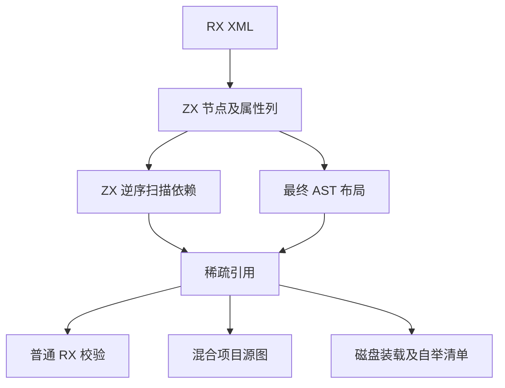

# RX 依赖扫描自举

## Intent

让普通 RX 校验、混合源图、磁盘装载和自举清单共用同一份依赖引用。使用 ZX 解析器已有的节点与属性列计算引用，避免为每个消费者重复走递归 AST。

## Data

ZX XML 解析器的节点按关闭顺序追加，每个节点保存最后一个子节点和前一个兄弟的行号。依赖诊断需要父节点先于子节点、同层从左到右。反向访问右子树和左子树后再处理父节点，即可产生原顺序的逆序。用有界的祖先栈记录当前返回点，只保留选中的属性编号和目标种类。最终 AST 的节点和属性继续拥有原有内容，引用借用它们。

## Edges

- 保留父子及同层诊断顺序、属性优先级和包路径分类。扫描只选择引用，目标解析和图错误仍由原阶段处理。
- 仅处理已通过 XML 解析的节点。引用不复制名称、属性内容或解码结果。通用 XML 和格式化入口无需生成引用。
- 直接传入手写 DSL AST 的公共入口以及初始 seed 继续通过兼容遍历读取输入。正式文本和 Source 自举清单使用 ZX 扫描。
- 绑定到原始 AST 的索引只接受同一棵树，传入不同根节点时回到兼容遍历。常驻生成器缓存 AST 与引用，模块路径和包配置随请求更新。

## Answer

集中核对嵌套分支、缺失和重复依赖、Store 与 Gateway、混合装载、Source 三阶段以及长和宽文档的成本。复用上一阶段的固定冷构建配置和安装版输出对照。

### 构建路径

磁盘入口最终调用普通模块集合校验时直接复用已经解析的 AST 与引用。编译库调用检查和 ZX 函数目标检查读取引用表的逆序，保留原先先检查右侧兄弟的顺序。包类型来源按原来的正序读取。初始版本接通主图后，复核发现常驻解析缓存不应保留上一次请求的路径和包配置，因此保留每次请求的模块描述符构造，只借用缓存持有的节点及引用。

### 行为与三阶段自编译

集中通过 11,175 项 Zig 检查和 76 项 CLI 场景，覆盖包类型来源、混合项目、原生与编译库链接、Store 调用边界、路径回退和监听重建。独立对照核对普通与混合模式的引用顺序、已解码属性、256 层嵌套和误配索引回退。12 份直接链接产物与上一阶段逐字节一致。

使用上一阶段 Source stage 3、Zig 0.17.0、ReleaseSmall、12 核和 16 分区依次生成三代工具。每代通过 22 步，排除工具身份文件后，三代各 10,687 份生成文件逐字节一致。向同一个常驻进程连续提交三次请求，保持 RX 文本不变并修改 ZX 函数正文。每轮七份产物与对应的禁用常驻生成一致，正文修改改变生成产物。

前后两版工具本体均由各自的 Source stage 2 生成，运行均使用 Source 分析与生成。用同一份 539 入口清单、每轮新建输出目录和空函数缓存，交替六轮并舍弃首轮。墙钟中位数 2.52 → 2.56 秒，CPU 11.02 → 10.99 秒，单进程峰值 RSS 856.6 → 855.5 MB。首尾轮次共比较每版 10,053 份主组产物，均逐字节一致。

### 安装版成本

安装版工具本体由 Native seed 引导，运行使用 Source。含 4,096 条 Import 的两组输入分别使用直接路径和需要两次消除父级的路径。两版交替十一轮，舍弃首轮。

| 路径与入口           | 墙钟中位数 / ms | 峰值 RSS / MB |
| -------------------- | --------------: | ------------: |
| 直接路径，显式文件集 |   26.08 → 26.10 | 11.98 → 12.32 |
| 直接路径，磁盘入口   |   53.24 → 30.63 | 26.59 → 15.16 |
| 复杂路径，显式文件集 |   52.22 → 52.29 | 15.20 → 15.55 |
| 复杂路径，磁盘入口   |  105.99 → 57.22 | 34.78 → 18.68 |

磁盘入口复用已解析的模块，直接及复杂路径的退役指令分别减少约 45% 和 47%。显式文件集已经只解析一次，仍持有少量稀疏索引。登记 4,096 个无依赖的独立模块，墙钟 63.59 → 63.96 ms，峰值 49.33 → 49.40 MB。含 1,024 个 ZX 目录入口的混合项目，墙钟 1.304 → 1.305 秒，CPU 1.390 → 1.392 秒，峰值 97.68 → 97.78 MB。

四组库发布共 53 份文件逐字节一致，墙钟中位数变化为 −0.07 至 +0.14 ms。闭包与原生项目的缓存恢复与禁用缓存产物一致。每轮 24 次恢复的墙钟中位数 0.1200 → 0.1203 秒，CPU 0.1192 → 0.1200 秒。

### 完整冷构建

固定 Zig 0.17.0、ReleaseSmall、12 核、四分区及构建种子 `0x3b41c83f`。关闭常驻生成，从空的本地和全局缓存开始。工具本体由 Native seed 引导，安装版执行 Source 分析和生成。最终版本通过全部 70 步。

| 指标                  | 固定历史基线 | 上一阶段 |  本阶段 |
| --------------------- | -----------: | -------: | ------: |
| 墙钟 / s（`time -l`） |            — |   116.03 |  116.11 |
| 进程树采样墙钟 / s    |      129.740 |  116.105 | 116.331 |
| CPU / s               |       216.03 |   203.93 |  203.27 |
| 进程树峰值 RSS / MB   |      2,247.3 |  2,289.1 | 2,302.0 |
| 单进程峰值 RSS / MB   |      2,075.0 |  2,130.7 | 2,134.4 |

同四分区对照下，墙钟增加 0.08 秒，CPU 减少 0.66 秒，树峰增加 13.0 MB，单进程峰增加 3.7 MB。相比固定历史记录，采样墙钟少 13.41 秒，CPU 少 12.76 秒，树峰仍高 54.7 MB，单进程峰仍高 59.4 MB。历史记录使用两分区，阶段内归因采用四分区对照。

首次接通主图和最终版本的树峰均约 2,302 MB。前后峰值都在 LLVM 分区 0、1、2 编译重叠时出现。最终样本的分区 0 增加 17.7 MB，分区 1 增加 6.6 MB，分区 2 减少 11.3 MB。当前采样能定位峰值阶段，尚不能把整仓差额归因到某个编译器 arena。

自我复核保留两个边界。正式文本路径已迁移扫描，Zig 仍负责递归 AST 物化、把编号映射为借用指针，以及兼容手写 AST。局部装载内存下降明显，整仓树峰相对固定历史记录的差距仍存在。正式入口的完整传递依赖审计仍待完成。

回归、常驻生成和对照记录位于 `.zig-cache/cold-build-analysis/ownership-research/rx-dependency-scan/`，冷构建与采样位于相邻的 `partition-reference/cold-rx-dependency-scan-final/`。
