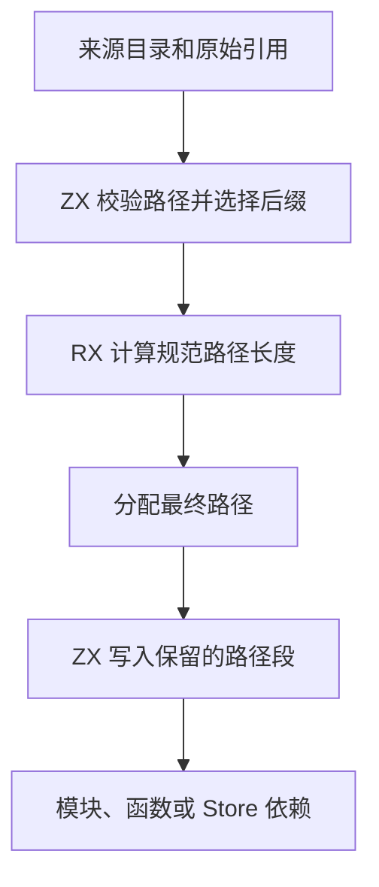

# RX 依赖路径归一化自举

## Intent

将 RX 模块、Store 和 ZX 函数引用的目标选择与规范化迁入 ZX。保持原有后缀、目录入口、根边界、诊断和返回值所有权。

## Data

引用解析原先在 Zig 中拼接来源目录、引用和后缀，生成路径规则再扫描整段字符串。归一化构造片段列表，反转后取消父级引用，再反转保留片段，最后由 Zig 写回路径。

RX 先调用 ZX 规则校验输入及选择后缀，再计算规范路径长度。ZX 从引用尾部到目录前缀逐段处理，用计数消去对应的父级和目录段。宿主只为最终路径分配内存，ZX 使用相同的顺序直接写入该缓冲。

## Edges

- 保留普通 RX、Gateway、Store 的注册文件约束。函数引用继续将目录解析为 `index.zx`，且保留原有的显式后缀和诊断。
- Zig 负责平台 dirname、分配和调用边界。路径准入、后缀和规范化算法由生成代码执行。初始 seed 继续提供原路径。
- 生成的规划与写入入口使用零容量分配器。借用输入以字节为单位，文件名可包含系统支持的非 UTF-8 字节。

## Answer

用既有图、路径、Store、CLI、模块和编译库回归验证路径兼容性。对照普通和复杂路径的安装版成本、冷构建及三阶段自编译产物。

### 安装版对照

两版交替执行十一轮并舍弃首轮。每个输入含 4,096 条 Import。复杂路径经过当前目录及两次父级消除。墙钟包含相同的进程启动与 `time -l` 包装成本。

| 路径与入口       | 墙钟中位数 / ms | 峰值 RSS / MB |   退役指令 / 百万 |
| ---------------- | --------------: | ------------: | ----------------: |
| 普通，显式文件集 |   26.29 → 25.62 | 13.80 → 11.76 |   621.17 → 611.36 |
| 普通，磁盘入口   |   53.88 → 52.09 | 34.85 → 26.85 | 1313.89 → 1281.40 |
| 复杂，显式文件集 |   52.14 → 50.80 | 17.96 → 15.09 | 1296.74 → 1278.33 |
| 复杂，磁盘入口   | 106.75 → 103.27 | 49.28 → 35.03 | 2685.99 → 2626.72 |

四组库发布的 53 份文件逐字节一致，墙钟中位数减少 0.04–0.43 ms。闭包和原生项目恢复缓存与禁用缓存的产物一致。每轮 24 次热恢复的墙钟中位数为 0.1199 → 0.1200 秒，CPU 中位数均为 0.1195 秒。

集中回归通过 10,851 项 Zig 检查及 37 项 CLI 场景，包含 10,446 项既有合成图和路径用例。12 份直接链接输出逐字节一致。独立差分探针比较 59,565 组模块、Store 和函数引用及注册路径，覆盖重复分隔符、当前目录、父级、绝对路径、特殊后缀、非法分隔符和非 UTF-8 字节。探针使用原有后缀与校验规则，并用独立的正向片段栈归一化。新实现每次调用的分配预算仅为一次，路径与错误均一致。平台 dirname 仍由宿主提供，本次验证使用当前 macOS 主机。

### 三阶段自编译

由上一阶段的 Source stage 3 引导，固定 Zig 0.17.0、ReleaseSmall、12 核和 16 分区。三个阶段各通过 22 步。排除工具身份文件，每个阶段的 10,671 份生成文件逐字节一致。

前后工具本体均由各自的 Source stage 2 生成，运行时均执行 Source 分析和生成。用同一份 537 入口清单交替六轮，每轮使用新输出目录和空函数缓存，舍弃首轮。墙钟及 CPU 中位数分别保持 2.43 秒及 10.96 秒，单进程峰值 RSS 从 876.0 MB 降至 856.7 MB。首尾轮次的 10,037 份主组产物逐字节一致。

### 完整冷构建

固定 Zig 0.17.0、ReleaseSmall、12 核、四分区与种子 `0x3b41c83f`。关闭常驻生成，本地及全局缓存从空开始。工具本体由 Native seed 引导，安装版执行 Source 分析和生成。70 步全部通过。

| 指标                             | 固定历史基线 | 上一阶段 |  本阶段 |
| -------------------------------- | -----------: | -------: | ------: |
| 墙钟 / s（`time -l`）            |            — |   117.59 |  116.27 |
| 进程树采样墙钟 / s               |      129.740 |  117.733 | 116.333 |
| CPU / s                          |       216.03 |   203.17 |  202.59 |
| 进程树峰值 RSS / MB              |      2,247.3 |  2,255.5 | 2,325.7 |
| 单进程峰值 RSS / MB（`time -l`） |      2,075.0 |  2,134.0 | 2,135.2 |

较上一阶段，墙钟减少 1.32 秒，CPU 减少 0.58 秒，树峰增加 70.2 MB，单进程峰值增加约 1.1 MB。较固定基线，采样墙钟减少 13.41 秒，CPU 减少 13.44 秒，树峰高 78.4 MB，单进程峰值高 60.2 MB。

两轮树峰都出现在 LLVM 分区 0、1、2 的后段重叠，三个分区的目标文件逐字节一致。分区 1 在该样本的 RSS 增加约 58.2 MB。第四个目标文件增加 3,120 字节，未参与两轮树峰。整仓峰值变化无法单独归因于路径归一化。

回归、专项和 Source 对照记录位于 `.zig-cache/cold-build-analysis/ownership-research/rx-path-resolution/`，冷构建和进程采样位于相邻的 `partition-reference/cold-rx-path-resolution/`。
