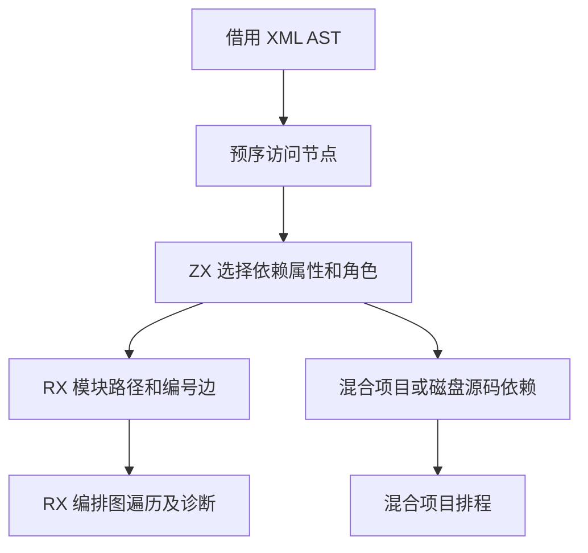

# RX 依赖边采集自举

## Intent

让 RX 模块校验、混合项目图和磁盘源码收集共用依赖标签规则。保持预序、属性位置、诊断顺序、包引用及各种目标文件类型的行为。

## Data

RX 模块校验和混合项目各维护一套 AST 遍历栈。混合项目对每个栈帧复制整个节点描述符，再由 Zig 决定属性、依赖角色和路径解析器。模块校验重复读取 Call.module，并在每条边另外保存源编号。

ZX 一次返回首选及后备属性、目标种类、依赖角色和包引用准入。Zig 的共享游标只在进入尚有后续兄弟的子树时保存兄弟切片，直接借用原始节点和属性。模块校验的诊断行只保留这两个指针，源编号取自已校验的图结果。

## Edges

- 普通模块图只纳入本地 Import.from 与 Call.module。混合项目和磁盘收集还支持 Call.fn、Module.fn、Type.from、Store.from 与 Route.service，保留 Call.module 优先及包查找顺序。
- Zig 暂时持有原生 XML AST、预序游标、模块注册表及路径解析适配。依赖规则和图错误消息由生成入口执行。初始 seed 继续提供等价规则。
- 图校验发生在模块标签解码之后。磁盘收集和混合项目继续在缺失必填目标时使用原有的位置及消息。

## Answer

核对共享 ZX 规则和 RX 图校验生成物，集中运行图、混合项目、磁盘 CLI 和编译库回归。比较前后安装版产物、三阶段 Source 自编译和固定配置冷构建。

### 安装版对照

对含 16 或 4,096 条 Import 的同一项目，分别执行显式文件集校验和磁盘入口检查。前后两版交替九轮，舍弃首轮。小输入的墙钟和 CPU 均低于 `time -l` 的 0.01 秒分辨率。4,096 条边的结果如下。

| 场景           |    墙钟 / s |     CPU / s | 峰值 RSS / MB |   退役指令 / 百万 |
| -------------- | ----------: | ----------: | ------------: | ----------------: |
| 显式文件集校验 | 0.02 → 0.02 | 0.02 → 0.02 | 15.45 → 15.20 |   694.10 → 692.26 |
| 磁盘入口检查   | 0.05 → 0.05 | 0.05 → 0.05 | 36.95 → 37.09 | 1480.46 → 1456.08 |

四组库发布的 53 份生成文件逐字节一致，墙钟中位数变化为 −0.41 至 +0.20 ms。闭包和原生项目恢复缓存与禁用缓存的产物一致。每轮 24 次恢复的墙钟中位数为 0.1200 → 0.1202 秒，CPU 为 0.1198 → 0.1197 秒。

集中回归通过 10,719 项 Zig 检查，覆盖模块图、分配失败、RX 类型推导、混合工件和语义缓存。其中 10,446 项为既有合成图，36 项为六组源码及编译库执行检查。12 份直接链接输出与上一阶段逐字节一致。安装版另通过 37 项 CLI 场景，包含显式图校验、磁盘项目、Store 路径和 watch 恢复。

### 三阶段自编译

由上一阶段 Source stage 3 引导，使用 Zig 0.17.0、ReleaseSmall、12 核和 16 分区。三个阶段各通过 22 步。排除生成工具身份文件 `.zxc-inputs`，主组、增长组、宿主组、集合组和有序组共 10,651 份产物逐字节一致。

两个对照工具本体均由各自的 Source stage 2 生成，执行 Source 分析和生成。对同一份 534 入口主清单交替六轮，每轮使用新输出目录和空函数缓存，舍弃首轮。墙钟中位数为 2.44 → 2.43 秒，CPU 为 11.00 → 10.97 秒，单进程峰值 RSS 为 864.8 → 863.3 MB。首尾两轮的 10,017 份主组产物逐字节一致。

### 完整冷构建

固定 Zig 0.17.0、ReleaseSmall、12 核、四分区和种子 `0x3b41c83f`。关闭常驻生成，本地与全局缓存从空开始。工具本体由 Native seed 引导，安装版运行 Source 分析和生成。首轮发现 Zig 适配器的导入名与路径函数参数重名。修正并检查 Zig 源码后，完整冷构建通过 70 步。

| 指标                             | 固定历史基线 | 上一阶段 |  本阶段 |
| -------------------------------- | -----------: | -------: | ------: |
| 墙钟 / s（`time -l`）            |            — |   117.28 |  118.24 |
| 进程树采样墙钟 / s               |      129.740 |  117.516 | 118.370 |
| CPU / s                          |       216.03 |   203.36 |  204.11 |
| 进程树峰值 RSS / MB              |      2,247.3 |  2,316.8 | 2,251.2 |
| 单进程峰值 RSS / MB（`time -l`） |      2,075.0 |  2,144.9 | 2,135.4 |

较上一阶段，墙钟增加 0.96 秒，CPU 增加 0.75 秒，树峰减少 65.6 MB，单进程峰值减少 9.5 MB。较固定基线，采样墙钟减少 11.37 秒，CPU 减少 11.92 秒，树峰增加 3.9 MB，单进程峰值增加 60.4 MB。较今天的近期低点 203.13 秒，CPU 累计增加 0.98 秒。

上一轮树峰由四个 LLVM 分区与 RX 检查重叠形成，本轮树峰时有三个 LLVM 分区在运行。LLVM 分区合计采样峰值从 2,187.8 MB 增至 2,223.3 MB。前三个分区对象逐字节一致，第四个增加 1,656 字节。全树峰值下降受进程重叠变化影响，各项采集改动对整仓峰值的独立贡献仍待量化。

回归、专项与 Source 对照记录位于 `.zig-cache/cold-build-analysis/ownership-research/rx-dependency-edges/`，冷构建和进程采样位于相邻的 `partition-reference/cold-rx-dependency-edges/`。
