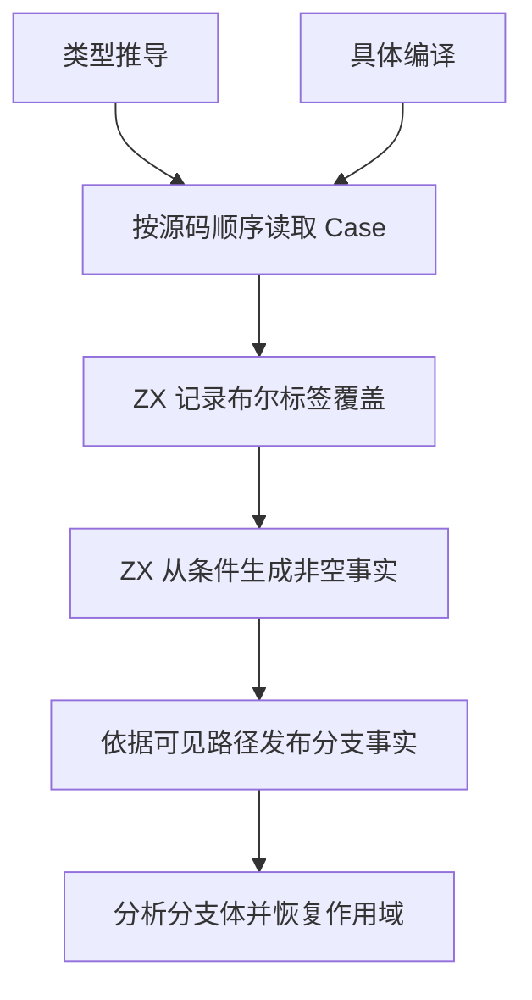
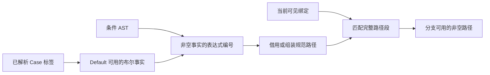

# RX 分支作用域自举

## Intent

在类型推导和具体编译中复用同一套 Default 布尔收窄与作用域路径判定。保留分支的源码诊断顺序，减少标签解析和绑定路径遍历。

## Data

Switch 可以把 Default 放在任意位置。只有显式标签均为同一个布尔值时，Default 能获得相反的布尔事实。If 的显式分支使用合成的 true 标签，Else 使用同一套规则。分支事实在当前分支及其子层有效，离开分支时恢复原作用域。

## Edges

- Default 之前使用已解析的标签。靠前的 Default 按需查看后续标签，标签仍在原来的位置校验并报告诊断。
- 暂存至多两个向前查看的解析结果。连续重复布尔标签时，逐个释放额外解析结果，防止错误输入令暂存随分支数增长。
- ZX 识别连续的绑定路径，并在字段分隔点判定有效前缀。连续路径直接借用源码，含空白或注释的路径按名称组装；名称相等使用普通字节比较。
- 保留同名候选的收集顺序、void 候选过滤和延迟消歧。事实只沿可见的根发布，离开分支后还原绑定和事实的长度。
- Zig 保留解析结果的生命周期、宿主图约束的读写和分支遍历。Native seed 保留对应规则用于初始引导。

## Answer

集中回归通过 118 个构建步骤及 427 项 Zig 测试，覆盖 RX 推导、Task、项目 CLI、Store、属性和混合库。Native seed 与 Source stage 3 生成的覆盖和路径规则通过零容量分配器验证，排除包含生成模式的 `.zxc-inputs` 后，12 个生成文件逐字节一致。

最终源码复验通过 96 个构建步骤、279 项 Zig 测试和 32 项 Task CLI 用例。分支作用域的 15 项生成与诊断对照也使用最终源码重跑。

安装版对照 61 个 RX 项目，33 份生成 Zig 和 28 份预期失败诊断逐字节一致。覆盖靠前和靠后的 Default、多个拼写表示的重复布尔值、分支体与后续标签的诊断顺序、含空白或注释的路径，以及超过栈缓冲区的路径。

### 性能

固定 Zig 0.17.0、ReleaseSmall、12 核、四分区和构建种子 `0x3b41c83f`，关闭常驻生成，本地及全局缓存从空开始。Native seed 负责引导工具本体，安装版执行 Source 分析和生成。

| 指标                             | 固定历史基线 | 上一阶段 | 首次实现 |  优化后 |
| -------------------------------- | -----------: | -------: | -------: | ------: |
| 墙钟 / s（`time -l`）            |            — |   116.70 |   119.56 |  116.44 |
| 进程树采样墙钟 / s               |      129.740 |  116.716 |  119.768 | 116.575 |
| CPU / s                          |       216.03 |   209.71 |   209.66 |  208.21 |
| 进程树峰值 RSS / MB              |      2,247.3 |  2,326.9 |  2,323.6 | 2,317.0 |
| 单进程峰值 RSS / MB（`time -l`） |      2,075.0 |  2,114.0 |  2,105.5 | 2,114.4 |

首次冷构建超过墙钟阈值，长 Task 链也变慢。最终路径先检查前缀长度，再直接复用已有的 ZX 路径重叠规则，去掉了新增的调用层。优化后冷构建通过 70 步，四个分区对象与上一阶段逐字节一致。较上一阶段，墙钟少 0.26 秒，CPU 少 1.50 秒，树峰值少 9.9 MB。CPU 较近期低点高 1.88 秒，树峰值较固定历史基线高 69.7 MB。冷测后恢复了对外的 Zig 路径函数签名，RX 分析继续调用同一条借用路径。

安装版无缓存生成交替测七轮，取后六轮的中位数。峰值 RSS 另取五轮单次生成的中位数。

| 项目                        |  两次生成墙钟 / s |  两次生成 CPU / s |   单次峰值 RSS / MB |
| --------------------------- | ----------------: | ----------------: | ------------------: |
| 384 个整数 Switch 分支      | 0.14899 → 0.14860 | 0.14820 → 0.14785 |       46.15 → 46.30 |
| 256 个有结果依赖的顺序 Task | 1.59184 → 1.59718 | 1.59190 → 1.59677 | 1,001.93 → 1,002.54 |
| 密集捕获环境                | 0.18709 → 0.18902 | 0.19223 → 0.19230 |       35.80 → 36.23 |

有结果依赖的顺序 Task 在两个版本中均达到约 1 GB RSS。表达式编译为每次求值传入完整可见环境，并在同一父分配器下创建暂存和结果 arena。两处成本需要分别量化，才能确定峰值来源。

探针、回归和安装版对照位于 `.zig-cache/cold-build-analysis/ownership-research/rx-branch-scope/`，两次冷构建的采样与分区哈希位于相邻的 `partition-reference/cold-rx-branch-scope/` 和 `partition-reference/cold-rx-branch-scope-final/`。
