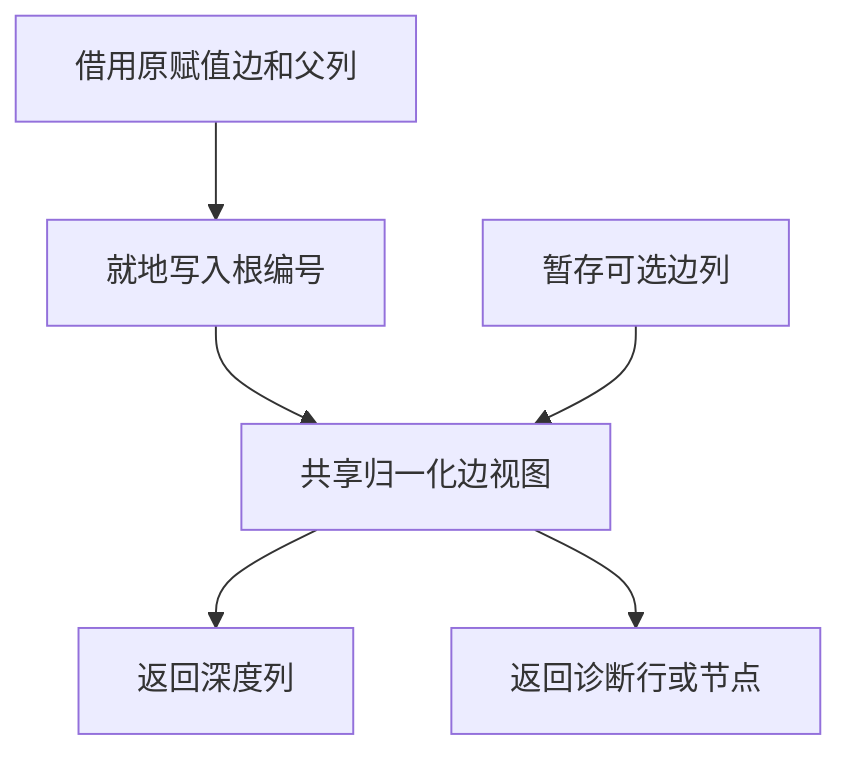

# RX 可选深度求解编排自举

## Intent

以一个 RX 入口编排赋值边归一化、可选边收集、深度求解和冲突来源选择。保留现有求解算法、根压缩顺序与首个诊断。

## Data

正式路径的 Zig 宿主依次归一化原边、调用可选边生成器、执行深度求解。赋值边的编号列能够独占借用，已有 `std:memory` 支持就地读写。可选边只有在遇到可选根时才需要暂存，其顺序来自图节点编号。

## Edges

归一化就地修改赋值边，去重索引仍持有原登记键。节点和边列在执行期间不会增长。可选边继续按图节点编号收集，赋值边仍先于可选边求解。失败时保留边行与图节点的位置映射。Native seed 保留原引导路径。

可选边由两列随实际结果增长的列表保存。初次追加才分配，随后沿用生成器的容量元数据。求解过程只借用归一化后的赋值边，不再经 Zig 返回中间可选边描述符。递归冲突保留首条赋值边或图首节点的位置，普通冲突使用原行，涉及可选边时返回对应节点编号。

## Answer

核对已有赋值、可选类型、递归和诊断输入的生成产物与失败位置。验证生成代码的借用写入和临时分配，对比专项及固定冷构建，并核对三代 Source 生成结果。

### 安装版专项

前后工具均由 Native seed 引导，安装版运行 Source。关闭应用编译缓存。68 份生成 Zig、39 份拒绝诊断逐字节一致。十组专项各交替七轮，舍弃首轮。其 CPU 中位数变化介于 −0.108 毫秒和 +0.051 毫秒。

| 场景             |     墙钟 / ms |        CPU / ms | 单进程峰值 RSS / MB |
| ---------------- | ------------: | --------------: | ------------------: |
| 宽赋值图         | 17.43 → 17.48 | 16.893 → 16.890 |       11.65 → 11.66 |
| 宽约束根图       | 54.84 → 54.84 | 54.190 → 54.226 |       24.39 → 24.35 |
| 带可选约束的索引 |   4.97 → 4.85 |   4.477 → 4.429 |         8.98 → 8.97 |
| 深层默认索引     |   7.40 → 7.37 |   7.071 → 6.963 |       10.40 → 10.33 |

### 完整冷构建

同一隔离目录、Zig 0.17.0、ReleaseSmall、12 核、四分区、种子 `0x3b41c83f`。使用空的本地与全局缓存，关闭常驻生成。Native seed 引导工具本体，安装版运行 Source。两版候选均通过 70 步。最终源码去除一处随后必然覆盖的重复游标写入。

| 指标                             | 固定历史记录，两分区 | 上一阶段复测 |    首轮 | 最终源码 |
| -------------------------------- | -------------------: | -----------: | ------: | -------: |
| 墙钟 / s（`time -l`）            |                    — |       115.94 |  116.49 |   117.30 |
| 进程树采样墙钟 / s               |              129.740 |      116.100 | 116.622 |  117.308 |
| CPU / s                          |               216.03 |       209.03 |  209.78 |   209.48 |
| 进程树峰值 RSS / MB              |              2,247.3 |      2,310.9 | 2,329.2 |  2,349.4 |
| 单进程峰值 RSS / MB（`time -l`） |              2,075.0 |      2,156.2 | 2,151.9 |  2,154.8 |
| LLVM 分区合计峰值 RSS / MB       |                    — |      2,281.2 | 2,299.6 |  2,227.7 |

最终源码墙钟增加 1.36 秒，其中 1.09 秒出现在首次采到子编译进程之前。该进程出现后到构建完成的采样耗时增加约 0.12 秒。CPU 增加 0.45 秒，四分区末次采样 CPU 合计由 79.19 降至 79.08 秒。分区 0 至 2 对象逐字节一致，分区 3 增加 184 字节。

树峰增加 38.6 MB，LLVM 分区合计峰值减少 53.5 MB。最终树峰发生于四个 LLVM 分区与约 451.6 MB 的 Zig 检查并行时，上一阶段树峰是三个 LLVM 分区重叠。相对固定历史记录，进程树采样墙钟少 12.43 秒，CPU 少 6.55 秒，树峰高 102.1 MB。相对同隔离目录的早期 207.44 CPU 秒累计增加 2.04 秒，原工作区 203.17 CPU 秒的跨目录差额为 6.31 秒。

### 正确性与阶段自编译

最终安装版的 312 项既有回归通过，涵盖推导、并行、任务、分配失败、工件及可选列表运行。源码闭包、原生模块与 Store 的 47 份库发布文件逐字节一致。

以上一阶段 Source stage 3 引导，依次生成三代。Zig 0.17.0、ReleaseSmall、12 核和 16 分区，各代通过 22 步。排除工具身份文件，两组相邻阶段各 10,830 份生成文件逐字节一致。检查最终 Source 的 11 个相关生成函数体，RX 编排与写入桥接不分配或复制边列，新增的两列可选边使用保留容量的追加路径。

两版独立生成器均由各自 Source stage 2 生成，使用同一份 551 入口清单，运行 Source。交替六轮，从空函数缓存和新输出目录开始，舍弃首轮。墙钟中位数 2.41 → 2.42 秒，CPU 10.94 → 10.95 秒，单进程峰值 RSS 853.9 → 863.3 MB，10,194 份主组文件逐字节一致。

本阶段迁移可选深度求解的内部编排。图节点、赋值边的底层存储和多轮求解仍在宿主。最终冷构建墙钟整体高于相邻复测一秒以上，样本差异集中在第一个子编译进程出现前，固定历史基线与累计 CPU 继续保留。

原始对照和采样记录位于 `.zig-cache/cold-build-analysis/ownership-research/rx-optional-depth/`。
