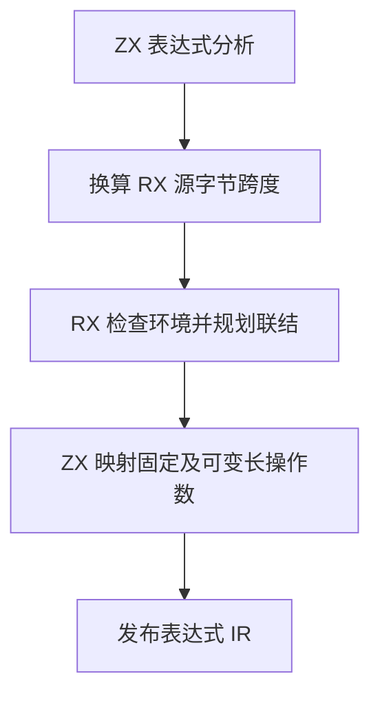
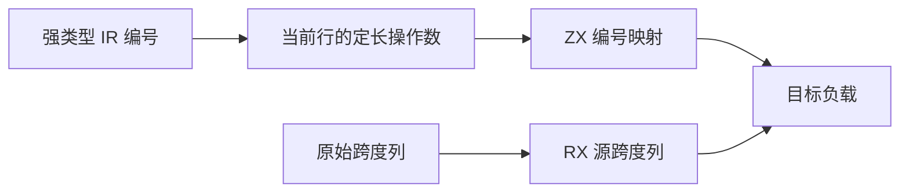

# RX 固定操作数与位置联结自举

## Intent

让 RX 固定宽度表达式及聚合负载头的引用共用 ZX 操作数规则。保持位置和诊断语义，消除源位置发布的前缀重扫。

## Data

上一阶段的定长写入规则已支持表达式编号、符号编号和缺失引用检查。固定宽度负载中的引用在 IR 中使用显式的表达式编号或符号编号类型。花括号属性保留原字节，发布成功 IR 的跨度只需要字节偏移。

## Edges

- 固定负载仅收集本行的标量引用。Native seed 保留等价映射，宿主仍发布 IR 列并管理字符串生命周期。
- RX 联结规划在生成目标 IR 前拒绝依赖 Store、调用或并发结构的表达式行。表达式与符号分别按强类型收集，可空值不加入映射。
- 从列直接读取跨度。花括号属性的字节偏移直接加基址，带实体或空白归一化的字符串属性继续使用偏向规则。
- 只在需要报告诊断坐标时计算行号和列号。

## Answer

Native 和 Source stage 3 生成的联结规划均通过定容探针。覆盖正常与乱序绑定、跳过的表达式、非法投影、类型冲突和禁止联结的调用。偏移探针逐个对照普通位置与结束位置，涵盖 CRLF、多字节实体、缺失原始属性和越界。

集中回归通过 124 个构建步骤、482 项 Zig 测试、32 项 Task CLI 用例和 55 次 RX 属性运行。

两个安装版对照 48 个项目，26 份生成 Zig 和 22 份预期失败诊断逐字节一致。宽属性使用同一 RX 文件和无缓存生成，交替执行七轮，取后六轮的中位数。

| 单个属性的数组元素数 |          墙钟 / s |           CPU / s |
| -------------------: | ----------------: | ----------------: |
|                  256 | 0.01647 → 0.01420 | 0.01631 → 0.01378 |
|                1,024 | 0.07861 → 0.05425 | 0.07833 → 0.05399 |
|                4,096 | 0.74489 → 0.34178 | 0.74434 → 0.34125 |

同样使用交替对照，稀疏并行项目两次生成的墙钟从 0.12680 秒降至 0.12510 秒，密集并行项目从 0.18688 秒降至 0.18405 秒。

### 冷构建

Zig 0.17.0、ReleaseSmall、12 核、四分区，沿用固定构建种子 `0x3b41c83f`，关闭常驻生成，清空测量目录的本地及全局缓存。Native seed 引导工具本体，安装版执行 Source 分析与生成。

| 指标                             | 固定历史基线 | 上一阶段 |  本阶段 |
| -------------------------------- | -----------: | -------: | ------: |
| 墙钟 / s（`time -l`）            |            — |   116.40 |  116.25 |
| 进程树采样墙钟 / s               |      129.740 |  116.413 | 116.338 |
| CPU / s                          |       216.03 |   209.46 |  209.54 |
| 进程树峰值 RSS / MB              |      2,247.3 |  2,291.8 | 2,337.6 |
| 单进程峰值 RSS / MB（`time -l`） |      2,075.0 |  2,120.9 | 2,130.4 |

70 个冷构建步骤通过。较上一阶段，墙钟少 0.15 秒，CPU 多 0.08 秒，树峰值多 45.8 MB。峰值样本中四个分区与约 459 MB 的 `zig test` 进程重叠。单独合计分区进程，峰值从 2,261.4 MB 增至 2,266.7 MB。

前三个分区对象逐字节一致，第四个增加 336 字节，采样 CPU 增加 0.04 秒。较固定历史基线，采样墙钟少 13.40 秒，CPU 少 6.49 秒，树峰值多 90.3 MB。CPU 较近期低点高 3.21 秒，累计变化仍需追踪。近期低点的分区 3 对象为 1,189,280 字节，上一阶段为 1,279,912 字节，对应采样 CPU 由 12.39 秒升至 13.47 秒。

探针、回归及项目对照位于 `.zig-cache/cold-build-analysis/ownership-research/rx-fixed-operands/`，完整冷构建采样和分区哈希位于相邻的 `partition-reference/cold-rx-fixed-operands/`。
