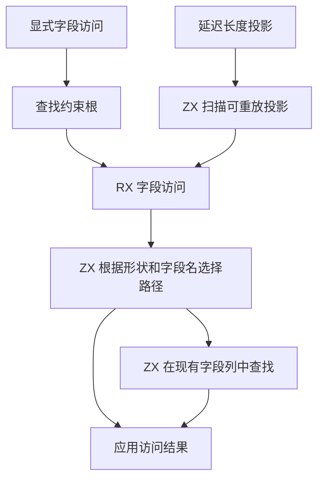

# RX 字段访问与长度投影自举

## Intent

将对象成员访问、序列长度读取及延迟长度投影的字段决策迁入 RX/ZX。直接借用推导节点和已知类型列，按原先的顺序应用字段约束。

## Data

Zig 目前从约束根还原 Graph.Shape，再在已知形状上还原整个 Type。ZX 接收转换后的类别，只决定粗粒度路由。随后宿主查找字段、区分缺失与扩展，并在延迟长度重放时重复查找根。

## Edges

普通对象字段允许按原规则扩展。显式对象类型的字段集合封闭。标量限制的错误优先于推导字段查找。列表和字符串保留 length 的 u64 类型，未知来源继续延迟，序列来源仍按列表约束处理。

宿主持有可增长存储，每次写入后重新借用。字段名字符串和成员列使用既有存储。Native seed 保留兼容路径。整轮调度仍需能在 RX 中表达循环与借用重新建立的通用能力。

## Answer

验收现有字段、列表长度、字符串长度、对象 length 字段、延迟投影及拒绝诊断。检查生成调用是否直接借用列，并对照专项、完整冷构建与 Source 自编译。

### 安装版专项

前后工具由 Native seed 引导，运行 Source 分析和生成。关闭应用编译缓存。58 份生成 Zig 和 34 份拒绝诊断逐字节一致。八组输入交替七轮，舍弃首轮，生成 Zig 均一致。

| 场景                 |     墙钟 / ms |      CPU / ms | 单进程峰值 RSS / MB |
| -------------------- | ------------: | ------------: | ------------------: |
| 宽对象合并与覆盖     |   7.87 → 8.03 |   7.66 → 7.58 |       10.51 → 10.50 |
| 宽对象构造           |   7.94 → 7.87 |   7.61 → 7.56 |       10.48 → 10.49 |
| 重复开放对象字段     |   4.45 → 4.45 |   4.02 → 4.00 |         8.77 → 8.77 |
| 由投影约束的平面列表 |   4.37 → 4.49 |   3.95 → 3.97 |         8.22 → 8.24 |
| 深层默认索引         |   7.52 → 7.48 |   7.06 → 7.04 |       10.35 → 10.31 |
| 带可选约束的索引     |   4.92 → 4.85 |   4.45 → 4.43 |         8.96 → 8.96 |
| 重复索引             | 17.32 → 17.36 | 16.92 → 16.87 |       14.87 → 14.88 |
| 宽对象内嵌列表默认   | 21.22 → 21.09 | 20.66 → 20.62 |       12.26 → 12.21 |

### 完整冷构建

同一隔离目录，Zig 0.17.0、ReleaseSmall、12 核、四分区、种子 `0x3b41c83f`。两次均从空本地与全局缓存开始，关闭常驻生成。工具本体由 Native seed 引导，安装版运行 Source 分析与生成。构建通过 70 步。

| 指标                             | 固定历史记录，两分区 | 上一阶段 |  本阶段 |
| -------------------------------- | -------------------: | -------: | ------: |
| 墙钟 / s（`time -l`）            |                    — |   115.27 |  115.72 |
| 进程树采样墙钟 / s               |              129.740 |  115.398 | 115.846 |
| CPU / s                          |               216.03 |   207.98 |  208.29 |
| 进程树峰值 RSS / MB              |              2,247.3 |  2,323.0 | 2,360.8 |
| 单进程峰值 RSS / MB（`time -l`） |              2,075.0 |  2,142.7 | 2,137.9 |

墙钟增加 0.45 秒，CPU 增加 0.31 秒。早期同目录基线 207.44 CPU 秒，累计增加 0.85 秒。原工作区近期低点 203.17 CPU 秒，差额为 5.12 秒，跨目录对照仍需细分。相对两分区历史基线，采样墙钟少 13.89 秒，CPU 少 7.74 秒。

树峰增加 37.8 MB，单进程峰值减少 4.8 MB。相对历史两分区记录，树峰仍高 113.5 MB。上一阶段的树峰来自三个 LLVM 分区同时运行，本阶段的树峰出现于四个分区与占用约 482.5 MB 的 Zig 检查重叠时。单独统计四个 LLVM 分区对象编译进程，合计峰值由 2,293.5 降至 2,203.3 MB。分区 0 至 2 的对象逐字节一致，分区 3 增加 144 字节。

### 正确性与阶段自编译

312 项既有回归通过，包括推导、并行、任务输出、混合工件、模块记录、模块化循环生成和可选列表长度运行。源码闭包、原生模块和 Store 的 47 份库发布文件逐字节一致。

使用上一阶段 Source stage 3 引导本次 stage 1，再由本次 stage 1、stage 2 依次生成下一代。Zig 0.17.0、ReleaseSmall、12 核和 16 分区。三代各通过 22 步。排除工具身份文件，两组相邻阶段各 10,812 份生成文件逐字节一致。最终 Source 的四个字段访问相关函数体未出现分配、缓冲增长或显式内存复制调用。第三代首次编译因磁盘空间不足中断，清理旧隔离构建缓存后只重跑第三代。

独立生成对照的两版工具均由各自的 Source stage 2 生成，执行 Source。相同 548 入口清单从空函数缓存和新输出目录交替运行六轮，舍弃首轮。墙钟中位数由 2.40 增至 2.41 秒，CPU 由 10.89 增至 10.92 秒，单进程峰值 RSS 由 858.7 增至 864.0 MB。首尾对照的 10,176 份主组文件逐字节一致。

自我复核保留两项边界。开放对象追加字段时仍由原图构造合并后的成员列，独立检查的四个函数覆盖借用读取和选择。长度重放的选择与字段规则已经迁移，图写入、诊断位置和多轮调度仍由宿主控制。冷构建树峰的并发构成与上一阶段不同，专项结果只覆盖字段访问相关输入。

原始记录位于 `.zig-cache/cold-build-analysis/ownership-research/rx-field-projections/`。完整冷构建记录位于同根下的 `rx-call-inputs/paired-source/.zig-cache/cold-build-analysis/ownership-research/partition-reference/cold-rx-field-projections/`。
