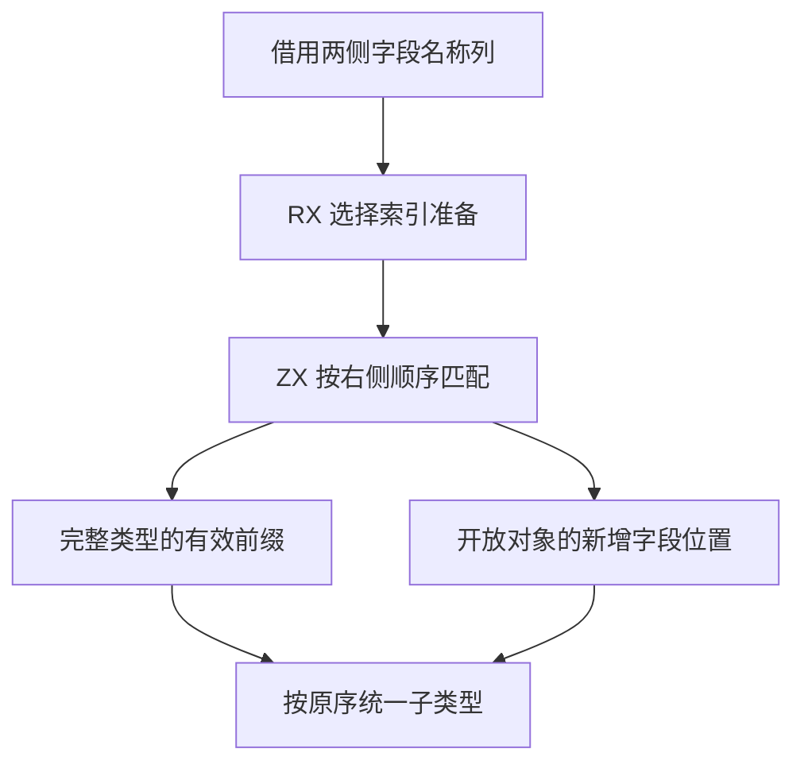

# RX 对象字段统一布局自举

## Intent

将 RX 推导中对象字段的配对、完整类型约束和新增字段布局迁入 RX/ZX，保持递归统一顺序、首个诊断和字段身份。

## Data

原 Source 逐字段从 Zig 调用 ZX 名称查询。两个对象统一时，Zig 暂存新增字段的名称与节点，随后再写入结果。已知类型对推导对象约束时按推导字段顺序匹配，缺失位置之前的字段冲突优先。

批量入口借用原名称列，将目标编号写入调用方的定长缓冲。短字段列线性匹配，宽列复用固定字节索引。已有字段复用原序号，新增字段按右侧顺序取得尾部序号。

固定索引在已有字段至少 16 项、待匹配字段至少 8 项时启用。索引的字节键和线性匹配的字符串借用同一名称列。定长位置和桶由宿主提供，生成入口用零容量分配器执行。已知类型与开放对象共用配对，递归期间仍使用原先借出的字段和编号。

## Edges

- 完整类型只处理首个缺失字段之前的匹配项，宿主按该前缀递归处理后报告缺失。开放对象保留两侧既有的顺序和覆盖规则。
- 空对象直接复用原字段列。没有新增字段时不分配输出字段。新布局只复制一次旧字段描述符，底层名称文本始终借用。
- Zig 仍管理图的递归修改、完整类型登记、诊断位置和缓冲生命周期。Native seed 提供兼容的线性匹配。

## Answer

验证宽对象、同名合并、不同名合并、完整类型缺失及递归诊断的同输入结果，再集中执行 RX 推导回归、冷构建和三代 Source 自编译。

### 安装版专项

两版工具均由 Native seed 引导，运行使用 Source。禁用应用生成缓存，对照 39 份生成 Zig 和 20 份拒绝诊断，均逐字节一致。专项交替七轮并舍弃首轮。

| 场景                      |     墙钟 / ms |      CPU / ms | 单进程峰值 RSS / MB |
| ------------------------- | ------------: | ------------: | ------------------: |
| 单字段重叠                |   4.95 → 4.96 |   4.77 → 4.80 |         9.22 → 9.26 |
| 单字段不重叠              |   4.94 → 4.95 |   4.81 → 4.82 |         9.25 → 9.31 |
| 64 字段双展开             |   7.84 → 7.92 |   7.63 → 7.54 |       10.45 → 10.48 |
| 256 字段列                | 54.71 → 54.69 | 54.15 → 53.99 |       24.67 → 24.71 |
| 48 个嵌套对象             | 28.81 → 28.77 | 28.24 → 28.17 |       11.84 → 11.91 |
| 两侧各 256 字段且重叠一半 | 83.86 → 83.48 | 83.75 → 83.26 |       31.04 → 31.09 |

所有专项的生成 Zig 均逐字节一致。最宽推导用例同时包含表达式分析和代码生成，不能用该样本推断字段查找的独立耗时。

### 完整冷构建

同一隔离源码目录，Zig 0.17.0、ReleaseSmall、12 核、四分区、种子 `0x3b41c83f`，关闭常驻生成，使用空本地及全局缓存。Native seed 引导工具本体，安装版运行 Source。两阶段各通过 70 步。

| 指标                  | 固定历史记录 | 同目录上一阶段 |  本阶段 |
| --------------------- | -----------: | -------------: | ------: |
| 墙钟 / s（`time -l`） |            — |         116.49 |  116.95 |
| 进程树采样墙钟 / s    |      129.740 |        116.609 | 117.002 |
| CPU / s               |       216.03 |         207.33 |  208.17 |
| 进程树峰值 RSS / MB   |      2,247.3 |        2,320.2 | 2,361.2 |
| 单进程峰值 RSS / MB   |      2,075.0 |        2,164.7 | 2,152.1 |

墙钟增加 0.46 秒，CPU 增加 0.84 秒，树峰增加 41.0 MB，单进程峰值少 12.6 MB。两次树峰都在四个 LLVM 分区与 Zig 检查重叠时，检查进程在该采样点多 46.2 MB，四个分区合计少 5.1 MB。按末次采样，主生成、LLVM 分区和 C 工具编译均有小幅 CPU 增量，Zig 宿主库编译减少 0.34 秒。本阶段样本不足以将全部 CPU 差额归因于字段规则。

相对两分区的固定历史记录，采样墙钟少 12.74 秒，CPU 少 7.86 秒，树峰多 113.9 MB。相对原工作区近期同配置 CPU 参考值 203.17 秒，本阶段仍高 5.00 秒，累计差额继续追踪。

### 正确性与阶段自编译

最终安装版链接的 Source 分区通过 302 项既有 Zig 检查，覆盖 RX 推导、并行、Task、混合工件和模块记录。源码闭包、原生模块和 Store 三组库的 47 份发布文件逐字节一致。

以上一阶段 Source stage 3 为起点，在 Zig 0.17.0、ReleaseSmall、12 核、16 分区下逐级生成三代工具。每代通过 22 步，排除工具身份文件后每代 10,765 个生成文件逐字节一致。

两版性能工具分别由各自的 Source stage 2 生成，运行使用 Source。固定 549 个入口，以空函数缓存和新输出目录交替六轮，舍弃首轮。墙钟中位数为 3.53 → 2.93 秒，样本范围为 2.64–3.84 秒和 2.64–3.58 秒。CPU 中位数为 11.18 → 11.06 秒，单进程峰值 RSS 均约 862.4 MB。墙钟样本区间重叠，首尾轮次的 10,131 个主组文件逐字节一致。

自我复核的边界包括 Zig 管理的递归图修改、类型登记和字段描述符写入。宽对象的索引阈值按输入规模选择，现有实测覆盖默认阈值两侧及端到端生成。最终传递依赖审计仍待完成。

专项、回归和阶段原始记录位于 `.zig-cache/cold-build-analysis/ownership-research/rx-field-unification-layout/`。同目录冷构建位于 `rx-call-inputs/paired-source/` 隔离源码中的 `cold-rx-object-dependency-layout` 和 `cold-rx-field-unification-layout`。
