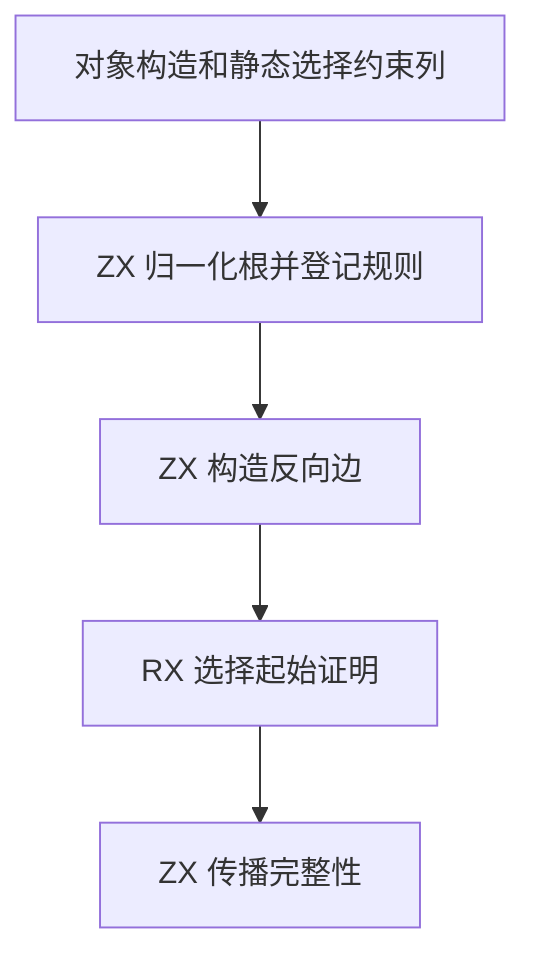

# RX 对象完整性依赖图自举

## Intent

将对象展开和静态字段选择的完整性依赖图构建迁入 RX/ZX，保持根合并、规则顺序、循环、完整性证明及错误位置。

## Data

Source 已在 RX/ZX 中执行起始证明和反向传播。迁移前，Zig 遍历构造与选择、压缩父关系、登记稀疏根编号并构造反向邻接表。本阶段将构造部件和选择规则改用约束列，生成入口直接借用已登记数据。

归一化按原序登记对象规则及其依赖，稀疏索引复用核心整数索引。RX 调用 ZX 标记已知根，再构造反向边。反向填充从各分组终点向前写入，复用偏移列作为游标，保留每组的原顺序和重复项。

## Edges

- 根索引只为参与规则的节点登记位置。构造在前，选择在后，保留同一规则内的展开顺序和重复依赖。
- 父列压缩保持原存储与等价关系。图修订使已缓存的两类查询结果失效。
- Native seed 保留递归证明。Source 宿主管理图与快照的分配区、借用约束列和按修订复用快照。归一化通过现有状态入口接收父列，避免只读 RX 入口将它降为普通列表后触发复制。索引键和桶在工作状态中分别持有，生成循环可以转移两列的存储。

## Answer

对照既有展开、字段选择、嵌套与拒绝用例，核对生成 Zig 和诊断。集中验收 RX 推导、混合项目、固定口径冷构建与三代 Source 工具。

### 安装版专项

前后工具均由 Native seed 引导，运行使用 Source。禁用应用生成缓存。对照 45 个既有项目，30 份生成 Zig 和 15 份拒绝诊断逐字节一致。专项按版本交替运行七轮，256 分支运行三轮，均舍弃首轮。

| 场景                     |       墙钟 / ms |        CPU / ms | 单进程峰值 RSS / MB |
| ------------------------ | --------------: | --------------: | ------------------: |
| 既有展开与覆盖           |     7.92 → 7.92 |     7.64 → 7.62 |       10.39 → 10.50 |
| 192 个数字字段           |   19.01 → 19.03 |   18.51 → 18.43 |       12.40 → 12.42 |
| 48 个嵌套对象            |   29.05 → 28.81 |   28.37 → 28.19 |       11.92 → 11.86 |
| 嵌套展开与 pick/omit     |     4.99 → 4.88 |     4.46 → 4.51 |         8.48 → 8.54 |
| 64 个带展开的 Call 分支  |   67.78 → 67.83 |   67.19 → 67.42 |       18.13 → 18.26 |
| 256 个带展开的 Call 分支 | 280.91 → 281.51 | 280.32 → 280.96 |       44.06 → 44.45 |

### 完整冷构建

同一隔离源码目录，Zig 0.17.0、ReleaseSmall、12 核、四分区、种子 `0x3b41c83f`，关闭常驻生成，从空本地和全局缓存开始。Native seed 引导工具本体，安装版使用 Source。两阶段均通过 70 步。

| 指标                  | 固定历史记录 | 同目录上一阶段 |  本阶段 |
| --------------------- | -----------: | -------------: | ------: |
| 墙钟 / s（`time -l`） |            — |         116.55 |  116.49 |
| 进程树采样墙钟 / s    |      129.740 |        116.658 | 116.609 |
| CPU / s               |       216.03 |         208.43 |  207.33 |
| 进程树峰值 RSS / MB   |      2,247.3 |        2,363.3 | 2,320.2 |
| 单进程峰值 RSS / MB   |      2,075.0 |        2,148.8 | 2,164.7 |

相邻阶段墙钟少 0.06 秒，CPU 少 1.10 秒，树峰少 43.2 MB，单进程峰值多 15.9 MB。两次树峰均处于四个 LLVM 分区与 Zig 检查重叠时。本阶段对应采样点的检查进程 RSS 少 53.4 MB，四个分区合计多 10.2 MB。单进程峰值仍出现在 Zig 编译宿主库时。

相较两分区的固定历史记录，采样墙钟少 13.13 秒、CPU 少 8.70 秒、树峰多 72.9 MB。原工作区近期同配置 CPU 参考值为 203.17 秒，本阶段仍高 4.16 秒，继续跟踪累计变化。

### 正确性与阶段自编译

最终安装版链接的 Source 分区通过 302 项既有 Zig 检查，覆盖 RX 推导、并行推导、Task、混合工件和模块记录。源码闭包、原生模块和 Store 三组库的 47 份发布产物逐字节一致。

以上一阶段 Source stage 3 为起点，固定 Zig 0.17.0、ReleaseSmall、12 核、16 分区逐级生成三代工具。每代通过 22 步，排除工具身份文件后每代 10,756 个生成文件逐字节一致。

两版性能工具分别由各自的 Source stage 2 生成，运行使用 Source。固定 548 个入口，以空函数缓存和新输出目录交替六轮，舍弃首轮。墙钟中位数均为 2.49 秒，CPU 均为 10.91 秒，单进程峰值 RSS 中位数为 861.7 → 876.7 MB。两组 RSS 样本分别覆盖 860.9–896.0 MB 和 860.3–882.6 MB。首尾轮次的 10,122 个主组产物逐字节一致。

自我复核的边界包括 Zig 管理的快照版本和分配区、字段约束写入及真实类型表登记。本阶段完成完整性图的布局和查询逻辑迁移。固定历史口径上的内存差额仍需追踪，正式编译器传递依赖仍需逐项验收。

原始专项、回归和生成文件对照记录位于 `.zig-cache/cold-build-analysis/ownership-research/rx-object-dependency-layout/`。冷构建原始记录位于相邻的 `rx-call-inputs/paired-source/` 隔离源码目录下的 `cold-rx-object-dependency-layout`。
