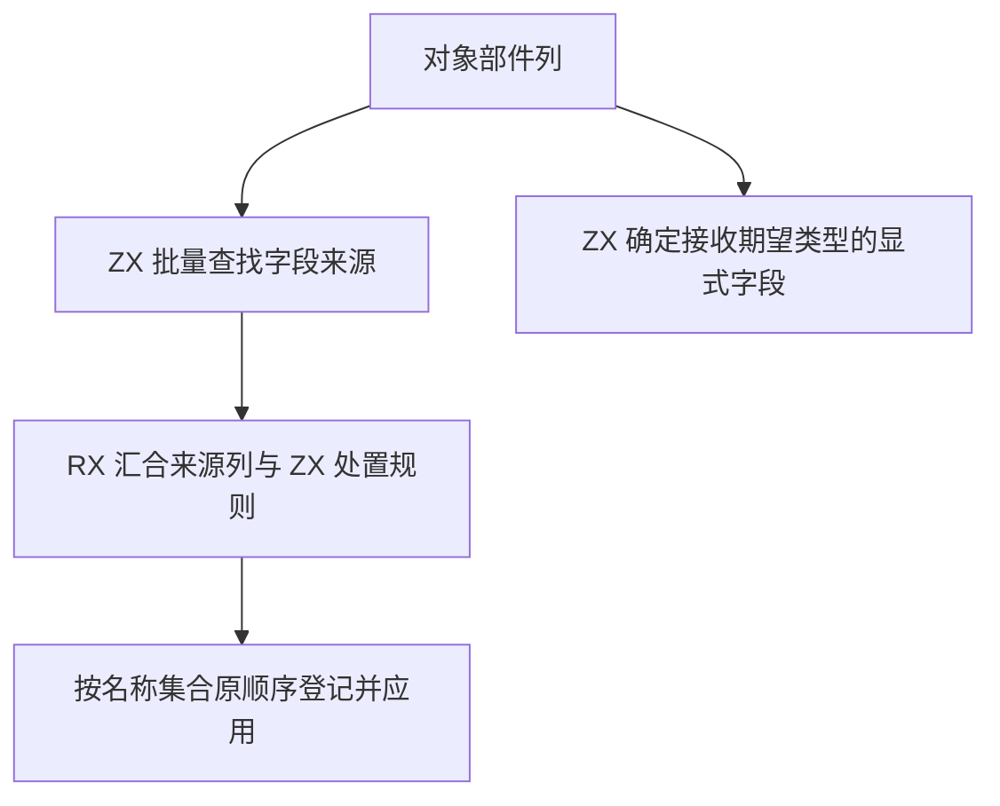

# RX 对象构造字段约束批量自举

## Intent

让 RX 对象构造批量确定字段来源和约束处置，并将显式字段接收期望类型的规则迁入 ZX。保持展开覆盖顺序、图状态变化和首个诊断。

## Data

原 Source 为名称集合中的每个字段分别进入生成入口，反向查找部件并应用处置规则。部件视图在一次传播内固定，只有目标字段的可选性和约束状态需要在登记后读取。显式字段的期望类型取决于是否被后续显式字段或展开覆盖。

## Edges

- 来源按原逻辑反向查找。生成端为每个对象发布一次处置和适用条件，宿主按当前字段状态应用。
- 同根别名仍引用刚登记的结果字段。明确来源即使处于歧义时也先登记其类型。来源名称和字段文本借用原存储。
- 宿主继续按原名集合顺序登记字段，保留首个诊断。Native seed 继续使用兼容规则。

批量入口只暂存名称的切片描述符，保留原哈希表的迭代顺序。期望类型标记借用对象约束已预留的名称列，在递归推导之前生成。反向扫描遇到展开后结束，之前的显式字段均不会取得期望类型。重复显式字段只有最后出现的字段能取得期望类型。

初版为每个字段分别写入可选、未约束和已约束三列处置。48 个嵌套对象的对照 CPU 中位数为 28.11 → 28.72 毫秒。处置只取决于来源类别和是否终局，最终版每个对象生成一次规则，字段登记后仅在需要时读取类型和约束状态。

## Answer

核对既有覆盖、展开、歧义、缺失和嵌套用例，以及宽对象的同输入性能。集中验收 RX 推导、库发布、完整冷构建与三代 Source 自编译。

### 安装版专项

两版工具由 Native seed 引导，运行使用 Source。禁用应用生成缓存，39 份生成 Zig 和 20 份拒绝诊断逐字节一致。专项交替七轮，256 分支交替三轮，均舍弃首轮。

| 场景                         |       墙钟 / ms |        CPU / ms | 单进程峰值 RSS / MB |
| ---------------------------- | --------------: | --------------: | ------------------: |
| 64 字段双展开                |     7.98 → 8.10 |     7.64 → 7.69 |       10.49 → 10.54 |
| 256 字段列                   |   54.59 → 54.55 |   54.04 → 53.87 |       24.69 → 24.76 |
| 48 个嵌套对象                |   28.69 → 28.99 |   28.18 → 28.29 |       11.91 → 11.98 |
| 64 个带展开的 Call 分支      |   67.72 → 67.60 |   67.27 → 67.15 |       18.25 → 18.39 |
| 256 个带展开的 Call 分支     | 280.80 → 281.19 | 280.16 → 280.52 |       44.42 → 44.54 |
| 256 个接收显式期望类型的字段 |   29.12 → 28.90 |   28.61 → 28.46 |       16.03 → 16.07 |

所有专项生成 Zig 逐字节一致。嵌套对象的 CPU 差额从初版约 0.62 毫秒收窄到约 0.12 毫秒。

### 完整冷构建

同一隔离源码目录，Zig 0.17.0、ReleaseSmall、12 核、四分区、种子 `0x3b41c83f`，关闭常驻生成，从空本地和全局缓存开始。Native seed 引导工具本体，安装版使用 Source。两阶段各通过 70 步。

| 指标                  | 固定历史记录 | 同目录上一阶段 |  本阶段 |
| --------------------- | -----------: | -------------: | ------: |
| 墙钟 / s（`time -l`） |            — |         116.95 |  117.12 |
| 进程树采样墙钟 / s    |      129.740 |        117.002 | 117.344 |
| CPU / s               |       216.03 |         208.17 |  208.57 |
| 进程树峰值 RSS / MB   |      2,247.3 |        2,361.2 | 2,368.5 |
| 单进程峰值 RSS / MB   |      2,075.0 |        2,152.1 | 2,166.0 |

相邻阶段墙钟增加 0.17 秒，CPU 增加 0.40 秒，树峰增加 7.3 MB，单进程峰值增加 13.9 MB。两次树峰都出现于四个 LLVM 分区和 Zig 检查重叠时，三个分区目标文件逐字节一致。相对两分区的固定历史记录，采样墙钟少 12.40 秒，CPU 少 7.46 秒，树峰多 121.2 MB。

相对近期同配置的 203.17 CPU 秒，本阶段仍高 5.40 秒。按两次构建中各进程的末次有效采样，Zig 宿主库约由 34.14 增至 35.76 CPU 秒，四个 LLVM 分区由 78.20 增至 78.88 秒，Zig 检查由 1.54 增至 2.13 秒，C 翻译工具由 14.02 增至 14.55 秒。清单生成进程合计由 8.01 降至 7.38 秒。参考值取自原工作区，当前样本取自隔离目录，进程采样还会遗漏退出前的尾部时间。这组分解指向宿主编译和后端，后续需用同目录对照细分累计差额。

### 正确性与阶段自编译

最终安装版链接的 Source 分区通过 302 项既有 Zig 检查，覆盖 RX 推导、并行、Task、混合工件和模块记录。源码闭包、原生模块和 Store 三组库的 47 份发布文件逐字节一致。

以上一阶段的 Source stage 3 为起点，在 Zig 0.17.0、ReleaseSmall、12 核、16 分区下逐级生成三代工具。每代通过 22 步，排除工具身份文件后每代 10,772 个生成文件逐字节一致。

两版性能工具分别由各自的 Source stage 2 生成，运行使用 Source。固定 550 个入口，从空函数缓存和新输出目录交替六轮，舍弃首轮。墙钟中位数为 4.05 → 3.74 秒，样本范围为 2.64–4.20 秒和 2.66–4.44 秒。CPU 中位数为 11.42 → 11.26 秒，单进程峰值 RSS 中位数为 883.2 → 864.1 MB。墙钟样本区间重叠。首尾轮次的 10,138 个主组文件逐字节一致。

本阶段保留原反向查找的复杂度。宿主仍持有名称集合、图状态修改、类型登记与诊断，且每个对象临时收集一列名称描述符。三代生成一致之后仍需检查正式入口的传递依赖。

专项、Source 自编译与对照原始记录位于 `.zig-cache/cold-build-analysis/ownership-research/rx-construction-batch/`。完整冷构建位于同根下的 `rx-call-inputs/paired-source/.zig-cache/cold-build-analysis/ownership-research/partition-reference/cold-rx-construction-batch/`。
