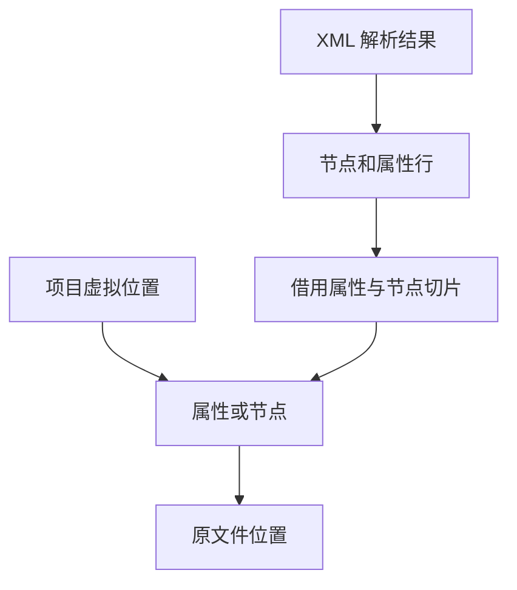

# RX 属性偏移与索引诊断

## Intent

收口 RX 诊断从表达式字节偏移到模块源码位置的路径。已索引的 XML 借用解析结果中的有序属性和节点，生成 ZX 负责实体偏移与换行坐标。

## Data

旧路径递归查找原始属性及节点。解析器按源码顺序发布属性，节点和属性已有连续存储，索引可借用同一份数据。属性中的实体与 CRLF 会改变解码前后的字节位置。

## Edges

- 原始属性范围包含结束位置。无属性命中时，允许定位到节点起始位置。调用方自建的 AST 仍使用递归顺序。
- 实体内起点指向实体首字节，终点偏向实体末尾。保留项目诊断与属性诊断各自的换行语义。
- 索引借用 XML 已有的属性切片和节点的有序子切片。属性二分查找和节点下降使用 Zig 标准库，未增加逐节点索引行。

## Answer

### 安装版对照

工具本体均由 Native seed 引导，安装版使用 Source。关闭应用缓存，85 份生成 Zig、53 份拒绝诊断、9 个端口项目和 37 个任务项目与上一版一致。源码闭包、原生模块及 Store 的 47 份发布文件逐字节一致。下表为九轮交替并舍弃首轮的中位数。

| 场景               |           墙钟 / ms |            CPU / ms | 单进程峰值 RSS / MB |
| ------------------ | ------------------: | ------------------: | ------------------: |
| 宽约束图           |       54.13 → 54.38 |       53.62 → 53.96 |       17.40 → 17.38 |
| 192 个显式端口模块 |       55.76 → 55.68 |       74.83 → 74.98 |       32.25 → 32.24 |
| 宽分支             | 1,313.97 → 1,318.98 | 1,312.74 → 1,317.82 |     120.59 → 120.30 |
| 密集并行任务       |     206.77 → 207.95 |     213.78 → 214.85 |       45.23 → 45.23 |

### 整仓冷构建

同一隔离目录、Zig 0.17.0、ReleaseSmall、12 核、四分区和空缓存，关闭常驻生成。工具本体由 Native seed 引导，两次构建均通过 70 步。

| 指标                             | 上一阶段 |  本阶段 |
| -------------------------------- | -------: | ------: |
| 墙钟 / s（`time -l`）            |   117.37 |  117.19 |
| 总 CPU / s                       |   209.07 |  209.11 |
| 进程树峰值 RSS / MB              |  2,333.3 | 2,314.9 |
| 单进程峰值 RSS / MB（`time -l`） |  2,140.5 | 2,149.6 |
| LLVM 分区合计峰值 RSS / MB       |  2,309.4 | 2,282.2 |

相对同目录固定基线 207.44 CPU 秒，累计多 1.67 秒。相邻的整树峰值少 18.4 MB，单进程峰值多 9.1 MB。前一轮整树峰值出现在三个 LLVM 分区重叠时，本轮出现在四个分区与 Zig 检查重叠时，两轮 Zig 检查报告峰值均为 486 MB。冷构建后三个分区对象哈希相同，变化集中于承载新增定位函数的第四个分区。

### 回归与自编译

冷构建配置通过 663 项既有回归，其中新增纳入本批验收的 285 项覆盖 RX 属性解析、Schema、文本模块和 XML 表达式位置。多字节实体的内部起止偏向、单独 CR、CRLF、LF、输入末端与分配失败均有既有回归。抽查由 Source 生成的偏移和坐标函数，均无分配、显式复制或缓冲更新调用。坐标写入调用方提供的两个栈槽。

安装版另通过 6 项属性语义拒绝用例。以上一版 Source 工具引导，三代各通过 22 步，两组相邻阶段各有 10,897 份生成文件逐字节一致。两版 Source 工具在同一源码和 556 个公共入口上交替六轮，舍弃首轮。墙钟中位数 2.47 → 2.48 秒，CPU 均为 11.06 秒，单进程峰值 RSS 854.59 → 864.24 MB。10,249 份输出逐字节一致。完整阶段构建单独覆盖新入口。

自我复核保留两条边界。源码索引仅用于与解析结果匹配的不可变 AST。自建 AST 仍用原递归顺序。宿主二分查找借用通用 Zig 标准库，生成 ZX 处理实体、字节偏移及行列规则。

专项、回归和 Source 证据在 `.zig-cache/cold-build-analysis/ownership-research/rx-attribute-position/`。冷构建及进程采样在同根的 `rx-call-inputs/paired-source/.zig-cache/cold-build-analysis/ownership-research/partition-reference/cold-rx-attribute-position/`。
