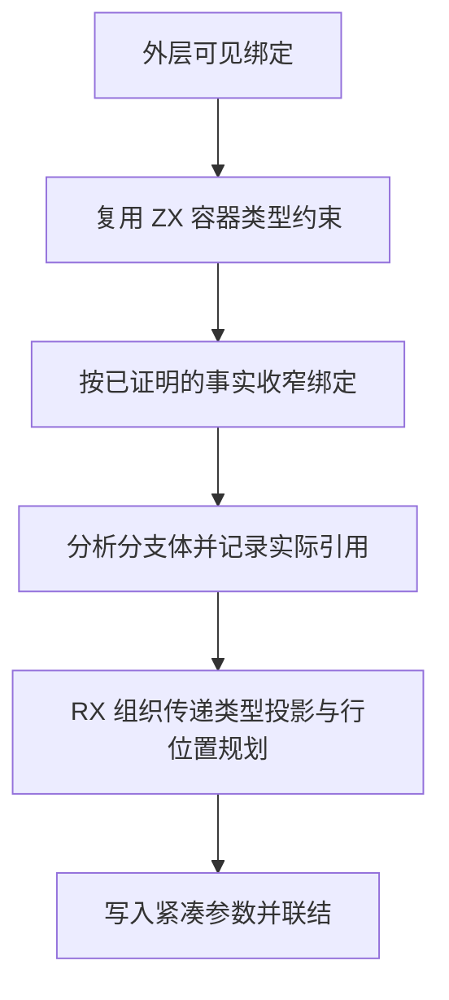
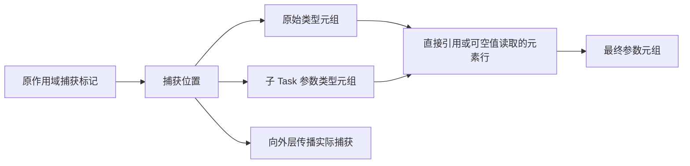

# RX 并行捕获环境自举

## Intent

让 Parallel Task 的参数只装配实际捕获的值，在 RX/ZX 中规划传递类型、非空收窄和元组元素位置。嵌套 Task 保留原作用域中的捕获身份。

## Data

原实现先构造完整可见环境的元组类型，再从中读取已捕获的值。每个 Task 的临时参数程序都生成全作用域的符号和投影，随后链接器丢弃这些投影。192 个外层绑定和 192 个稀疏捕获分支的基线峰值 RSS 为 94.2 MB。

## Edges

- 保持捕获定义顺序、原始类型及已有精确非空事实。捕获内层对象字段与捕获外层对象本身保留原类型边界。
- 保留全作用域已有的 Task 类型准入检查。校验时只读类型列，避免为检查构造元组。
- 当原始类型和参数类型一致时共用一个元组类型。零捕获仍使用空元组。
- 暂存的作用域、捕获位置和布局在 Task 完成时释放。Zig 负责借用列和写入实际 IR 存储，Native seed 保留等价布局。
- 捕获函数使用带边界的同一编号区间和函数后缀区间联结。类型、函数和原生模块的映射复用现有 ZX 范围规则，省去每次导入的三张映射数组。

## Answer

集中回归通过 118 个构建步骤、427 项 Zig 测试和 32 项 Task CLI 用例，覆盖类型推导、嵌套捕获、纯度诊断、Store 和混合库。Native seed 与 Source stage 3 生成的布局规则均通过稀疏、完整和空捕获探针，非空收窄及类型准入在零容量分配器下执行。

两个安装版对照 61 个项目。32 份生成 Zig 和 28 份错误诊断逐字节一致。另一个项目省掉了完整环境元组，输出形态随之改变。稀疏、密集、嵌套、非空及本地捕获五个项目的执行结果一致。

移除导入映射数组后，重新通过同一组集中回归。65 个项目的生成 Zig 或错误诊断与此前的捕获布局候选版逐字节一致，包括四个专门扩展的捕获规模。

### 运行成本

安装版关闭缓存，交替运行七轮，取后六轮中位数。墙钟和 CPU 按每次生成计算。峰值 RSS 独立采集。

| 项目                               |      生成墙钟 / s |           CPU / s | 峰值 RSS / MB |
| ---------------------------------- | ----------------: | ----------------: | ------------: |
| 192 个外层绑定、192 个稀疏捕获分支 | 0.25339 → 0.24985 | 0.26566 → 0.26138 | 94.09 → 94.20 |
| 48 个外层绑定、32 个密集捕获分支   | 0.28759 → 0.28893 | 0.29518 → 0.29673 | 42.83 → 42.80 |
| 256 个相互依赖的顺序 Task          | 0.42912 → 0.43199 | 0.42847 → 0.43159 | 28.82 → 28.79 |
| 嵌套捕获                           | 0.00396 → 0.00396 | 0.00411 → 0.00411 |   9.07 → 9.02 |

192 个稀疏分支的生成 Zig 从 454,834 降到 452,613 字节，类型声明从 3 个降到 2 个。每个分支只装配一个实际捕获的绑定，原来每个分支装配 192 个。测得的进程峰值接近，尚未独立量化该部分临时分配在整条链路的占比。

### 冷构建

使用 Zig 0.17.0、ReleaseSmall、12 核、四分区和构建种子 `0x3b41c83f`，关闭常驻生成，本地与全局缓存从空开始。Native seed 引导工具本体，安装版执行 Source 分析和生成。每次冷构建均通过 70 步。

| 版本               | 墙钟 / s（`time -l`） | CPU / s | 进程树峰值 RSS / MB | 单进程峰值 RSS / MB |
| ------------------ | --------------------: | ------: | ------------------: | ------------------: |
| 前一阶段           |                116.52 |  209.16 |             2,226.9 |             2,118.3 |
| 前一阶段复测       |                117.73 |  208.60 |             2,327.1 |             2,109.0 |
| 捕获布局初测       |                118.69 |  209.22 |             2,305.4 |             2,120.1 |
| 捕获布局配对复测   |                118.63 |  210.61 |             2,324.3 |             2,128.5 |
| 导入范围优化后     |                117.10 |  210.17 |             2,328.1 |             2,121.3 |
| 导入范围优化后复测 |                118.31 |  210.25 |             2,281.1 |             2,123.4 |
| 指纹工具优化后     |                117.56 |  205.14 |             2,300.2 |             2,130.7 |

指纹工具优化前，导入范围优化后的两次测量相对前一阶段两次的中位数为墙钟多 0.58 秒、CPU 多 1.33 秒。前一阶段复测自身的进程树峰值相差约 100 MB。相对前一阶段，分区 0 和 2 的对象保持逐字节一致，分区 1 和 3 分别增加 1,648 和 2,400 字节。

对照进程采样后，选取冷构建中每次都需要编译的缓存指纹宿主工具进行隔离实验。该工具原用 ReleaseFast 编译，两个基线样本中编译 CPU 均超过 4.7 秒。用同一 Zig 工具链和源文件分别以 ReleaseFast、ReleaseSmall 从空缓存构建，编译 CPU 分别为 5.609、2.089 秒。两个工具读取同一份冷构建指纹输入，交替运行七轮，后六轮的运行 CPU 中位数为 0.658、0.661 秒，墙钟中位数为 0.0738、0.0747 秒。输出的 `digest.zig` 和 `cache_identity.s` 逐字节一致。

将指纹工具改用 ReleaseSmall，保留捕获布局和范围映射。构建参数、指纹输入范围和摘要算法保持原有契约。

优化后的冷构建墙钟 117.56 秒，较基线两次的中位数多 0.44 秒，较同配置复测基线少 0.17 秒。CPU 205.14 秒，较基线中位数少 3.74 秒，较近期低点 206.33 秒少 1.19 秒。指纹工具优化前后四个分区对象逐字节一致，65 个项目的生成 Zig 或错误诊断亦逐字节一致。

最终安装版通过五项持久语义缓存用例、三项增量生成执行用例和一项原生 ABI 声明重排用例。重排用例改为按声明块交换顺序，兼容枚举纵向排版。修正后的用例在前一阶段和本阶段的安装版均通过。

探针、集中回归、安装版对照和执行日志位于 `.zig-cache/cold-build-analysis/ownership-research/rx-parallel-capture-layout/`。冷构建日志、进程采样与分区哈希位于相邻的 `partition-reference/cold-rx-parallel-capture-*/`。
