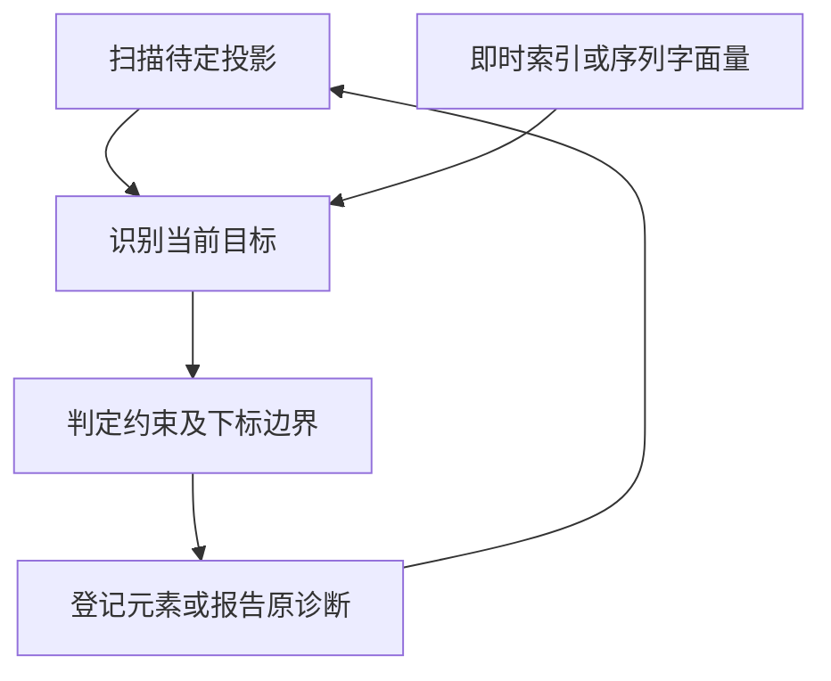
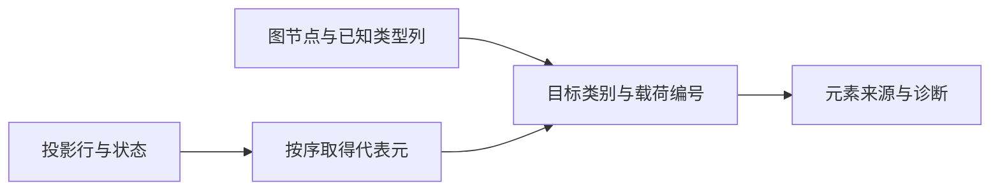

# RX 序列目标与索引投影自举

## Intent

将 RX 序列目标分类、元素来源和索引投影计划从手写 Zig 迁入 RX/ZX。保持下标诊断及其位置、约束登记顺序、延迟重放与默认列表的时机。

## Data

现有实现先在宿主重建目标联合类型，再调用生成规则。重放扫描已找到代表元，但应用时重新找根、重建目标并调用规则。图节点形状、元组成员和已知类型的载荷均已有独立列。直接借用这些列并传递代表元与编号，可以去掉目标联合类型与重放的第二次找根。

## Edges

已知元组与推导元组分别从共享类型成员列与图成员列读取。保留每次成功或报错前的原始诊断顺序。重放应用一项后重新借用图列，以容纳新节点登记。长度投影仍由现有字段访问执行。旧 Native seed 保留独立引导规则。

序列和索引共用 ZX 目标识别。序列字面量的 RX 入口将分类和元素数交给约束判定。下标入口先识别类别，元组分支验证整数位置，再从对应成员列取出编号。重放入口从扫描结果取得代表元并调用相同的索引模块。默认列表、长度和延迟索引使用同一遍历算法，父列的压缩沿用有界借用。

## Answer

复用现有列表、元组、字符串、非法下标和延迟投影用例。对照安装版生成和诊断、受影响路径的性能、完整冷构建与三代 Source 产物。

### 安装版专项

两版工具均由 Native seed 引导，执行 Source 分析和生成。禁用应用缓存后，57 份生成 Zig 和 34 份拒绝诊断逐字节一致。专项交替七轮，舍弃首轮。

| 场景                 |     墙钟 / ms |      CPU / ms | 单进程峰值 RSS / MB |
| -------------------- | ------------: | ------------: | ------------------: |
| 宽显式元组           | 44.23 → 44.14 | 43.63 → 43.39 |       16.61 → 16.58 |
| 由投影约束的平面列表 |   4.44 → 4.59 |   4.03 → 4.02 |         8.24 → 8.23 |
| 深层默认索引         |   7.43 → 7.46 |   7.02 → 7.01 |       10.31 → 10.32 |
| 带可选约束的索引     |   4.85 → 4.80 |   4.46 → 4.40 |         8.97 → 8.95 |
| 重复索引             | 17.40 → 17.32 | 16.95 → 16.95 |       14.88 → 14.86 |
| 宽对象内嵌列表默认   | 21.34 → 21.29 | 20.75 → 20.65 |       12.26 → 12.23 |

六组专项生成 Zig 逐字节一致。CPU 差额包含完整输入分析与生成。检查完整安装版生成的 12 个相关函数，借用图列与类型列，生成代码直接传递投影结果。

### 完整冷构建

同一隔离源码目录，Zig 0.17.0、ReleaseSmall、12 核、四分区、种子 `0x3b41c83f`，关闭常驻生成，从空本地和全局缓存开始。工具本体由 Native seed 引导，安装版运行 Source。各轮均通过 70 步。

| 指标                  | 固定历史记录 | 上一阶段复测 |  本阶段 |
| --------------------- | -----------: | -----------: | ------: |
| 墙钟 / s（`time -l`） |            — |       115.84 |  115.27 |
| 进程树采样墙钟 / s    |      129.740 |      115.886 | 115.398 |
| CPU / s               |       216.03 |       207.67 |  207.98 |
| 进程树峰值 RSS / MB   |      2,247.3 |      2,386.2 | 2,323.0 |
| 单进程峰值 RSS / MB   |      2,075.0 |      2,152.0 | 2,142.7 |

相对上一阶段复测，墙钟减少 0.57 秒，CPU 增加 0.31 秒。相对上一阶段两轮平均值，墙钟减少 1.27 秒，CPU 减少约 0.31 秒。进程树峰值减少 63.2 MB，单进程峰值减少 9.2 MB。LLVM 分区合计峰值由 2,229.1 增至 2,293.5 MB，本次峰值由三个目标逐字节一致的分区贡献。上一阶段的树峰包含四分区与 Zig 检查同时运行，本次树峰发生于三个分区并发时。变更所在分区增加 480 字节。

相对固定的两分区记录，采样墙钟少 14.34 秒，CPU 少 8.05 秒。相对早先同隔离目录的 207.44 CPU 秒累计增加 0.54 秒。相对原工作区低点的 203.17 CPU 秒高 4.81 秒。按这两个目录中各进程的末次有效采样，宿主库编译约从 33.99 至 35.67 CPU 秒，LLVM 分区合计从 78.20 至 78.92 秒，清单生成合计从 7.55 至 7.62 秒。采样可能漏掉进程退出前的尾部。

### 正确性与阶段自编译

冷构建安装版通过 305 项已有回归，覆盖 RX 推导、并行、任务输出、混合工件、模块记录和模块化循环增量生成。源码闭包、原生模块和 Store 的 47 份发布文件逐字节一致。

使用上一阶段 Source stage 3 引导本次 stage 1，再用本次 stage 1、stage 2 依次生成下一代。Zig 0.17.0、ReleaseSmall、12 核和 16 分区。三代各通过 22 步。排除工具身份文件后，两组相邻阶段各 10,808 份生成文件逐字节一致。最终生成的 12 个相关函数体未出现分配、缓冲增长或显式内存复制调用。

独立性能对照的工具本体均由各自的 Source stage 2 生成，运行使用 Source。以相同 548 入口清单，使用新输出目录与空函数缓存交替六轮，舍弃首轮。墙钟中位数为 2.40 → 2.41 秒，CPU 为 10.91 → 10.92 秒，单进程峰值 RSS 为 854.6 → 870.5 MB。对照中的 10,172 份主组产物逐字节一致。

本阶段由生成端决定可重放的下标、判定元组边界并读取成员编号。宿主仍应用赋值和统一约束、保存源码位置并登记类型节点。类型表和图的存储以及整轮约束调度仍在 Zig。

专项、回归、Source 自编译与对照原始记录位于 `.zig-cache/cold-build-analysis/ownership-research/rx-sequence-projections/`。完整冷构建位于同根下的 `rx-call-inputs/paired-source/.zig-cache/cold-build-analysis/ownership-research/partition-reference/cold-rx-sequence-projections/`。
