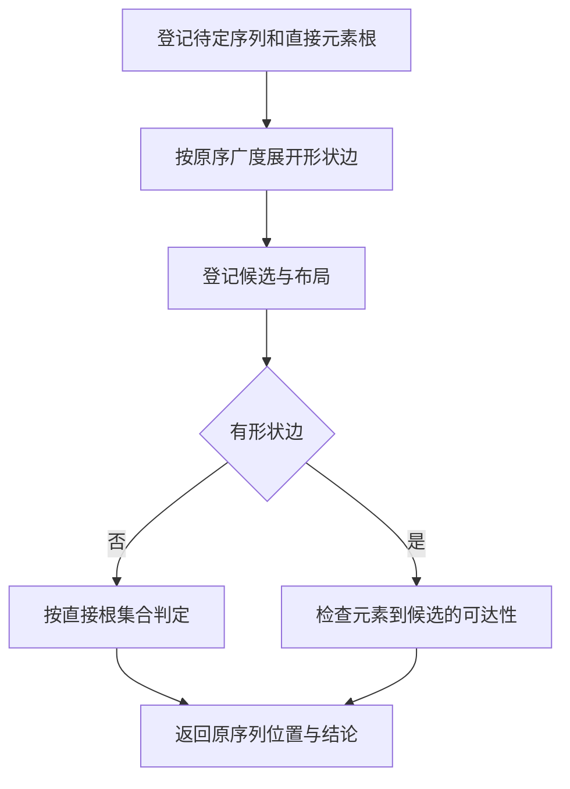
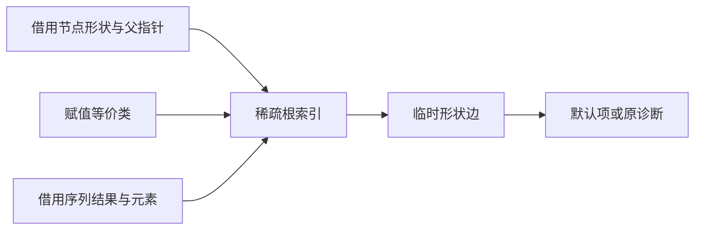

# RX 序列默认类型依赖求解

## Intent

让 RX/ZX 从现有约束图推导未定序列的默认列表类型。保持候选遍历顺序、赋值等价类解释、循环与深度诊断，以及确定一个默认值后重新求解的行为。

## Data

当前 Zig 扫描未定序列、登记元素根、广度展开形状边，再把临时图交给 RX 选择默认项。图节点、父指针和赋值等价类在进入默认决策时已经存在。序列元素列表可以由图直接借出。用 ZX 构建相同的稀疏图，预期无需额外复制原始元素列或约束图。

## Edges

默认选择只在赋值等价类未失效时读取。先登记各待定序列的元素，再展开可达节点，最后登记候选。遍历遇到超深形状时保留原诊断顺序。没有形状边时不构造元素位置列。Native seed 保留原有初始引导路径。

序列记录改为列存储，生成入口直接借用结果编号与元素切片。等价类定位沿用赋值快照的原编号，缺少代表元时用借用的父列做路径折半。ZX 用共享整数索引按插入顺序登记根，并以广度顺序追加邻接偏移与子编号。无形状边时，直接判断候选根是否在元素根集合里，省去候选登记和两列位置数组。包含形状边时，仍按原始候选与元素的顺序检查可达性。

## Answer

对照现有序列、对象嵌套、延迟绑定和非法递归用例的产物与诊断，核对专项性能、同配置冷构建和三代 Source 生成。

### 安装版专项

两版工具由 Native seed 引导，执行 Source 分析和生成。禁用应用缓存后，57 份生成 Zig 和 34 份拒绝诊断逐字节一致。专项交替七轮，舍弃首轮。

| 场景                 |     墙钟 / ms |      CPU / ms | 单进程峰值 RSS / MB |
| -------------------- | ------------: | ------------: | ------------------: |
| 宽平面列表默认       | 17.34 → 17.47 | 16.78 → 16.82 |       11.64 → 11.64 |
| 宽对象内嵌列表默认   | 21.24 → 21.18 | 20.62 → 20.70 |       12.31 → 12.26 |
| 宽显式元组           | 44.08 → 44.01 | 43.42 → 43.47 |       16.68 → 16.61 |
| 由索引约束的平面列表 |   4.48 → 4.62 |   4.01 → 4.03 |         8.32 → 8.22 |
| 嵌套列表             |   4.48 → 4.61 |   4.10 → 4.09 |         8.36 → 8.32 |
| 对象子列表           |   5.15 → 5.11 |   4.66 → 4.63 |         8.93 → 8.90 |

六组专项的生成 Zig 均一致。最终版 CPU 中位数变化约为 −0.031 至 +0.079 毫秒，范围包含完整输入分析与代码生成。

### 完整冷构建

同一隔离源码目录，Zig 0.17.0、ReleaseSmall、12 核、四分区、种子 `0x3b41c83f`，关闭常驻生成，从空本地和全局缓存开始。工具本体由 Native seed 引导，安装版运行 Source。每轮通过 70 步。

| 指标                  | 固定历史记录 | 同目录上一阶段 | 最终首轮 | 最终复测 |
| --------------------- | -----------: | -------------: | -------: | -------: |
| 墙钟 / s（`time -l`） |            — |         115.76 |   117.24 |   115.84 |
| 进程树采样墙钟 / s    |      129.740 |        115.958 |  117.406 |  115.886 |
| CPU / s               |       216.03 |         208.62 |   208.90 |   207.67 |
| 进程树峰值 RSS / MB   |      2,247.3 |        2,259.3 |  2,374.2 |  2,386.2 |
| 单进程峰值 RSS / MB   |      2,075.0 |        2,156.7 |  2,147.0 |  2,152.0 |

首轮墙钟增加 1.48 秒，其中 1.29 秒出现在首次采到 Native seed 编译前。复测墙钟只增加 0.08 秒，两轮平均增加 0.78 秒，平均 CPU 减少约 0.34 秒。两轮生成的四个分区目标逐字节一致。相对上一阶段，分区 0、2 逐字节一致，分区 1 增加 536 字节，分区 3 增加 7,584 字节。

树峰增加 114.9–126.9 MB。最终两轮的树峰都包含四个 LLVM 分区与约 480 MB 的 Zig 检查进程并发，上一阶段的树峰来自三个 LLVM 分区并发。单独看 LLVM 分区合计峰值，上一阶段为 2,229.6 MB，最终两轮为 2,256.5 和 2,229.1 MB。最终两轮的单进程峰均下降。整仓树峰仍需独立追踪。

相对固定的两分区记录，平均采样墙钟少 13.09 秒，平均 CPU 少约 7.75 秒。相对早先同隔离目录的 207.44 CPU 秒，平均累计增加约 0.85 秒。相对原工作区的 203.17 CPU 秒，仍高约 5.12 秒。按原工作区低点与最终复测各进程的末次有效采样，宿主库编译约从 34.14 增至 35.95 CPU 秒，四个 LLVM 分区合计从 78.20 增至 79.07 秒，清单生成进程合计约从 8.01 降至 7.09 秒。两轮在不同目录，采样可能漏掉进程退出前的尾部。

### 正确性与阶段自编译

最终安装版所链接的 Source 分区通过 305 项既有回归，覆盖 RX 推导、并行、Task 输出、混合工件、模块记录和模块化循环增量生成。源码闭包、原生模块和 Store 三组库的 47 份发布文件逐字节一致。

初版在四分区安装版和十六分区 Source 产物中均会为整数索引装配堆上的描述符。最终版通过共享插入算法直接传递键列、桶列和计数，原调用接口复用该算法。命中已有键时直接返回字段，避免为中间展开构造记录。新入口在未扩容时复用已探测的槽位，省去一次哈希探测。检查最终冷构建与第三代 Source 的 19 个序列规则函数，列表按容量增长，原始图列保持借用。

以上一阶段的 Source stage 3 为起点，使用 Zig 0.17.0、ReleaseSmall、12 核、16 分区依次构建三代工具。每代通过 22 步，排除工具身份文件后每代 10,800 个生成文件逐字节一致。

两版工具分别由各自的 Source stage 2 生成，运行使用 Source。固定 548 个入口，从空函数缓存和新输出目录交替六轮，舍弃首轮。墙钟中位数均为 2.40 秒，CPU 由 10.90 至 10.92 秒，单进程峰值 RSS 为 869.9 → 855.0 MB。首尾轮次的 10,164 个主组文件逐字节一致。

默认决策的全流程已在 RX/ZX。Zig 宿主继续持有类型图、序列元素位置及工作分配器，应用生成结果后按现有修订检查重新求解。整个推导的调度仍在 Zig。

专项、回归、Source 自编译与对照原始记录位于 `.zig-cache/cold-build-analysis/ownership-research/rx-sequence-defaults/`。完整冷构建位于同根下的 `rx-call-inputs/paired-source/.zig-cache/cold-build-analysis/ownership-research/partition-reference/`，目录分别为 `cold-rx-sequence-defaults-flat` 和 `cold-rx-sequence-defaults-flat-repeat`。
