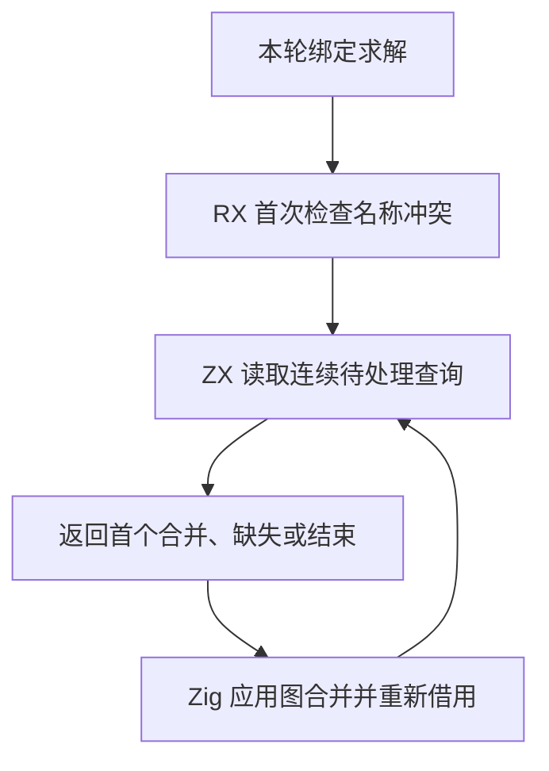

# RX 延迟绑定求解自举

## Intent

把 RX 延迟名称冲突与绑定候选求解的编排移入 RX。ZX 直接扫描借用的候选列和图节点，宿主应用图合并与报告诊断。

## Data

现有流程先检查当前轮的名称冲突，再按登记顺序选择非 void 候选。一个查询只有一个非 void 候选时才能合并，零个候选给出缺失诊断，多个候选留待下一轮。一次合并可以改变后续查询的状态。

## Edges

先报告名称冲突。候选查询仍按登记顺序处理，调用前后保持原父列路径折半的顺序。保留普通轮与终局的不同冲突判定。借用期间不增长图或候选列，单次合并结束后重新取得视图。Native seed 继续使用兼容实现。

候选列表、输出节点和源码位置分列存储。ZX 读取候选列，宿主仅在返回具体动作时读取位置和输出节点。已处理的查询不会在同一次重放中再次扫描。父列通过已有的定长缓冲接口就地压缩，查询结果只传回行号和节点编号。

## Answer

对照已有延迟绑定、void、并行和名称冲突回归，检查生成代码的列借用与分配路径。验收受影响路径成本和三代 Source 产物。

### 安装版专项

两版工具由 Native seed 引导，安装版运行 Source。关闭应用编译缓存，73 份生成 Zig 和 45 份拒绝诊断逐字节一致。11 组专项交替七轮，舍弃首轮。

| 场景          |     墙钟 / ms |        CPU / ms | 单进程峰值 RSS / MB |
| ------------- | ------------: | --------------: | ------------------: |
| 24 组延迟绑定 | 18.25 → 18.27 | 25.369 → 25.298 |       20.35 → 20.28 |
| 宽赋值图      | 17.52 → 17.31 | 16.965 → 16.822 |       11.67 → 11.69 |
| 宽约束根图    | 54.97 → 54.75 | 54.324 → 54.181 |       24.38 → 24.40 |
| 重复下标      | 17.35 → 17.46 | 16.889 → 17.012 |       14.43 → 14.46 |

初步检查 12 个生成函数体，绑定检查和扫描没有分配、缓冲增长或显式复制调用。

### 完整冷构建

同一隔离目录，Zig 0.17.0、ReleaseSmall、12 核、四分区、种子 `0x3b41c83f`。空本地与全局缓存，关闭常驻生成。Native seed 引导工具本体，安装版运行 Source，两次均通过 70 步。

| 指标                             | 固定历史记录，两分区 | 上一阶段 |  本阶段 |
| -------------------------------- | -------------------: | -------: | ------: |
| 墙钟 / s（`time -l`）            |                    — |   117.30 |  115.97 |
| 进程树采样墙钟 / s               |              129.740 |  117.308 | 115.994 |
| CPU / s                          |               216.03 |   209.48 |  208.74 |
| 进程树峰值 RSS / MB              |              2,247.3 |  2,349.4 | 2,372.1 |
| 单进程峰值 RSS / MB（`time -l`） |              2,075.0 |  2,154.8 | 2,162.5 |
| LLVM 分区合计峰值 RSS / MB       |                    — |  2,227.7 | 2,272.0 |

相邻墙钟减少 1.33 秒，其中 1.26 秒出现在第一个子编译进程被采到之前。CPU 减少 0.74 秒。相对历史两分区记录，采样墙钟减少 13.75 秒，CPU 减少 7.29 秒。相对同目录早期 207.44 CPU 秒，累计增加 1.30 秒，较上一阶段收窄 0.74 秒。原工作区 203.17 CPU 秒的跨目录差额为 5.57 秒。

树峰增加 22.7 MB。两轮峰值都包含四个 LLVM 分区和 Zig 检查。峰值采样点的 Zig 检查 RSS 由 451.6 增至 480.6 MB，四分区合计峰值增加 44.3 MB。分区 0 至 2 对象逐字节一致，分区 3 增加 344 字节。分区合计末次采样 CPU 增加 0.13 秒。

### 正确性与阶段自编译

最终安装版通过 305 项既有回归，覆盖推导、并行、任务输出、分配失败、模块记录、混合工件与模块化生成。源码闭包、原生模块和 Store 的 47 份库发布文件逐字节一致。

以上一阶段 Source stage 3 引导，依次生成三代。Zig 0.17.0、ReleaseSmall、12 核和 16 分区，每代通过 22 步。排除工具身份文件，两组相邻阶段各 10,833 份生成文件逐字节一致。最终 Source 的 12 个相关函数体没有分配、缓冲增长或显式复制调用。

两版独立工具由各自的 Source stage 2 生成，以同一份 550 入口清单运行 Source。交替六轮，从空函数缓存和新输出目录开始，舍弃首轮。墙钟中位数 2.42 → 2.41 秒，CPU 10.97 → 10.93 秒，单进程峰值 RSS 871.4 → 877.0 MB。10,197 份主组文件逐字节一致。

宿主仍负责候选缓冲的登记、图合并和源位置诊断。整轮约束求解尚未迁移。已验证的零分配范围是绑定检查和扫描，图合并仍可登记新的图节点。

原始对照记录位于 `.zig-cache/cold-build-analysis/ownership-research/rx-deferred-bindings/`。整仓冷构建位于同根下的 `rx-call-inputs/paired-source/.zig-cache/cold-build-analysis/ownership-research/partition-reference/cold-rx-deferred-bindings/`。
