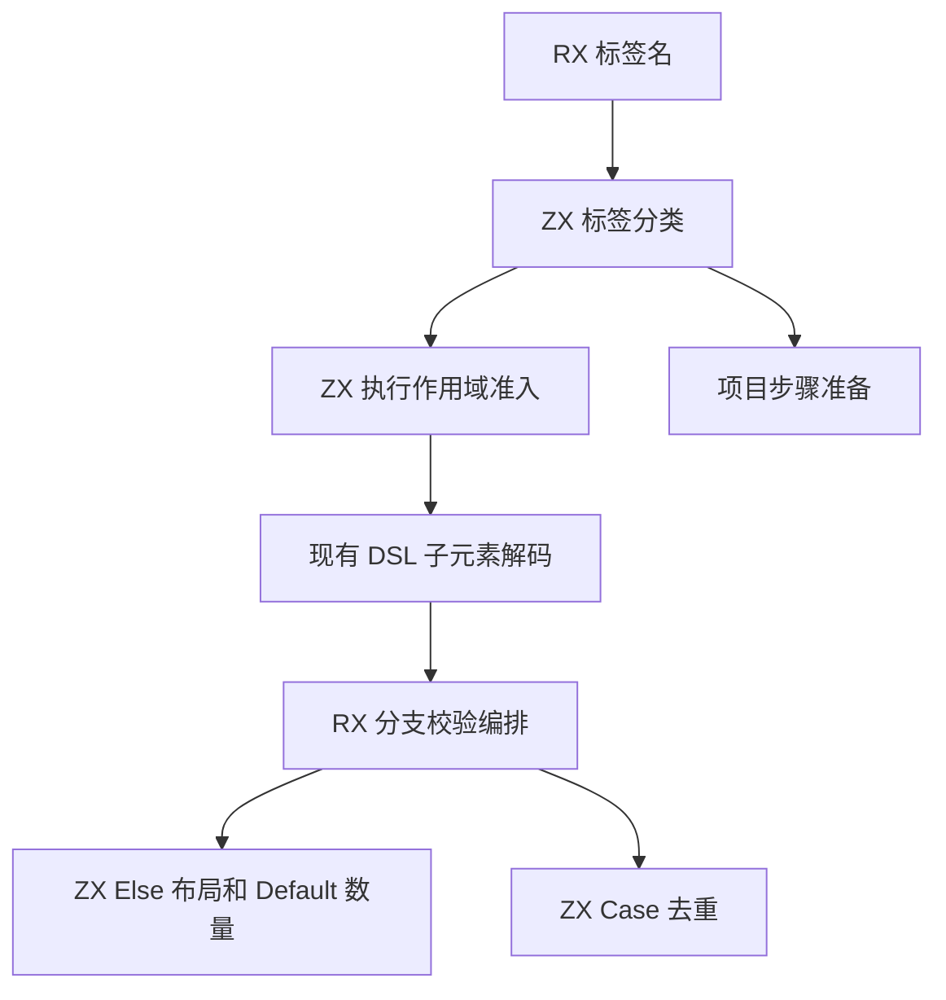

# RX 执行作用域与分支校验

## Intent

让正式 RX 校验和项目分析共用 ZX 的执行标签分类。将执行作用域准入、If 的 Else 布局、Switch 的 Case 重复和 Default 数量规则迁入 RX/ZX，保留位置诊断与执行顺序。

## Data

Schema 原先逐项比较标签字符串，项目装载再次用不同的比较顺序分发。同一 Switch 的 Case 校验对每项重新比较前面的子标签和属性，成本随分支数平方增长。Case 比较使用 XML 解码后的值，保留属性属于引号文本还是花括号表达式的区别。

## Edges

- 保留普通步骤、Task 及 Parallel 的原准入集合。Schema 完成子标签和属性校验后执行跨分支规则。
- Switch 保留 Case 错误优先于重复 Default 的诊断顺序，Case 比较继续使用原始解码属性，不提前修剪表达式。不会把两种属性种类折叠成同一个键。
- 索引借用字符串存储。桶为有界的校验临时缓冲，成功后立即释放。项目分析继续使用已验证的 AST 与当前请求的依赖。
- 初始 seed 保留等价的布局检查。公开 DSL 仍负责通用标签数据解码，项目宿主负责在原执行顺序联结步骤、签名和 Store 权限。

## Answer

对照既有分支、作用域、返回路径、项目和格式化用例。在真实文本入口比较诊断和产物，测量窄、宽 Switch 与普通项目的成本，最后核对完整冷构建与三代 Source 生成结果。

### 专项成本

前后安装版均由 Native seed 引导，运行使用 Source。两版交替九轮，取后八轮中位数。使用已有字节索引为两种 Case 属性分别保存桶，按原顺序查找。桶容量由输入数确定，索引直接借用属性值。没有可重复 Case 的 Switch 不装配索引。

| 场景                         |      墙钟 / ms |       CPU / ms | 单进程峰值 RSS / MB |
| ---------------------------- | -------------: | -------------: | ------------------: |
| 小型 If 结构检查             |    4.44 → 4.29 |    3.00 → 2.90 |         3.52 → 3.51 |
| 4,096 个 Case 的结构检查     | 712.03 → 21.55 | 710.24 → 20.18 |       15.73 → 15.91 |
| 4,096 个 Case 的普通 lint    | 508.54 → 94.95 | 507.16 → 93.55 |       23.23 → 23.27 |
| 200 层嵌套 If 的普通 lint    |    7.29 → 7.23 |    6.11 → 6.11 |         5.90 → 5.90 |
| 256 个 Case 的无缓存项目生成 |  39.66 → 37.30 |  38.99 → 36.63 |       13.43 → 13.39 |

4,096 个 Case 的结构检查由 186.94 亿降到 4.93 亿条退役指令。256 分支项目的生成 Zig 在所有对照中逐字节一致。

### 回归和阶段一致性

安装版通过 11,177 项 Zig 检查、76 项项目与库 CLI 场景、32 项 Task 输出与执行用例、52 项格式化 CLI 检查、一项格式化前后的应用运行对照和 18 项 RX 语义 lint。Task 输出脚本首次运行时漏传了 fixture 目录，正确调用后 32 项全部通过。回归涵盖 Task 和 Parallel 准入、重复 Case 和 Default、分支返回路径、分配失败及 XML 位置诊断。

仓库 1,277 个 RX 文件的格式化和普通 lint 退出码、输出和诊断逐字节一致。使用上一阶段 Source stage 3、Zig 0.17.0、ReleaseSmall、12 核和 16 分区生成三代工具。每代通过 22 步。排除工具身份文件后，三代各 10,715 个生成文件逐字节一致。

两个 Source 对照工具本体均由各自的 Source stage 2 生成，运行使用 Source 分析和生成。对相同的 543 入口清单交替六轮，每轮使用空函数缓存及新输出目录，舍弃首轮。墙钟中位数均为 2.45 秒，CPU 均为 11.02 秒，单进程峰值 RSS 为 851.8 → 850.4 MB。首尾两轮的 10,081 份主组产物逐字节一致。

### 完整冷构建

使用 Zig 0.17.0、ReleaseSmall、12 核、四分区和种子 `0x3b41c83f`。关闭常驻生成，从空本地与全局缓存开始。工具本体由 Native seed 引导，安装版使用 Source 分析与生成。三次候选构建均通过 70 步。

| 指标                             | 固定历史基线 | 上一阶段同配置两次 | 本阶段三次中位数 |
| -------------------------------- | -----------: | -----------------: | ---------------: |
| 墙钟 / s（`time -l`）            |            — |    117.54 / 117.54 |           118.16 |
| 进程树采样墙钟 / s               |      129.740 |  117.749 / 117.754 |          118.217 |
| CPU / s                          |       216.03 |    204.82 / 206.01 |           206.24 |
| 进程树峰值 RSS / MB              |      2,247.3 |  2,345.1 / 2,304.3 |          2,344.1 |
| 单进程峰值 RSS / MB（`time -l`） |      2,075.0 |  2,141.0 / 2,145.1 |          2,152.7 |

三次墙钟分别为 117.90、119.53 和 118.16 秒。较慢的第二轮比同目录上一阶段多 1.99 秒，seed 编译开始前的差额为 1.42 秒。三轮从 seed 启动到构建结束分别约 80.63、80.96 和 80.32 秒，上一阶段同目录为 80.39 秒。CPU 三轮为 205.93、206.24 和 206.38 秒。阶段中位数较上一阶段配对验收多 0.62 秒墙钟和 0.23 秒 CPU，较上一阶段两次 CPU 的均值多 0.83 秒。

同目录上一阶段的树峰也包含四个 LLVM 分区与约 479 MB 的 Zig 检查进程。本阶段首轮出现相同重叠，树峰 2,344.1 MB，另两轮分别为 2,295.7 和 2,346.4 MB。相对固定历史记录，采样墙钟少 11.52 秒、CPU 少 9.79 秒，树峰仍高 96.8 MB，单进程峰值仍高 77.7 MB。总 CPU 中位数较同配置近期低点 203.17 秒高 3.07 秒，后续需按进程窗口追踪累计增长。

自我复核保留两项边界。正式规则中的标签准入、Else 判定和 Case 去重已迁入 RX/ZX，宿主仍从已解码节点投影 Else 与 Default 的位置，并按项目诊断顺序联结步骤、签名和 Store 权限。完整 DSL 解码、项目步骤降级及正式入口的传递依赖审计仍待迁移或验收。

回归和对照位于 `.zig-cache/cold-build-analysis/ownership-research/rx-selection-rules/`。冷构建和进程采样位于相邻的 `partition-reference/cold-rx-selection-rules*`。
