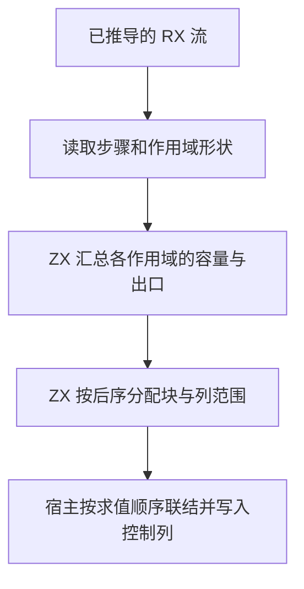
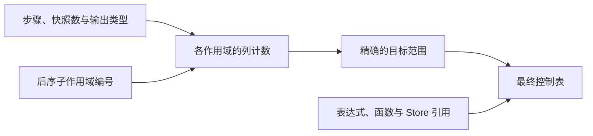

# RX 控制表装配自举

## Intent

把 RX 的终止判断、语句容量和控制列布局迁入 RX/ZX。让宿主按既有求值顺序直接写入最终控制表。

## Data

顺序 Task 与父块共用语句范围，Switch 分支各有独立块。控制表按后序发布块及负载编号。调用参数需要在执行前取得 Store 快照，Parallel 的所有输入只能看见分支开始前的作用域。

## Edges

- 保持原有块编号、语句顺序、快照顺序及分支绑定边界。
- 计划只包含形状与位置。IR 负载、字符串生命周期和宿主分配继续由 Zig 管理。
- Native seed 使用等价的形状算法。正式路径借用形状列并按计划写入最终存储。
- 计数与放置复用每个作用域八个 `u32` 的暂存行。初版对象数组为逐步更新分配对象，改用定长缓冲读写后，生成规则只访问既有存储。
- 编译后的步骤按已知长度一次分配。Parallel 输出从最终并行符号列按序发布。

## Answer

Native 与 Source stage 3 生成的规划都通过零容量分配器验证。覆盖空块、顺序 Task 并入父块、Switch 子块、快照与捕获计数、Parallel、隐式 void 返回、不可达和缺少返回。

集中回归通过 118 个构建步骤、427 项 Zig 测试、32 项 Task CLI 用例和 55 次 RX 属性运行，覆盖 Store、真实磁盘项目及混合库。

两个安装版对照 45 个项目，23 份生成 Zig 和 22 份预期失败诊断逐字节一致。无缓存生成按版本交替七轮，取后六轮的中位数。另对单次生成交替采集五轮单进程峰值 RSS。

| 项目                   |  两次生成墙钟 / s |  两次生成 CPU / s | 单次生成峰值 RSS / MB |
| ---------------------- | ----------------: | ----------------: | --------------------: |
| 384 个整数 Switch 分支 | 0.14940 → 0.14907 | 0.14868 → 0.14833 |         48.07 → 46.14 |
| 384 个顺序 Task        | 0.62549 → 0.63379 | 0.62443 → 0.63042 |         50.25 → 46.81 |

### 冷构建

沿用 Zig 0.17.0、ReleaseSmall、12 核、四分区及构建种子 `0x3b41c83f`。关闭常驻生成，本地及全局缓存从空开始。Native seed 引导工具本体，安装版执行 Source 分析与生成。

| 指标                             | 固定历史基线 | 上一阶段 |  本阶段 |
| -------------------------------- | -----------: | -------: | ------: |
| 墙钟 / s（`time -l`）            |            — |   116.25 |  116.70 |
| 进程树采样墙钟 / s               |      129.740 |  116.338 | 116.716 |
| CPU / s                          |       216.03 |   209.54 |  209.71 |
| 进程树峰值 RSS / MB              |      2,247.3 |  2,337.6 | 2,326.9 |
| 单进程峰值 RSS / MB（`time -l`） |      2,075.0 |  2,130.4 | 2,114.0 |

冷构建通过 70 步。较上一阶段，墙钟多 0.45 秒，CPU 多 0.17 秒，进程树及单进程峰值分别少 10.7 MB 和 16.4 MB。较固定历史基线，采样墙钟少 13.02 秒，CPU 少 6.32 秒，树峰值多 79.6 MB。

前三个分区对象逐字节一致，第四个增加 3,456 字节，采样 CPU 为 13.51 → 13.50 秒。CPU 较近期低点仍高 3.38 秒。顺序 Task 生成中位数增加 8.30 毫秒，两轮生成的 CPU 增加 5.998 毫秒，单次生成峰值少 3.44 MB。

探针、回归及安装版对照位于 `.zig-cache/cold-build-analysis/ownership-research/rx-control-layout/`，完整冷构建采样和分区哈希位于相邻的 `partition-reference/cold-rx-control-layout/`。
