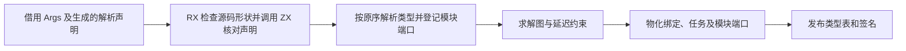
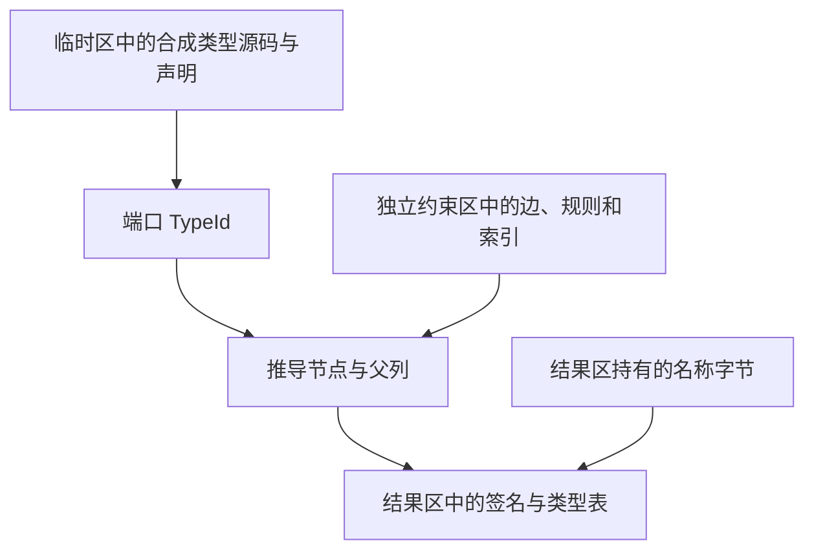

# RX 推导工作区与签名发布

## Intent

把 Args 声明验证迁入 RX/ZX，将声明解析、待求解约束和签名结果的生命周期按最后使用点收口。保留类型编号、约束应用顺序、首个诊断和生成结果。

## Data

原先项目结果区同时保存输入类型表的两份列、推导节点和父列、延迟约束、签名中间状态及最终结果。只有已知类型索引和赋值去重索引在约束求解后释放。签名生成只需要求解后的节点、父列、绑定和任务状态。对象字段名称字节可能被最终类型表引用，生成的调用结果名称也进入最终签名。

## Edges

- 合成 Args 声明只允许原先支持的语法形状，诊断仍映射到 RX 属性。ZX 借用解析器的声明行和源文本，不构造额外的名称列。
- 声明解析的临时区随端口登记结束释放。诊断在释放前转存。约束缓冲与登记索引随最终求解释放，节点、父列和签名中间状态在签名物化后释放。
- CLI 原先把临时分配器也接到进程结果 arena。子 arena 结束时，其底层页仍可能被父 arena 保留。正式 RX 入口现提供可独立回收的临时分配器，类型构造和解析的中间列也使用它。项目 API 默认沿用调用方分配器，测试可继续注入分配失败。
- 最终结果持有类型列、字段名称字节及签名名称。输入类型表只复制一次，维持结果对输入表的独立所有权。
- 初始 seed 保留等价验证。约束求解的整轮调度与图写回继续由原宿主执行。

## Answer

### 安装版专项

前后工具本体均由 Native seed 引导，运行使用 Source 分析和生成。关闭应用缓存后，85 份生成 Zig、53 份拒绝诊断和 47 份库发布文件逐字节一致。另有 9 个端口项目一致，包含宽显式端口、默认端口、四类转发入口和三种诊断。三处新增 RX/ZX 源码通过格式检查。

四组专项各交替九轮，舍弃首轮。每轮输出 Zig 的哈希一致。

| 输入               |     墙钟 / ms |      CPU / ms | 单进程峰值 RSS / MB |
| ------------------ | ------------: | ------------: | ------------------: |
| 宽约束图           | 54.63 → 54.57 | 54.00 → 54.02 |       24.33 → 17.51 |
| 192 个显式端口模块 | 56.19 → 55.81 | 77.02 → 74.93 |       36.68 → 32.36 |
| 192 个默认端口模块 | 49.03 → 48.82 | 66.94 → 66.13 |       31.61 → 27.67 |
| 宽赋值图           | 18.31 → 18.45 | 17.71 → 17.87 |       11.55 → 10.40 |

宽约束图峰值减少 6.82 MB。另有宽标量和延迟绑定等 12 组配对。库发布三个项目一轮合计墙钟中位数 71.5 → 72.5 毫秒，CPU 77.1 → 77.2 毫秒。生成的 Args 验证入口、名称扫描及两个字节接口的函数体中没有分配、增长或显式复制调用。

### 完整冷构建

同一隔离源码目录，Zig 0.17.0、ReleaseSmall、12 核、四分区、种子 `0x3b41c83f`。关闭常驻生成，本地和全局缓存从空开始。工具本体由 Native seed 引导，安装版使用 Source。两版均通过 70 步。

| 指标                       | 固定历史记录，两分区 | 上一阶段 |  本阶段 |
| -------------------------- | -------------------: | -------: | ------: |
| 墙钟 / s（`time -l`）      |                    — |   116.20 |  116.85 |
| 进程树采样墙钟 / s         |              129.740 |  116.361 | 117.007 |
| CPU / s                    |               216.03 |   209.79 |  209.52 |
| 进程树峰值 RSS / MB        |              2,247.3 |  2,264.5 | 2,368.9 |
| 单进程峰值 RSS / MB        |              2,075.0 |  2,150.0 | 2,157.2 |
| LLVM 分区合计峰值 RSS / MB |                    — |  2,213.5 | 2,261.0 |

相邻墙钟增加 0.65 秒，CPU 减少 0.27 秒。同目录早期 207.44 CPU 秒到当前累计增加 2.08 秒，原工作区 203.17 秒的跨目录差额为 6.35 秒。相对两分区历史记录，采样墙钟减少 12.73 秒，CPU 减少 6.51 秒。

相邻树峰增加 104.4 MB，单进程峰值增加 7.1 MB。两次树峰均在四个 LLVM 分区和 `rx-tests-check` 重叠时发生，四个分区对象逐字节一致，Zig 构建报告的 `rx-tests-check` 峰值均为 486 MB。它在两个整树峰值采样点的 RSS 分别为 378.4 MB 和 478.2 MB，差额约占整树增量的 96%。整仓峰值仍受并发重叠影响，专项的内存降幅不能外推至该峰值。

### 回归与 Source 自编译

冷构建安装版通过 305 项既有回归，覆盖约束与任务、并行分支、分配失败、工件、模块记录与增量生成。源码闭包、原生模块和 Store 的 47 份发布文件与上一版逐字节一致。

以上一阶段 Source stage 3 引导，使用 Zig 0.17.0、ReleaseSmall、12 核、16 分区生成三代。三代各通过 22 步，排除工具身份文件后，两组相邻阶段各有 10,846 份生成文件逐字节一致。与上一提交的 Source 输出相比，新增 7 份文件及 6 处目录、类型和分区登记变化均对应新 Args 验证入口。

前后对照的工具本体均由各自 Source stage 2 生成，运行使用 Source。固定此前 550 个入口，交替六轮并舍弃首轮，使用新输出目录和空函数缓存。墙钟中位数 2.41 → 2.42 秒，CPU 10.93 → 10.97 秒，单进程峰值 RSS 865.53 → 860.93 MB。主组 10,203 份生成文件逐字节一致。固定入口组用于核对可比的工具成本，新入口的生成和链接由三代完整构建覆盖。

自我复核保留两个边界。CLI 使用可独立回收的临时分配器，使用 arena 的调用方需要传入独立分配器，物理内存才能随临时区释放。已发布的字段字节与签名名称仍按结果生命周期保存。图节点存储、整轮不动点调度、签名物化和错误位置转交仍在 Zig，当前阶段迁入了 Args 验证规则并完成释放边界。

专项、回归和 Source 对照在 `.zig-cache/cold-build-analysis/ownership-research/rx-inference-workspace/`。冷构建及进程采样在同根的 `rx-call-inputs/paired-source/.zig-cache/cold-build-analysis/ownership-research/partition-reference/cold-rx-inference-workspace/`。
