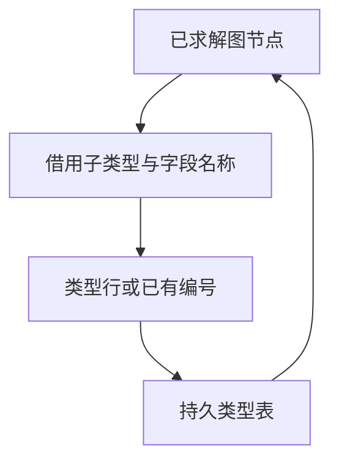

# RX 推导类型物化

## Intent

让 RX 将推导遍历产生的容器请求接到共享类型构造流程。保持类型编号、图写回、嵌套限制和首个诊断顺序，继续借用元组成员和对象名称列。

## Data

原路径从 ZX 取回遍历状态，在 Zig 分别拼装列表、可选、元组及对象候选，再进入共享类型构造。类型表最终写入已经支持直接发布单行。推导图的对象名称和成员节点共用一块内存，宿主需要从成员列还原名称视图。标量和已有类型走原有即时返回路径。

## Edges

- 保留递归回溯顺序和图写回时机。对象排序只作用于临时描述符。用于查重的类型列、未排序成员和名称按引用传入。
- 两条类型构造入口共用宿主单行提交逻辑。暂存使用调用期间的工作区，最终表继续持有发布结果。
- Native seed 保留原递归求解。图的物理状态和签名结果装配仍由 Zig 管理。

## Answer

### 安装版专项

工具本体均由 Native seed 引导，运行 Source 分析和生成。关闭应用缓存，85 份生成 Zig、53 份拒绝诊断、9 个端口项目与上一阶段一致。以下四组专项各交替九轮并舍弃首轮。

| 输入               |     墙钟 / ms |      CPU / ms | 单进程峰值 RSS / MB |
| ------------------ | ------------: | ------------: | ------------------: |
| 宽约束图           | 54.39 → 54.28 | 53.71 → 53.65 |       17.47 → 17.50 |
| 192 个显式端口模块 | 55.31 → 55.22 | 74.49 → 74.24 |       32.49 → 32.41 |
| 192 个默认端口模块 | 43.99 → 43.88 | 63.28 → 63.04 |       27.57 → 27.66 |
| 宽赋值图           | 17.15 → 17.08 | 16.47 → 16.47 |       10.31 → 10.32 |

生成的值入口和 RX 编排函数中未出现描述符堆创建或显式复制。构造内部的对象成员排序继续使用暂存，物化使用独立栈缓冲及溢出区，释放后遍历可以继续复用原工作区。新增生成代码与宿主共享上一阶段的结果发布路径。

### 整仓冷构建

同一隔离目录、Zig 0.17.0、ReleaseSmall、12 核、四分区、种子 `0x3b41c83f`。本地和全局缓存从空开始，关闭常驻生成。工具本体由 Native seed 引导，安装版运行 Source。两版均通过 70 步。

| 指标                       | 固定历史记录，两分区 | 上一阶段 |  本阶段 |
| -------------------------- | -------------------: | -------: | ------: |
| 墙钟 / s（`time -l`）      |                    — |   116.76 |  116.66 |
| 进程树采样墙钟 / s         |              129.740 |  116.983 | 116.733 |
| CPU / s                    |               216.03 |   209.90 |  210.13 |
| 进程树峰值 RSS / MB        |              2,247.3 |  2,341.9 | 2,373.9 |
| 单进程峰值 RSS / MB        |              2,075.0 |  2,150.7 | 2,152.0 |
| LLVM 分区合计峰值 RSS / MB |                    — |  2,259.6 | 2,200.9 |

相邻墙钟少 0.10 秒，CPU 多 0.23 秒。同目录固定记录 207.44 CPU 秒到当前累计增加 2.69 秒，距离 3 秒警戒线还有 0.31 秒。原工作区低点 203.17 CPU 秒的跨目录差额为 6.96 秒。

相邻进程树峰值多 32.0 MB。两轮均发生于四个 LLVM 分区与 `rx-tests-check` 重叠，检查进程在该采样点由 458.1 增至 484.7 MB，约占树峰差额的 83%。检查进程在 Zig 构建摘要中均为 486 MB，四个 LLVM 分区对象逐字节一致，分区合计峰值少 58.7 MB。整仓的并发树峰仍需独立跟踪。

### 回归与 Source 自编译

冷构建安装版通过 378 项既有回归，覆盖 RX 类型推导、并行任务、分配失败、库与工件、模块记录及 ZX 类型解析。源码闭包、原生模块和 Store 的 47 份发布文件与上一阶段逐字节一致。

以上一阶段 Source stage 3 引导，使用 Zig 0.17.0、ReleaseSmall、12 核和 16 分区构建三代。每代通过 22 步。排除工具身份文件，两组相邻产物各有 10,864 份文件逐字节一致。

用于计时的两版工具均由各自 Source stage 2 生成，运行使用 Source。固定此前 552 个入口，交替六轮，舍弃首轮，函数缓存和输出目录从空开始。墙钟中位数 2.45 → 2.44 秒，CPU 10.98 → 10.99 秒，单进程峰值 RSS 872.38 → 858.75 MB。主组 10,221 份生成文件逐字节一致。

自我复核确认候选字段、成员列和名称列按视图传入，共享构造规则写回单个类型编号。Zig 仍持有图的物理存储、驱动遍历续步并装配最终签名。三代对照覆盖生成一致性，正式编译器的传递依赖还需核查。

专项、回归和 Source 对照在 `.zig-cache/cold-build-analysis/ownership-research/rx-type-materialization/`。冷构建及进程采样在同根的 `rx-call-inputs/paired-source/.zig-cache/cold-build-analysis/ownership-research/partition-reference/cold-rx-type-materialization/`。
