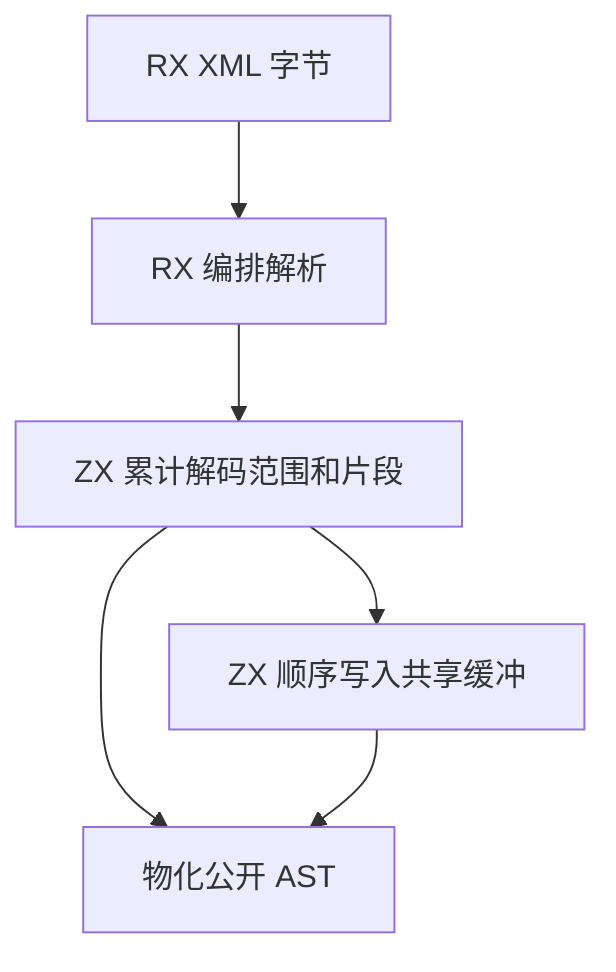

# RX 文本物化自举

## Intent

用 ZX 决定 RX XML 属性和文本的解码区间及写入顺序。保留实体、换行、表达式原文和源码缓冲生命周期，减少变换路径的分配与扫描。

## Data

原先每个变换后的属性或文本单独遍历片段计算长度，再分配缓冲并扫描一遍写入。普通值直接借用结果持有的源码字节。解析器已按遇见顺序记录实体和原文片段。

解析状态在追加片段时累计 UTF-8 长度。每个值记录全局输出区间，空区间表示原文可直接借用。XML 解析成功后，宿主为整份文档的变换文本分配一块定长缓冲。ZX 按片段顺序在该缓冲中写入，AST 直接借用其中的子切片。

## Edges

- XML 语法检查仍在写入前完成。未变换值、属性原文和位置语义保持兼容。
- 标准库负责对借用缓冲执行边界受检的字节移动与 UTF-8 标量写入。ZX 决定片段、范围、顺序和分配大小。
- Zig 仍负责分配最终缓冲和物化现有递归 DSL AST。初始 seed 仍用原生 XML 实现。

## Answer

集中核对既有 XML、RX 位置、图、Store、CLI 和编译库回归。测量同样的普通值和实体输入、完整冷构建及可比 Source 路径。

### 安装版对照

前后版本交替运行十一轮，舍弃首轮。每个输入有 4,096 条 Import。普通输入直接借用源码，实体输入的每个属性都有数字实体。墙钟包含相同的进程启动与 `time -l` 包装成本。

| 属性与入口       | 墙钟中位数 / ms | 峰值 RSS / MB |   退役指令 / 百万 |
| ---------------- | --------------: | ------------: | ----------------: |
| 普通，显式文件集 |   26.25 → 26.23 | 13.80 → 13.80 |   625.30 → 621.22 |
| 普通，磁盘入口   |   53.96 → 53.71 | 34.83 → 34.85 | 1319.95 → 1311.50 |
| 实体，显式文件集 |   27.80 → 27.69 | 14.68 → 14.66 |   667.71 → 662.65 |
| 实体，磁盘入口   |   57.45 → 57.24 | 38.14 → 38.14 | 1406.70 → 1396.80 |

四组库发布的 53 份文件逐字节一致，墙钟中位数变化为 −0.37 至 +0.49 ms。闭包和原生项目恢复缓存与禁用缓存的产物一致。每轮 24 次热恢复的墙钟中位数为 0.1203 → 0.1212 秒，CPU 为 0.1195 → 0.1199 秒。

集中回归通过 10,851 项 Zig 检查和 37 项 CLI 场景。Zig 检查包含 10,446 项既有合成图，以及实体、CDATA、CRLF、表达式位置、源码缓冲生命周期与分配失败回归。12 份直接链接输出逐字节一致。标准库独立探针覆盖重叠移动、越界、UTF-8 四字节标量和非法代理码点。

### 三阶段自编译

旧 Source 工具内置的标准库目录缺少新写入接口，完整预检使用临时原生接口映射。正式自编译使用本次冷构建的 Native seed，配置为 Zig 0.17.0、ReleaseSmall、12 核和 16 分区。三个阶段各通过 22 步。排除工具身份文件，stage 2 与 stage 3 的 10,669 份生成文件逐字节一致。Native seed 生成的 stage 1 与 stage 2 有 1,317 份文件差异。

前后工具本体均由各自的 Source stage 2 生成，运行时均使用 Source 分析和生成。以旧工具也可执行的 535 个共同入口交替运行六轮，每轮使用新输出目录与空函数缓存，舍弃首轮。墙钟中位数为 2.53 → 2.57 秒，CPU 为 10.95 → 10.96 秒，单进程峰值 RSS 为 858.4 → 860.7 MB。首尾轮次有 10,024 份产物逐字节一致。另两份文件的差异仅为 `types.zig` 中新增的标准库字节缓冲接口及 `.zxc-files` 中对应的哈希。

### 完整冷构建

固定 Zig 0.17.0、ReleaseSmall、12 核、四分区和种子 `0x3b41c83f`。关闭常驻生成，本地及全局缓存从空开始。工具本体由 Native seed 引导，安装版执行 Source 分析和生成。70 步全部通过。

| 指标                             | 固定历史基线 | 上一阶段 |  本阶段 |
| -------------------------------- | -----------: | -------: | ------: |
| 墙钟 / s（`time -l`）            |            — |   117.93 |  117.59 |
| 进程树采样墙钟 / s               |      129.740 |  118.106 | 117.733 |
| CPU / s                          |       216.03 |   203.76 |  203.17 |
| 进程树峰值 RSS / MB              |      2,247.3 |  2,312.6 | 2,255.5 |
| 单进程峰值 RSS / MB（`time -l`） |      2,075.0 |  2,129.1 | 2,134.0 |

较上一阶段，墙钟减少 0.34 秒，CPU 减少 0.59 秒，树峰减少 57.1 MB，单进程峰值增加 4.9 MB。较固定基线，采样墙钟减少 12.01 秒，CPU 减少 12.86 秒，树峰高 8.2 MB，单进程峰值高 59.0 MB。

两轮树峰都在 LLVM 分区 0、1、2 的后段重叠出现。分区 0、1 的目标文件逐字节一致，其中分区 1 在树峰样本中的 RSS 减少约 60.5 MB。分区 2、3 的对象分别减少 656 字节及增加 1,128 字节。树峰变化仍无法单独归因于 XML 文本物化。

回归、专项和 Source 对照记录位于 `.zig-cache/cold-build-analysis/ownership-research/rx-xml-values/`，冷构建和进程采样位于相邻的 `partition-reference/cold-rx-xml-values/`。
