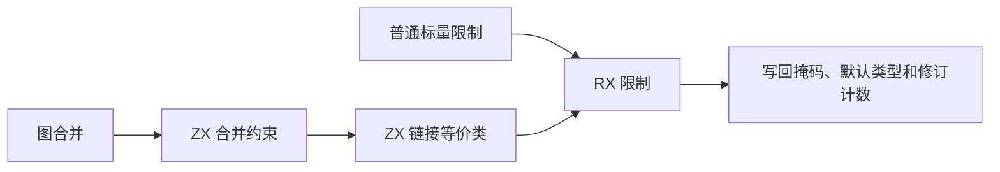
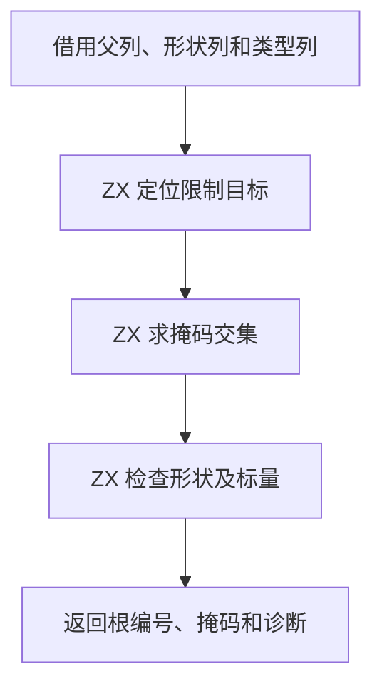

# RX 标量约束提交自举

## Intent

统一普通标量限制与图合并后的限制。RX 编排根定位、交集与准入。ZX 计算限制是否改变节点，宿主写回图列与修订计数。

## Data

原提交入口生成允许掩码和默认类型，并链接等价类。宿主随后重新定位标量限制的目标，按 Zig 形状枚举读取标量类型，再调用限制入口。图已经拥有等价的父列、形状列、掩码列和类型列，生成入口可以直接借用。

## Edges

图合并沿用原快照计算掩码与默认值。限制在链接之后读取当前代表元和当前掩码。空交集先于形状错误。失败时保留旧掩码，已提交的形状、默认值和等价类保持原行为。只有掩码变化时增加额外的求解修订。Native seed 保留兼容规则。

## Answer

验收独立限制、图合并、数值回退、诊断顺序与三代 Source。检查生成的借用路径与整仓冷构建。

### 安装版专项

两版均由 Native seed 引导工具本体，安装版使用 Source。关闭应用缓存后，85 份生成 Zig 和 53 份拒绝诊断逐字节一致。十二组专项各交替七轮，舍弃首轮。

| 场景       |       墙钟 / ms |        CPU / ms | 单进程峰值 RSS / MB |
| ---------- | --------------: | --------------: | ------------------: |
| 宽标量约束 | 24.138 → 24.130 | 23.697 → 23.709 |       11.86 → 11.81 |
| 宽赋值图   | 17.308 → 17.342 | 16.837 → 16.861 |       11.67 → 11.63 |
| 宽约束根图 | 54.696 → 54.630 | 54.049 → 54.105 |       24.38 → 24.33 |
| 延迟绑定   | 18.389 → 18.291 | 25.782 → 25.401 |       20.44 → 20.37 |

预检生成的 15 个函数体未出现分配、缓冲增长或显式内存复制调用。限制的列视图只在调用期间借用，宿主写回字段和修订次数。

### 完整冷构建

同一隔离目录，Zig 0.17.0、ReleaseSmall、12 核、四分区、种子 `0x3b41c83f`。从空本地和全局缓存开始，关闭常驻生成。工具本体由 Native seed 引导，安装版运行 Source。前后均通过 70 步。

| 指标                             | 固定历史记录，两分区 | 上一阶段 |  本阶段 |
| -------------------------------- | -------------------: | -------: | ------: |
| 墙钟 / s（`time -l`）            |                    — |   115.97 |  116.20 |
| 进程树采样墙钟 / s               |              129.740 |  115.994 | 116.361 |
| CPU / s                          |               216.03 |   208.74 |  209.79 |
| 进程树峰值 RSS / MB              |              2,247.3 |  2,372.1 | 2,264.5 |
| 单进程峰值 RSS / MB（`time -l`） |              2,075.0 |  2,162.5 | 2,150.0 |
| LLVM 分区合计峰值 RSS / MB       |                    — |  2,272.0 | 2,213.5 |

墙钟增加 0.23 秒，CPU 增加 1.05 秒。按项目验收规则，此次墙钟处于单阶段容差内，CPU 增幅计入累计趋势。同目录早期基线 207.44 CPU 秒，累计增加 2.35 秒。原工作区 203.17 CPU 秒的跨目录差额为 6.62 秒。相对固定历史记录，采样墙钟减少 13.38 秒，CPU 减少 6.24 秒。

树峰减少 107.6 MB，两轮都由四个 LLVM 分区与 Zig 检查并发形成。峰值采样时 Zig 检查的 RSS 从 480.6 降至 378.4 MB。LLVM 分区合计峰值下降 58.5 MB，末次采样 CPU 合计增加 0.16 秒。分区 0 至 2 对象逐字节一致，分区 3 增加 1,144 字节。

末次采样中，未改动的 `partition-objects` 构建工具自身的编译从 1.29 增至 2.41 CPU 秒，宿主库编译从 35.85 增至 35.95 CPU 秒，Zig 检查从 2.14 降至 1.72 CPU 秒。此分解存在进程退出前的采样尾差，保留完整 CPU 数值作为验收依据。

### 正确性与阶段自编译

最终安装版通过 305 项既有回归，覆盖推导、并行、任务输出、分配失败、混合工件、模块记录与模块化生成。源码闭包、原生模块和 Store 的 47 份库发布文件逐字节一致。

以上一阶段 Source stage 3 引导，依次生成三代。Zig 0.17.0、ReleaseSmall、12 核和 16 分区，每代通过 22 步。排除工具身份文件后，两组相邻阶段各有 10,839 份文件逐字节一致。最终 Source 的 15 个相关函数体均通过生成代码检查，父列直接借用，未出现分配、缓冲增长或显式内存复制调用。

前后工具均由各自 Source stage 2 生成。固定 550 入口，执行 Source 分析与生成。交替六轮，从空函数缓存及新输出目录开始，舍弃首轮。墙钟中位数 2.42 → 2.43 秒，CPU 均为 10.97 秒，单进程峰值 RSS 865.9 → 864.7 MB。10,203 份主组产物逐字节一致。

限制决策在 RX/ZX 中完成。宿主仍负责形状和掩码列写回、图修订计数、源位置及外层递归合并。此次未改变约束图的所有权和物理存储。

专项、回归和 Source 对照位于 `.zig-cache/cold-build-analysis/ownership-research/rx-scalar-commit/`。完整冷构建位于同根下 `rx-call-inputs/paired-source/.zig-cache/cold-build-analysis/ownership-research/partition-reference/cold-rx-scalar-commit/`。
