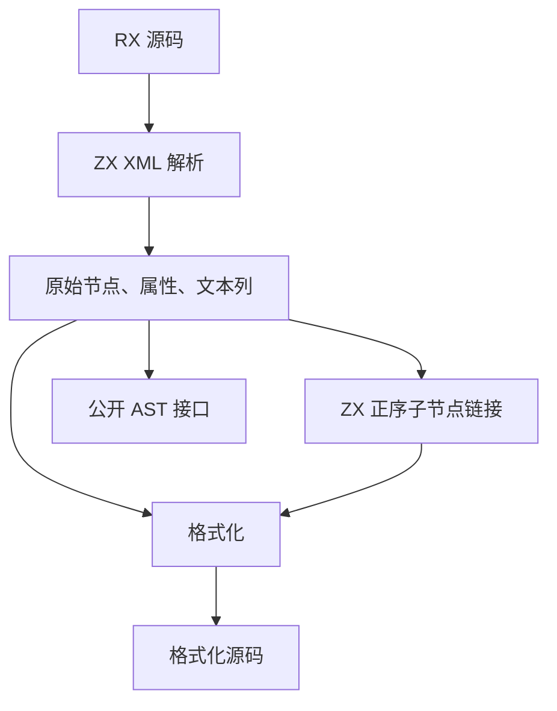
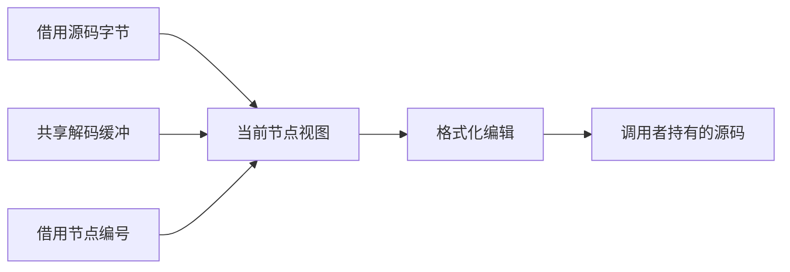

# RX 格式化借用语法列

## Intent

让 RX 格式化直接读取 ZX 解析器的节点与属性列，省去格式化各轮的递归 AST 构造和源码副本。语义校验与公开 XML AST 继续使用原接口。

## Data

格式化按源码顺序访问子节点，只读取标签名称、属性跨度、位置和混合文本。解析器已保存这些数据，子节点通过逆序兄弟链接表示。ZX 一次生成正序链接，格式化每次借用节点时只取得原列中的数据。`zxc lint` 已为 Schema 校验解析递归 AST，可把现有节点交给首轮格式化。

## Edges

- 保留现有格式化阶段、注释、CDATA、实体、表达式和 CRLF 的处理规则。需要重新解析时继续对编辑后的实际源码解析。
- 视图和解码缓冲在当前格式化阶段内借用。公开 AST 的持有与失效规则继续由原入口负责。
- 兼容手写 AST 和 Native seed。正式格式化入口使用生成的解析及链接逻辑。

## Answer

以既有格式化和 CLI 回归、仓库 RX 样本的逐字节对照、宽与深 XML 成本、完整冷构建和三阶段自编译验收。

### 行为验收

11,177 项 Zig 检查通过，包括已有的有效输出和语法诊断两项逐分配失败检查。52 项格式化 CLI 场景及一项格式化前后的应用运行对照通过。12 份直接链接产物与上一阶段逐字节一致。

对仓库 1,276 个 RX 文件分别执行 `fmt` 和普通 `lint`。两版退出码、标准输出和诊断逐字节一致。格式化为 1,274 个成功和 2 个诊断，普通 lint 为 614 个成功和 662 个诊断。

额外的 RX 语义 lint 18 项检查中通过 17 项。直接用 `.store.rx` 作入口时，错误的 Store 初值类型仍返回成功，上一阶段的二进制也以相同方式失败。该分支完成文件收集和结构校验后直接返回，未执行初值类型校验。

使用上一阶段 Source stage 3、Zig 0.17.0、ReleaseSmall、12 核和 16 分区生成三代工具。每代通过 22 步，排除工具身份文件后，三代各 10,692 份生成文件逐字节一致。

对照工具本体均由各自的 Source stage 2 生成，运行使用 Source 分析与生成。相同 540 入口清单交替六轮，每轮从空函数缓存和新目录开始，舍弃首轮。墙钟中位数 2.64 → 2.57 秒，CPU 11.23 → 11.07 秒，单进程峰值 RSS 854.9 → 861.8 MB。首尾轮次各比较 10,058 份主组产物，全部逐字节一致。

四组库发布的 53 份文件逐字节一致，墙钟中位数变化为 −0.07 至 +0.45 ms。闭包与原生项目的缓存恢复和禁用缓存输出一致。每轮 24 次热恢复的墙钟中位数均为 0.1219 秒，CPU 0.1212 → 0.1217 秒。

### 成本与原因

首轮借用视图保持输出字节一致，宽文档仍约 600 ms。检查标签排版发现每个标签都对整份文本搜索 CRLF，LF 文档因找不到匹配会重复扫描到底。现在每轮排版只判断一次行尾样式，并把标签 token 和布局结果放在单标签的暂存区。需要重解析时，先释放上一轮解析视图。只有混合文本实际包含变换片段时，才构造解码缓冲。

安装版对照以 Native seed 引导工具本体，运行时使用 Source。按版本交替九轮，取后八轮中位数，输出全部逐字节相同。

| 输入                     |      墙钟 / ms |       CPU / ms | 峰值 RSS / MB |
| ------------------------ | -------------: | -------------: | ------------: |
| 小型模块格式化           |    4.02 → 3.95 |    2.78 → 2.82 |   3.51 → 3.47 |
| 4,096 个标签             | 598.84 → 27.96 | 597.37 → 26.78 | 26.95 → 10.21 |
| 1,024 个含对象属性的标签 | 142.64 → 37.04 | 141.36 → 35.82 | 44.79 → 34.31 |
| 250 层嵌套               |    9.48 → 7.59 |    8.24 → 6.43 |   9.37 → 7.57 |
| 1,024 条引用的普通 lint  |  57.82 → 11.90 |  56.76 → 10.88 |  12.44 → 6.13 |

4,096 标签样本的退役指令由 210.52 亿降至 6.51 亿。只改借用视图时，该样本的峰值 26.95 → 26.69 MB，最终样本还包含去除全文件重扫和单标签临时存储的收益。

### 完整冷构建

固定 Zig 0.17.0、ReleaseSmall、12 核、四分区、种子 `0x3b41c83f`，关闭常驻生成，从空本地和全局缓存开始。Native seed 引导工具本体，安装版执行 Source 分析与生成。最终版本通过全部 70 步。

| 指标                  | 固定历史基线 | 上一阶段 |  本阶段 |
| --------------------- | -----------: | -------: | ------: |
| 墙钟 / s（`time -l`） |            — |   116.11 |  116.24 |
| 进程树采样墙钟 / s    |      129.740 |  116.331 | 116.401 |
| CPU / s               |       216.03 |   203.27 |  204.22 |
| 进程树峰值 RSS / MB   |      2,247.3 |  2,302.0 | 2,281.5 |
| 单进程峰值 RSS / MB   |      2,075.0 |  2,134.4 | 2,141.9 |

相对上一阶段同为四分区的构建，墙钟增加 0.13 秒，CPU 增加 0.95 秒，树峰下降 20.5 MB，单进程峰值增加 7.5 MB。较两分区的固定历史记录，采样墙钟少 13.34 秒，CPU 少 11.81 秒，树峰仍高 34.2 MB，单进程峰值仍高 66.9 MB。阶段验收采用四分区同配置对照。

自我复核保留两项边界。格式化已经移除递归 AST 物化，Schema 和语义分析仍使用递归 AST，排版编辑的编排仍由 Zig 调用。宽文件的加速来自消除每标签的整文档扫描，不能将全部收益计入借用视图。整仓单进程峰值仍高于历史记录，正式入口的完整传递依赖审计仍待完成。

回归和对照记录位于 `.zig-cache/cold-build-analysis/ownership-research/rx-formatter-view/`，冷构建及采样位于相邻的 `partition-reference/cold-rx-formatter-view-final/`。
