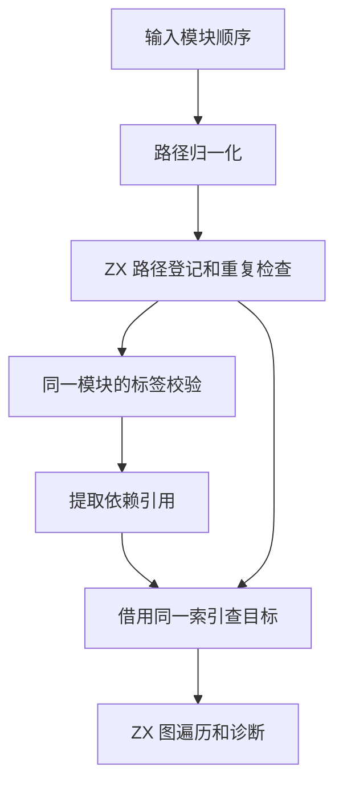

# RX 模块注册表自举

## Intent

让普通 RX 模块集合的路径登记和依赖目标查找共用 ZX 索引，保持输入顺序、首个诊断及依赖后序。

## Data

原先登记每个模块时逐项比较所有已登记路径。开始依赖校验后，宿主再次扫描已登记模块构造第二份路径表。这个流程还将图的临时分配区建立在结果分配区上。

登记和查找现在共享一份按模块数预分配的索引。ZX 用借用的路径列探测和登记编号。Zig 维持每个输入依次归一化、登记及校验标签的次序。图的分配区与输出分配区分别由调用者提供。

## Edges

- 保留每个输入的路径错误、重复错误和标签错误的先后顺序。依赖查找不再登记路径，仍使用原有边序定位首个失败。
- 平台内存分配与通用读写由 Zig 标准库提供，索引算法由 ZX 执行。混合 ZX/RX 项目的源索引及 AST 游标仍是后续迁移边界。
- 初始 seed 保留旧登记与图遍历，保证阶段零可引导。

## Answer

核对固定索引的冲突与越界行为、既有图及模块回归和安装版产物。比较小型项目、大批登记、冷构建及可比 Source 阶段。

### 安装版对照

对已写入磁盘的独立 RX 模块交替执行九轮显式文件集检查并舍弃首轮。墙钟包含相同的进程启动和 `time -l` 包装。

| 模块数 | 墙钟中位数 / ms | 峰值 RSS / MB |   退役指令 / 百万 |
| -----: | --------------: | ------------: | ----------------: |
|     16 |     4.41 → 4.09 |   3.54 → 3.52 |     23.37 → 23.30 |
|    512 |    17.52 → 9.75 |   9.22 → 9.13 |   252.95 → 168.90 |
|  4,096 |  577.30 → 62.45 | 49.61 → 49.27 | 6644.11 → 1273.74 |

两个模块之间重复查找 4,096 次目标时，显式文件集墙钟中位数为 25.63 → 25.74 ms，磁盘入口为 52.00 → 52.29 ms。退役指令分别增加约 0.05% 和 0.02%。

四组库发布的 53 份文件逐字节一致，墙钟中位数变化为 −0.38 至 +0.62 ms。闭包和原生项目的缓存恢复与禁用缓存输出一致。每轮 24 次恢复的墙钟中位数为 0.1199 → 0.1201 秒，CPU 为 0.1196 → 0.1193 秒。

集中回归通过 10,851 项 Zig 检查及 37 项 CLI 场景。其中 10,446 项是既有合成图与路径用例。12 份直接链接输出逐字节一致。独立探针通过真实 RX 文本触发末桶碰撞回绕，核对依赖后序、早期标签错误与后续重复错误的优先级。标准库定长读写的越界和最大 64 位值探针通过。

### 三阶段自编译

上一阶段 Source 工具内置的标准库目录缺少 `readU64`，完整预检使用临时原生接口映射。正式自编译使用本次冷构建的 Native seed，固定 Zig 0.17.0、ReleaseSmall、12 核和 16 分区。三个阶段各通过 22 步。排除工具身份文件，stage 2 与 stage 3 的 10,679 份生成文件逐字节一致。Native seed 生成的 stage 1 与 stage 2 有 1,347 份文件差异。

前后工具本体均由各自的 Source stage 2 生成，运行时均执行 Source 分析和生成。以 537 个共同入口交替执行六轮，使用新输出目录和空函数缓存并舍弃首轮。墙钟中位数为 2.99 → 3.05 秒，CPU 为 11.04 → 11.06 秒，单进程峰值 RSS 为 858.7 → 853.9 MB。首尾轮次的 10,035 份文件逐字节一致。另两份文件只包含 `readU64` 标准库接口及其产物哈希变化。

### 完整冷构建

固定 Zig 0.17.0、ReleaseSmall、12 核、四分区和种子 `0x3b41c83f`。关闭常驻生成，本地和全局缓存从空开始。工具本体由 Native seed 引导，安装版执行 Source 分析和生成。两轮各通过 70 步。

| 指标                             | 固定历史基线 | 上一阶段 |    首轮 |    复测 |
| -------------------------------- | -----------: | -------: | ------: | ------: |
| 墙钟 / s（`time -l`）            |            — |   116.27 |  117.61 |  115.85 |
| 进程树采样墙钟 / s               |      129.740 |  116.333 | 117.763 | 116.003 |
| CPU / s                          |       216.03 |   202.59 |  203.33 |  203.17 |
| 进程树峰值 RSS / MB              |      2,247.3 |  2,325.7 | 2,320.9 | 2,229.3 |
| 单进程峰值 RSS / MB（`time -l`） |      2,075.0 |  2,135.2 | 2,130.6 | 2,147.4 |

首轮墙钟增加 1.34 秒，因此按相同配置复测。Native seed 编译进程首次采样出现在第 36.02 → 38.09 → 36.05 秒，主生成进程出现在第 55.91 → 57.98 → 55.90 秒。首轮的时间增量在 seed 编译开始前已出现，复测未重现。两轮平均墙钟 116.73 秒，较上一阶段增加 0.46 秒。平均 CPU 203.25 秒，增加 0.66 秒。较固定基线，平均采样墙钟减少 12.86 秒，平均 CPU 减少 12.78 秒。

两轮各自四个 LLVM 分区的目标文件逐字节一致，进程树峰值相差 91.6 MB。较上一阶段，分区 1、2 的对象逐字节一致，分区 0 大小相同，分区 3 增加 904 字节。复测单进程峰值较固定基线仍高 72.4 MB。本次测量无法单独量化索引对整仓树峰的贡献。

回归、专项和 Source 对照记录位于 `.zig-cache/cold-build-analysis/ownership-research/rx-module-registry/`，冷构建和进程采样位于相邻的 `partition-reference/cold-rx-module-registry/` 与 `partition-reference/cold-rx-module-registry-repeat/`。
