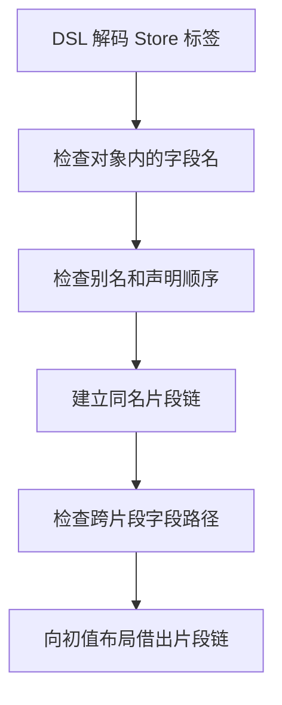

# RX 状态声明校验自举

## Intent

迁移 Store 声明的别名、标签顺序和字段冲突规则，复用校验产生的片段分组编译初值。

## Data

原校验逐对比较片段及字段。编译初值时再次分组。对象内的重复检查也逐对比较字段名。

RX 依次检查 Type 别名、标签顺序、对象分组和跨片段字段路径。ZX 复用字节索引定位已声明名称。每组遇到首个冲突片段时，仍扫描该片段中其余字段，以保留既有片段优先的诊断顺序。编译初值直接借用校验结果。

## Edges

- 保留父子校验顺序、别名重复优先级，以及跨片段冲突的三个排序键。先按当前片段，再按既有片段，最后按当前字段的声明位置。
- 借用已解码的字符串。校验产物的片段链只在声明分析期间使用。
- Zig 保留 DSL 数据投影、诊断发布以及初始 seed 的等价规则。

## Answer

Native seed 与既有 Source stage 3 均生成了三个入口。两个安装版对照 25 个 Store 项目，18 个可生成项目的 19 份文件以及 7 份拒绝诊断逐字节一致。六个专项诊断对照覆盖当前片段优先、既有片段优先、别名重复优先、迟到 Type、缺少对象和对象内字段冲突，诊断文字与位置一致。

集中回归通过 89 个构建步骤、299 项 Zig 测试和 14 项运行用例。最终安装版另通过 51 项 CLI 与库用例。

关闭缓存交替运行九轮，取后八轮中位数。

| 场景                                 | 生成墙钟 / ms |      CPU / ms | 单进程峰值 RSS / MB |
| ------------------------------------ | ------------: | ------------: | ------------------: |
| 单对象单字段                         |   4.50 → 4.45 |   3.97 → 3.96 |         8.63 → 8.61 |
| 单对象 160 字段                      | 23.33 → 20.08 | 22.81 → 19.39 |       11.67 → 11.96 |
| 32 个对象、96 个交错片段、384 个字段 | 46.57 → 45.82 | 45.94 → 45.16 |       32.00 → 32.31 |

### 冷构建

Zig 0.17.0、ReleaseSmall、12 核、四分区，种子 `0x3b41c83f`。关闭常驻生成，从空的本地和全局缓存开始。Native seed 引导工具本体，安装版执行 Source 分析和生成。三轮完整构建均通过 70 步。

| 版本               | 墙钟 / s（`time -l`） | CPU / s | 进程树峰值 RSS / MB | 单进程峰值 RSS / MB |
| ------------------ | --------------------: | ------: | ------------------: | ------------------: |
| 上一阶段           |                116.80 |  204.82 |             2,338.4 |             2,123.6 |
| 声明校验迁移       |                118.31 |  205.25 |             2,293.9 |             2,125.1 |
| 共用源码目录扫描后 |                117.50 |  205.02 |             2,325.9 |             2,137.2 |

首轮墙钟超出容差。构建配置原对多个入口清单分别遍历并排序相同源码目录。改为共用已排序的文件路径后，每个生成任务仍登记原有输入文件。优化前后生成清单的内容寻址标识以及四个分区对象哈希一致。在隔离快照中加入新目录和源码、再恢复原状，两次都触发重新配置。未修改时沿用配置缓存。

最终墙钟增加 0.70 秒，CPU 增加 0.20 秒，进程树峰值下降 12.5 MB，单进程峰值增加 13.6 MB。相对固定基线，进程树采样墙钟少 12.20 秒，CPU 少 11.01 秒。

生成、诊断、配置缓存和回归证据位于 `.zig-cache/cold-build-analysis/ownership-research/rx-store-schema/`。冷构建日志、采样和分区哈希位于相邻的 `partition-reference/cold-rx-store-schema*/`。
