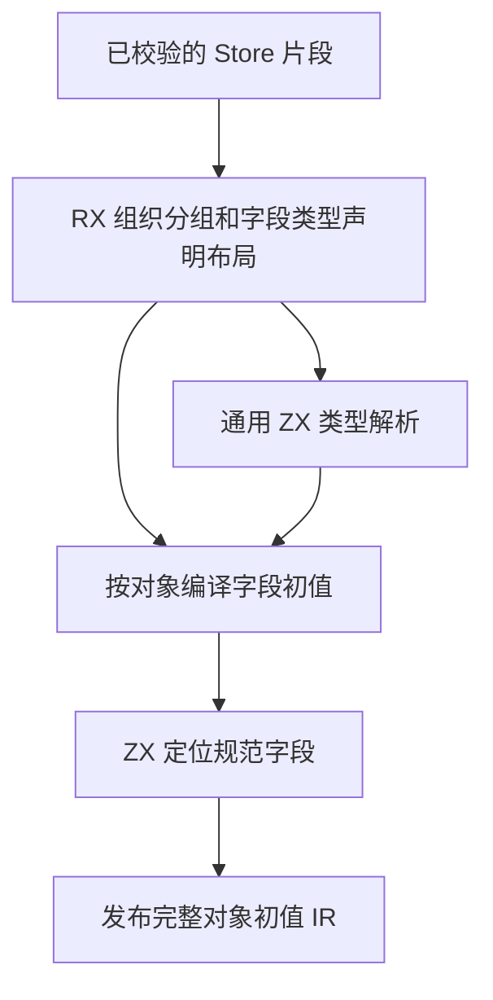
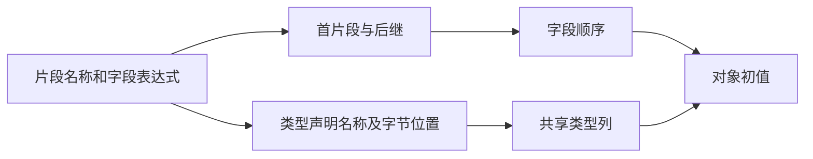

# RX 状态定义与初始化自举

## Intent

将 Store 对象片段分组、字段类型声明布局和初始化字段映射迁入 RX/ZX。初始化期间共享同一份可追加类型表，及时释放字段表达式暂存数据。

## Data

原实现按对象名称反复扫描已解析字段，每个初值表达式复制共享类型表，每个对象又线性查找规范字段位置。对象按首次声明顺序初始化，同一对象的字段按源顺序求值。

RX 串联片段分组、字段声明命名及长度计算。ZX 复用已有字节索引建立同名片段链，并用已有类型声明 writer 一次写入预定长度的缓冲。初始化字段按源顺序联结，以二分定位规范字段编号。

## Edges

- 保留类型诊断的 XML 位置、对象和字段顺序、跨片段合并及初值求值顺序。
- 结果独立拥有初值 IR 和类型数据。Native seed 保留等价规则。
- Store 应用状态继续由宿主按应用生命周期持有。
- 一份定义中的字段和对象共用同一套类型列。联结完成后释放该对象的临时表达式，最终对象统一发布完整类型表。
- 标签校验、通用类型求解和实际 IR 列发布仍通过现有 Zig 边界。不同 Store 定义继续各自持有基础类型快照。

## Answer

两个入口均由 Native seed 与既有 Source stage 3 成功生成。两个安装版对照 25 个项目。18 个可生成项目的 19 份文件逐字节一致，7 个拒绝项目的诊断一致。

集中回归通过 80 个构建步骤、243 项 Zig 测试和 14 项运行用例，覆盖推导、表达式绑定、分配失败、状态生命周期和库初始化器。最终安装版另通过 51 项 CLI 与库用例，覆盖 Store 物理路径、应用生命周期、状态初始化、库重发布和授权边界。

关闭缓存交替运行九轮，取后八轮中位数。

| 场景                                 | 生成墙钟 / ms |      CPU / ms | 单进程峰值 RSS / MB |
| ------------------------------------ | ------------: | ------------: | ------------------: |
| 单对象单字段                         |   4.69 → 4.68 |   4.15 → 4.16 |         8.72 → 8.67 |
| 单对象 160 字段                      | 24.40 → 23.57 | 23.86 → 23.03 |       16.83 → 11.55 |
| 32 个对象、96 个交错片段、384 个字段 | 48.62 → 46.75 | 48.13 → 46.10 |       32.26 → 32.00 |

### 冷构建

Zig 0.17.0、ReleaseSmall、12 核、四分区，种子 `0x3b41c83f`。关闭常驻生成，从空的本地和全局缓存开始。工具本体由 Native seed 引导，安装版执行 Source 分析和生成。70 个构建步骤全部通过。

| 版本     | 墙钟 / s（`time -l`） | CPU / s | 进程树峰值 RSS / MB | 单进程峰值 RSS / MB |
| -------- | --------------------: | ------: | ------------------: | ------------------: |
| 上一阶段 |                116.07 |  205.54 |             2,319.4 |             2,116.2 |
| 本阶段   |                116.80 |  204.82 |             2,338.4 |             2,123.6 |

墙钟增加 0.73 秒，CPU 减少 0.72 秒。相对固定基线，进程树采样墙钟减少 12.78 秒，CPU 减少 11.21 秒。树峰值增加 19.0 MB，单进程峰值增加 7.4 MB。此轮树峰值包含 LLVM 分区和 RX 编译检查同时运行。分区 1 和 2 的目标对象逐字节一致，分区 0 减少 3,216 字节，分区 3 增加 9,952 字节。

生成、回归与专项计时日志位于 `.zig-cache/cold-build-analysis/ownership-research/rx-store-definition/`。完整冷构建的日志、采样和分区哈希位于相邻的 `partition-reference/cold-rx-store-definition/`。
