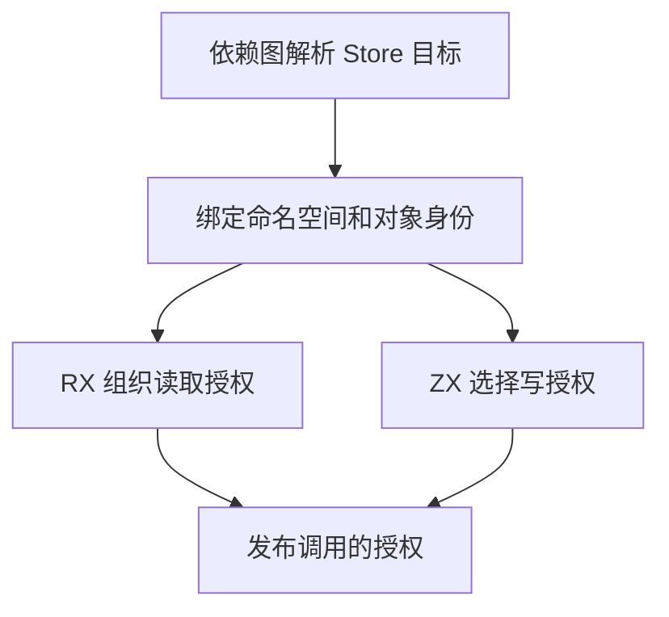
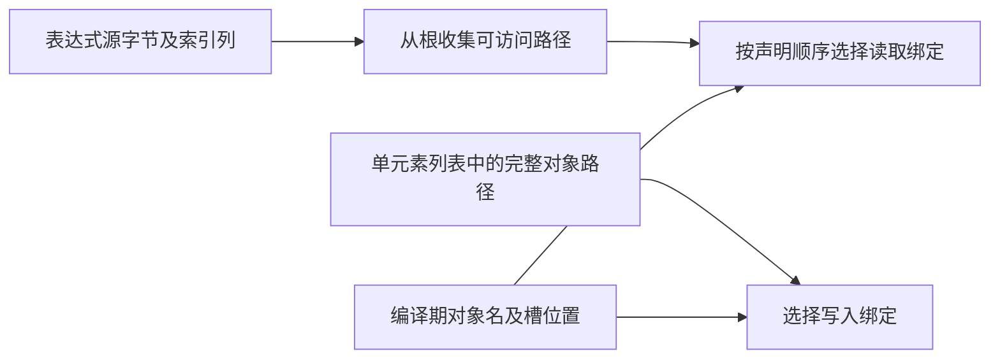

# RX 状态引用与调用授权自举

## Intent

在编译期复用依赖图解析的 Store 身份，由 RX/ZX 选择 Call 可读取的对象及完整对象的写授权。

## Data

原实现会重新规范化 Store 引用路径并扫描定义列表。Call 读授权在每个绑定上重走一遍表达式。索引解析路径还会为此装配语法树的顺序视图。

依赖图保留带 Store 角色的边，引用绑定用边上的源编号直接定位定义。ZX 使用规范化定义路径生成槽身份，并用别名生成引用名称。已登记的路径无需在绑定阶段重新解析。

索引解析器在子节点完成后追加父节点。读取授权沿节点编号逆序传播可达标记，模板插值、对象字段、参数和匹配分支直接读取已有的链接列。只将可达的完整 Store 路径送入名称匹配。写授权仍要求列表中有且仅有一个完整对象路径。

## Edges

- 保持规范化路径加对象名的槽身份，显示名和别名不改变状态身份。
- 保留授权范围、诊断位置、绑定发布顺序及闭包边界。宿主仍负责语法解析接线、错误发布和 IR 写入。
- 只借用索引解析列。名称描述符、读取位置和节点标记随调用的暂存 arena 释放。正式的 Zig 适配器仍持有命名空间表并写入授权记录。Native seed 保留等价规则以完成初始引导。

## Answer

初始 Native seed 和已有 Source stage 3 均成功生成三个入口。两套生成产物的链接列表遍历都直接更新同一份标记列，无分配器调用。

两个安装版对照了 25 个项目。18 个可生成项目的 19 份文件逐字节一致，7 个拒绝项目的诊断一致。

集中回归通过 77 个构建步骤和 203 项 Zig 测试，并通过这些步骤调用的 14 项运行用例，覆盖 RX 推导、状态生命周期、分配失败及库初始化器。最终安装版另通过 51 项 CLI 与库用例，覆盖物理路径去重、同一应用内的共享状态、进程重启初始化、库重发布和编译库写授权边界。

关闭缓存，交替运行九轮，取后八轮中位数。墙钟和 CPU 按每次生成计算。

| 场景                        | 生成墙钟 / ms |      CPU / ms | 单进程峰值 RSS / MB |
| --------------------------- | ------------: | ------------: | ------------------: |
| 两个命名空间和两处读取      |   5.51 → 5.34 |   5.09 → 5.07 |         9.16 → 9.34 |
| 256 个命名空间和三处读取    | 27.02 → 25.78 | 26.51 → 25.34 |       13.58 → 13.51 |
| 128 个命名空间和 128 处读取 | 44.52 → 43.87 | 44.03 → 43.27 |       17.60 → 17.53 |

### 冷构建

Zig 0.17.0、ReleaseSmall、12 核、四分区、种子 `0x3b41c83f`，禁用常驻生成，本地与全局缓存为空。Native seed 引导工具本体，安装版运行 Source 分析和生成。四次完整构建都通过 70 步。

| 版本             | 墙钟 / s（`time -l`） | CPU / s | 进程树峰值 RSS / MB | 单进程峰值 RSS / MB |
| ---------------- | --------------------: | ------: | ------------------: | ------------------: |
| 上一阶段原测     |                117.56 |  205.14 |             2,300.2 |             2,130.7 |
| 上一阶段配对复测 |                116.90 |  205.14 |             2,223.0 |             2,117.1 |
| Store 授权迁移   |                121.69 |  207.42 |             2,272.3 |             2,131.1 |
| 构建运行器优化后 |                116.07 |  205.54 |             2,319.4 |             2,116.2 |

首次迁移测量超出容差。进程采样显示，从启动到首个构建配置工具开始编译，由配对基线的 29.72 秒延至 33.98 秒。清单构建原将九套入口的流程在编译期展开。改为共用普通循环后，该位置提前至 28.38 秒。生成清单哈希与四个分区对象哈希在构建运行器优化前后全部一致。

最终墙钟较配对基线少 0.83 秒，CPU 多 0.40 秒。按进程树采样的墙钟相对固定基线 129.740 秒少 13.61 秒，CPU 相对固定基线 216.03 秒少 10.49 秒。树峰值相对两次上一阶段测量分别高 19.2 MB 和 96.3 MB，峰值时的分区重叠不同。最终峰值由三个 LLVM 分区并发形成，其中两个分区对象与上一阶段逐字节一致。单进程峰值较配对基线低 0.9 MB。

生成对照、专项计时和回归日志位于 `.zig-cache/cold-build-analysis/ownership-research/rx-store-access/`。完整冷构建的命令、日志、采样和分区哈希位于相邻的 `partition-reference/cold-rx-store-access-*/`。
