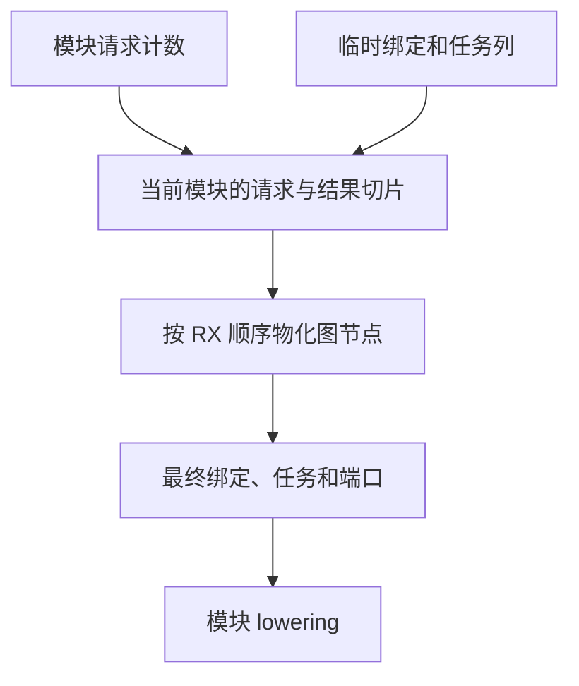

# RX 签名请求与发布

## Intent

把模块签名的类型请求顺序交给 RX。在收集时累计模块绑定和任务结果，物化时直接写入结果区。保持模块、绑定、任务及端口的求值顺序和诊断顺序。

## Data

原实现为每个模块单独增长待解析绑定和任务列表，并为非空结果分别分配数组。绑定在遍历时已经形成消费顺序。并行任务按完成子树的顺序登记，写入时仍须使用预先编号的任务槽位。模块输入、输出与绑定、任务共享类型图，首次物化可以发布类型编号。

## Edges

- 单模块依次解析绑定、任务、输入、输出。任务写入其原编号，保留嵌套任务的登记顺序。
- 所有模块复用两列连续请求，模块记录只保存这两列的终点。签名在两个最终数组中借用各自区间。名称字节由结果区持有。
- 可见绑定、非空事实和分支解析暂存由当前模块的临时区持有。切换模块时最多保留一页，推导完声明和流程后释放剩余容量。待解析请求和图在签名物化之后释放。
- 图写回和物理分配由宿主执行。RX 的后继规则在编译期展开，宿主直接执行原有遍历和物化。初始 seed 共用存储，使用等价的后继规则。

## Answer

### 安装版与完整冷构建

安装版的 85 份生成 Zig、53 份拒绝诊断、9 个端口项目及 47 份库发布文件与上阶段一致。宽约束图的墙钟中位数 54.42 → 54.65 毫秒，CPU 53.80 → 54.05 毫秒，单进程峰值 RSS 17.56 → 17.48 MB。192 个显式端口模块的墙钟 56.19 → 56.06 毫秒，CPU 75.15 → 75.03 毫秒，峰值 RSS 32.45 → 32.10 MB。专项工具本体由 Native seed 引导，运行 Source，交替九轮并舍弃首轮。

另有 37 个任务项目的生成产物或拒绝诊断一致。两组宽输入以相同方法配对。宽分支墙钟 1.3441 → 1.3445 秒，峰值 RSS 126.53 → 120.82 MB。密集并行任务墙钟 207.84 → 208.05 毫秒，峰值 RSS 45.22 → 45.38 MB。

同一隔离目录、Zig 0.17.0、ReleaseSmall、12 核、四分区、空本地及全局缓存，关闭常驻生成。工具本体由 Native seed 引导，安装版运行 Source。两次均通过 70 步。

| 指标                                      | 上一阶段 |  本阶段 |
| ----------------------------------------- | -------: | ------: |
| 墙钟 / s（`time -l`）                     |   116.66 |  117.43 |
| CPU / s                                   |   210.13 |  209.15 |
| 进程树峰值 RSS / MB                       |  2,373.9 | 2,358.3 |
| 单进程峰值 RSS / MB（`time -l`）          |  2,152.0 | 2,150.3 |
| LLVM 分区合计峰值 RSS / MB（按 PID 追踪） |  2,206.7 | 2,297.8 |

相邻墙钟增加 0.77 秒，CPU 减少 0.98 秒，进程树峰值减少 15.6 MB。同目录固定基线 207.44 CPU 秒到当前累计多 1.71 秒。原工作区低点 203.17 秒到当前差额 5.98 秒，包含目录差异。

整树峰值仍出现在四个 LLVM 分区与 `rx-tests-check` 重叠时。该时刻检查进程 RSS 为 484.7 → 483.2 MB，两轮 Zig 报告的检查峰值均为 486 MB。LLVM 合计峰值按同一 PID 贯穿进程退出前后的样本统计，因此上一阶段 2,206.7 MB 与仅用即时命令分类的旧记录略有差异。四个分区对象与直接上一版逐字节一致，LLVM 合计峰值的变化仍只能归到本次采样中的并发重叠。

冷构建安装版通过 378 项既有回归，覆盖嵌套任务、调用绑定、诊断、逐次分配失败、库工件和类型解析。

### Source 自编译

以上一阶段 Source stage 3 引导，使用 Zig 0.17.0、ReleaseSmall、12 核和 16 分区构建三代。每代通过 22 步。排除工具身份文件，两组相邻阶段各有 10,869 份生成文件逐字节一致。

两版固定入口对照工具均由各自 Source stage 2 生成，运行使用 Source。固定此前 552 个入口，交替六轮，舍弃首轮，函数缓存和输出目录从空开始。墙钟中位数 2.53 → 2.52 秒，CPU 均为 11.01 秒，单进程峰值 RSS 859.37 → 859.57 MB。10,221 份主组产物逐字节一致。

自我复核覆盖模块切片的归属、嵌套任务的槽位和第一个类型诊断。签名阶段的顺序已在 RX 定义。绑定与任务请求的实际遍历、类型图写回和最终列的物理存储仍在 Zig。临时区的收益受输入结构影响，整仓峰值继续按构建进程采样。

专项、回归和 Source 对照在 `.zig-cache/cold-build-analysis/ownership-research/rx-signature-publication/`。冷构建及进程采样在同根的 `rx-call-inputs/paired-source/.zig-cache/cold-build-analysis/ownership-research/partition-reference/cold-rx-signature-publication/`。
