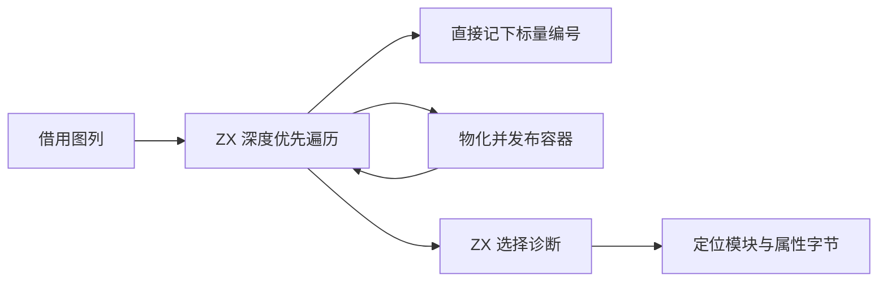
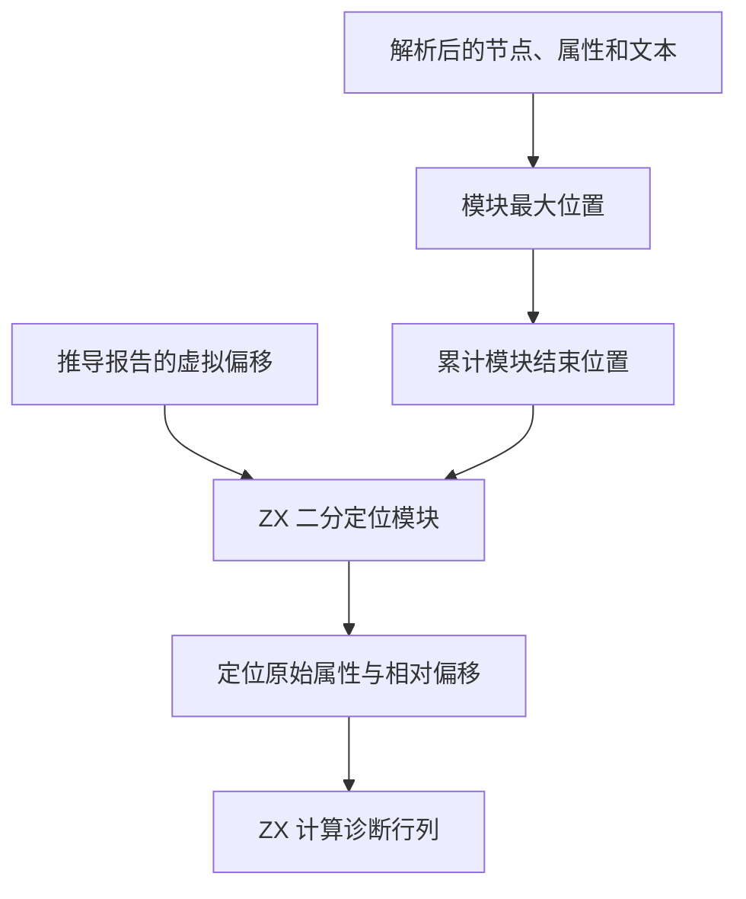

# RX 类型图写回与诊断定位

## Intent

由 ZX 控制推导类型写回、恢复遍历和诊断选择。容器继续通过共享 RX 类型构造发布。在原图列上记下类型编号，省去标量结果返回宿主的往返。诊断继续使用原模块、属性字节和行列规则。

## Data

类型图的形态和参数是独立列。已求解标量的成员列为空。容器必须先完成共享类型构造，返回有效编号后才能写回。RX 项目为每个模块分配连续虚拟位置，诊断依赖模块边界以及属性的原始字节。

## Edges

- 保持深度、短路、诊断和编号顺序。源位置按字节计列，只将 LF 当作属性值内部的换行。
- 继续支持调用方构造的 AST。已索引 XML 的范围可以复用解码时计算的最大位置。
- 图列仍由宿主管理容量。ZX 通过通用缓冲接口借用写入参数、类型标记和版本计数，宿主静态检查枚举的字节表示。成员列由图工作区统一回收，已物化的节点只按类型标记和编号读取。
- 属性范围内的行列计算写入调用方提供的两个栈槽。早期实现用聚合返回，生成代码还需要额外的循环状态分配，拒绝路径的空缓冲因此导致崩溃。最终生成函数用局部循环状态并直接写两个槽。任意 AST 的节点查找保留原属性、子节点、节点位置的优先顺序。

## Answer

### 安装版专项

工具本体均由 Native seed 引导，安装版运行 Source。关闭应用缓存，85 份生成 Zig、53 份拒绝诊断、9 个端口项目及 37 个任务项目与上一阶段一致。以下中位数为交替九轮并舍弃首轮。

| 场景               |           墙钟 / ms |            CPU / ms | 单进程峰值 RSS / MB |
| ------------------ | ------------------: | ------------------: | ------------------: |
| 宽约束图           |       54.68 → 54.29 |       54.07 → 53.64 |       17.48 → 17.40 |
| 192 个显式端口模块 |       55.93 → 55.78 |       74.81 → 74.81 |       32.33 → 31.93 |
| 192 个默认端口模块 |       44.73 → 44.31 |       63.60 → 63.23 |       28.40 → 27.46 |
| 宽赋值图           |       17.20 → 17.25 |       16.81 → 16.66 |       10.32 → 10.40 |
| 宽分支             | 1,323.14 → 1,317.65 | 1,321.90 → 1,316.28 |     120.67 → 120.94 |
| 密集并行任务       |     207.64 → 206.96 |     214.69 → 213.68 |       45.36 → 45.24 |

### 整仓冷构建

两版均用同一隔离目录、Zig 0.17.0、ReleaseSmall、12 核、四分区和空本地及全局缓存，关闭常驻生成。工具本体由 Native seed 引导，安装版运行 Source。两轮均通过 70 步。

| 指标                                      | 上一阶段 |  本阶段 |
| ----------------------------------------- | -------: | ------: |
| 墙钟 / s（`time -l`）                     |   117.43 |  117.37 |
| CPU / s                                   |   209.15 |  209.07 |
| 进程树峰值 RSS / MB                       |  2,358.3 | 2,333.3 |
| 单进程峰值 RSS / MB（`time -l`）          |  2,150.3 | 2,140.5 |
| LLVM 分区合计峰值 RSS / MB（按 PID 追踪） |  2,297.8 | 2,309.4 |

同目录固定基线 207.44 CPU 秒到当前累计多 1.63 秒，原工作区低点 203.17 秒到当前的跨目录差额为 5.90 秒。整树峰值减少 25.0 MB，前一轮出现在四个 LLVM 分区与 Zig 检查重叠时，本轮出现在三个 LLVM 分区重叠时。两轮 Zig 检查报告的峰值均为 486 MB，四个 LLVM 分区对象与直接上一版逐字节一致。分区合计峰值增加 11.6 MB，仍需结合重叠时段观察。

### 回归与引导

冷构建安装版通过 378 项既有回归，覆盖多模块位置、UTF-8、CRLF、表达式边界、并行任务、分配失败与类型解析。源码闭包、原生模块及 Store 的 47 份库发布文件逐字节一致。抽查最终生成的属性行列计算、模块二分定位和类型诊断函数体，均无分配或显式复制调用。推导仍按需使用已有的遍历栈及成员编号暂存。

上一版 Source 工具内置旧的标准库声明，不能读取新增的 `std:memory.writeU8`。这次用更新声明后的 Native seed 引导，再由生成的 Source 工具连续自编译。

Native seed 生成第 1 代时通过 33 步。第 1、2、3 代生成后继时分别通过 22 步。第 1 与第 2 代的生成源码有 1,370 处文件差异。第 2 与第 3 代、第 3 与第 4 代的两组 Source 产物各有 10,890 份文件逐字节一致，工具身份文件排除。

用两版各自由 Source 生成的工具，分别读取各自源码，固定相同的 552 个入口。源码根目录不同，且本版在固定入口中触达更多文件。这组对照包含本批迁移引起的生成差异。交替六轮并舍弃首轮，使用空函数缓存及新输出目录。墙钟中位数 2.44 → 2.42 秒，CPU 10.98 → 10.97 秒，单进程峰值 RSS 861.93 → 853.16 MB。10,206 份主组文件相同，另有 21 份文件发生变化或新增。

自我复核保留两处边界。节点借用写入需要稳定的宿主列，容量仍由 Zig 管理，容器发布的外层调用也仍在宿主。当前保留任意 AST 的 Zig 节点遍历和无索引 AST 的范围计算，生成的模块查找及行列计算由这两种入口共用。

专项、回归和 Source 对照在 `.zig-cache/cold-build-analysis/ownership-research/rx-resolution-publication/`。冷构建及进程采样在同根的 `rx-call-inputs/paired-source/.zig-cache/cold-build-analysis/ownership-research/partition-reference/cold-rx-resolution-publication/`。
