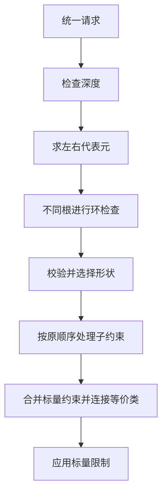
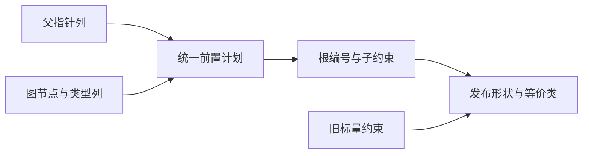

# RX 约束图统一求解

## Intent

将 RX 类型约束的统一前置检查、合并方向和提交规则迁入 RX/ZX，保留原来的递归顺序、图节点身份与首个诊断。

## Data

现有图按列存储节点，父指针可原地做路径折半。原实现先检查嵌套深度，再依次求左右代表元。不同根需要先做双向环检查，然后读取形状和标量约束。子约束递归成功后才发布父节点形状、连接等价类和限制标量。对象字段和已知类型仍由现有表登记。

## Edges

读取现有列与切片描述符，保留原地折半，不复制图及类型表。需要递归时重新借用可变列，避免使用可能因新节点登记而失效的视图。Native seed 保留初始引导路径。

前置入口用原图的节点类别、成员、载荷列和已知类型表的类别、长度列选择合并路径。两边代表元相同时直接返回，环检查仍按左到右的方向执行。已知类型只在另一侧需要结构检查时读取，子节点仍由宿主按原顺序统一和登记。

初版在生成端构造两个嵌套的形状记录，内部字段降为指针，触发了空分配器上的分配失败。改用扁平的类别、编号和长度。RX 的只读列表 ABI 也会丢失可变父列的所有权标记，导致提交生成扩容调用，较长路径的折半生成更新前复制。两处都改为通过 `std:memory` 借用有界 `U32Buffer`，保留原地折半和单元素登记。专项生成的前置和提交函数无分配、扩容、存储更新或整列复制调用。

## Answer

核对已有 RX 推导、对象构造与库联结回归，比较相同输入的生成内容、拒绝诊断和运行成本。记录冷构建的单阶段和累计变化，并逐代核对 Source 产物。

### 安装版专项

两版工具由 Native seed 引导，执行 Source。禁用应用缓存后，39 份生成 Zig 和 20 份拒绝诊断逐字节一致。包含前两版分别暴露问题的缺失字段与跨模块延迟绑定用例。专项交替七轮，最大展开分支组交替三轮，均舍弃首轮。

| 场景                         |       墙钟 / ms |        CPU / ms | 单进程峰值 RSS / MB |
| ---------------------------- | --------------: | --------------: | ------------------: |
| 64 字段双展开                |     7.85 → 7.88 |     7.60 → 7.58 |       10.58 → 10.56 |
| 256 字段列                   |   54.65 → 55.02 |   54.00 → 54.34 |       24.76 → 24.79 |
| 48 个嵌套对象                |   29.09 → 29.11 |   28.47 → 28.45 |       11.99 → 12.03 |
| 64 个带展开的 Call 分支      |   67.63 → 67.93 |   67.19 → 67.33 |       18.37 → 18.38 |
| 256 个带展开的 Call 分支     | 281.09 → 282.57 | 280.40 → 281.76 |       44.50 → 44.53 |
| 256 个接收显式期望类型的字段 |   29.09 → 28.83 |   28.56 → 28.41 |       16.07 → 16.09 |

专项的生成 Zig 均逐字节一致。最大样本的 CPU 增量约 1.36 毫秒。该样本同时包含加载、推导和生成，差额不能单独归因于父链读取。

### 完整冷构建

同一隔离源码目录，Zig 0.17.0、ReleaseSmall、12 核、四分区、种子 `0x3b41c83f`，关闭常驻生成，从空本地和全局缓存开始。Native seed 引导工具本体，安装版运行 Source。两轮各通过 70 步。

| 指标                  | 固定历史记录 | 同目录上一阶段 |  本阶段 |
| --------------------- | -----------: | -------------: | ------: |
| 墙钟 / s（`time -l`） |            — |         117.12 |  115.76 |
| 进程树采样墙钟 / s    |      129.740 |        117.344 | 115.958 |
| CPU / s               |       216.03 |         208.57 |  208.62 |
| 进程树峰值 RSS / MB   |      2,247.3 |        2,368.5 | 2,259.3 |
| 单进程峰值 RSS / MB   |      2,075.0 |        2,166.0 | 2,156.7 |

相邻阶段墙钟少 1.36 秒，CPU 多 0.05 秒，树峰少 109.2 MB，单进程峰少约 9.3 MB。上一阶段树峰包含四个 LLVM 分区和 Zig 检查进程，本阶段是三个 LLVM 分区重叠。分区 0、1、2 的目标文件逐字节一致，分区 3 增加 1,128 字节。峰值变化包含构建进程重叠差异。

相对固定的两分区记录，采样墙钟少 13.78 秒，CPU 少 7.41 秒，树峰多 12.0 MB。相对早先在同一隔离目录测得的 207.44 CPU 秒，累计增加 1.18 秒。相对原工作区近期同配置的 203.17 CPU 秒，本阶段多 5.45 秒。这两个参考使用不同源码时点和目录，累计差额继续追踪。

### 正确性与阶段自编译

最终安装版的 Source 分区通过 302 项已有回归，覆盖 RX 推导、并行、Task 输出、混合工件与模块记录。源码闭包、原生模块和 Store 三组库的 47 份发布文件逐字节一致。冷构建实际编译的 19 个统一规则生成函数与专项入口一致，没有分配、扩容、更新存储或整列复制调用。

以上一阶段的 Source stage 3 为起点，使用 Zig 0.17.0、ReleaseSmall、12 核和 16 分区依次构建三代工具。每代通过 22 步，排除工具身份文件后每代 10,782 个生成文件逐字节一致。

两版工具分别由各自的 Source stage 2 生成，运行使用 Source。固定 548 个入口，用空函数缓存和新输出目录交替六轮，舍弃首轮。墙钟中位数为 2.39 → 2.38 秒，CPU 为 10.87 → 10.85 秒，单进程峰值 RSS 为 860.2 → 861.3 MB。两组墙钟样本区间重叠。首尾轮次的 10,148 个主组文件逐字节一致。

本阶段仍由 Zig 持有图列、记录修订、登记已知类型和分配新字段布局。子约束按原顺序由宿主递归执行，完成整轮推导的调度与正式入口依赖审计仍需继续。

专项、回归、Source 自编译与对照原始记录位于 `.zig-cache/cold-build-analysis/ownership-research/rx-constraint-unification/`。完整冷构建位于同根下的 `rx-call-inputs/paired-source/.zig-cache/cold-build-analysis/ownership-research/partition-reference/cold-rx-constraint-unification/`。
