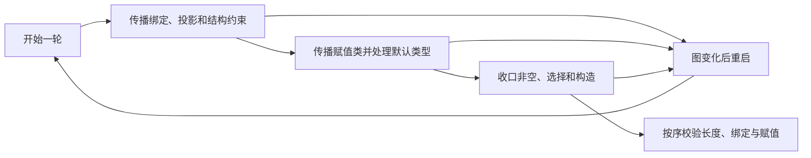
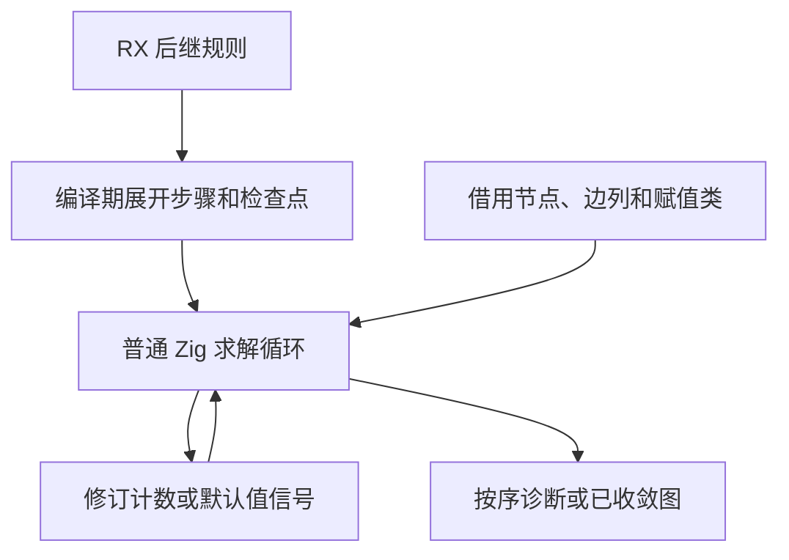

# RX 约束求解轮次编排

## Intent

把 RX 类型推导的一轮约束求解、重新求解条件和最终校验顺序迁入 RX。保持节点与类型编号、求解次数、首个诊断和资源生命周期。

## Data

原 `Graph.finish` 同时定义求解顺序、修订检查点、默认值重启和最后三项校验。各步骤通过 Zig 宿主操作同一份图，已有多个步骤调用生成的 ZX 规则。RX 的模块依赖图必须无环。阶段的后继只有有限个取值，可在 Zig 编译期求出，再展开成普通调用、条件分支和循环。

## Edges

- RX 定义每项操作的后继和重启检查点。宿主在编译期取得后继，执行已有图操作与修订读取。默认序列和默认下标沿用操作是否应用默认值的信号。
- 每一轮最多复用一份赋值类快照。只在原先的赋值阶段重置求解工作区，延续对象完整性缓存。
- 初始 seed 保留等价的后继规则，并与正式路径共用操作实现。图写回和部分步骤内部算法仍依赖手写 Zig。当前 RX 模块只有静态调用，缺少直接跨轮次调用并更新同一宿主图的机制，因此由宿主持有外层循环。

## Answer

### 安装版专项

前后工具本体均由 Native seed 引导，安装版使用 Source 分析和生成。关闭应用缓存，85 份生成 Zig、53 份拒绝诊断和 9 个端口项目与上阶段一致。四组专项各交替九轮，舍弃首轮，生成 Zig 逐字节一致。

| 场景               |     墙钟 / ms |      CPU / ms | 单进程峰值 RSS / MB |
| ------------------ | ------------: | ------------: | ------------------: |
| 宽约束图           | 54.78 → 54.37 | 54.14 → 53.94 |       17.51 → 17.51 |
| 192 个显式端口模块 | 56.09 → 56.22 | 75.14 → 75.12 |       32.39 → 32.40 |
| 192 个默认端口模块 | 44.40 → 44.38 | 63.60 → 63.44 |       27.72 → 27.68 |
| 宽赋值图           | 17.15 → 17.22 | 16.72 → 16.75 |       10.40 → 10.42 |

宿主用 `comptime` 求出每个步骤的两个后继，只有后继不同才检查运行时结果。最终校验出现在收敛轮的尾部，顺序与原宿主一致。宿主对象没有调度入口引用，反汇编的项目推导函数没有间接调用。符号和汇编仅覆盖本次安装版配置。

### 完整冷构建

同一隔离目录，Zig 0.17.0、ReleaseSmall、12 核、四分区、种子 `0x3b41c83f`。关闭常驻生成，本地和全局缓存从空开始。工具本体由 Native seed 引导，安装版使用 Source。两轮各通过 70 步。

| 指标                       | 历史两分区 | 上一阶段 |  本阶段 |
| -------------------------- | ---------: | -------: | ------: |
| 墙钟 / s（`time -l`）      |          — |   116.85 |  116.69 |
| 进程树采样墙钟 / s         |    129.740 |  117.007 | 116.863 |
| CPU / s                    |     216.03 |   209.52 |  209.00 |
| 进程树峰值 RSS / MB        |    2,247.3 |  2,368.9 | 2,304.3 |
| 单进程峰值 RSS / MB        |    2,075.0 |  2,157.2 | 2,150.8 |
| LLVM 分区合计峰值 RSS / MB |          — |  2,261.0 | 2,274.6 |

相邻墙钟少 0.16 秒，CPU 少 0.52 秒，树峰少 64.6 MB。四个分区对象逐字节一致。上轮峰值叠加了四个 LLVM 分区和 Zig 检查，本轮是三个 LLVM 分区重叠，LLVM 合计峰值增加 13.6 MB。相对同目录固定早期记录 207.44 CPU 秒，累计增加 1.56 秒，原工作区 203.17 秒的跨目录差额为 5.83 秒。相对历史两分区记录，采样墙钟少 12.88 秒，CPU 少 7.03 秒。

### 回归与阶段自编译

冷构建安装版通过 305 项既有回归，覆盖 RX 类型推导、并行任务、分配失败、混合工件、模块记录和增量生成。源码闭包、原生模块及 Store 的 47 份库发布文件逐字节一致。

以上一阶段 Source stage 3 引导，使用 Zig 0.17.0、ReleaseSmall、12 核和 16 分区生成三代。三代各通过 22 步，排除工具身份文件，两组相邻阶段各 10,851 份生成文件逐字节一致。跨提交的主组变化集中在新增调度入口、共享 ABI 和重新分区，另外四组完全一致。

两版工具本体分别由各自 Source stage 2 生成，运行使用 Source。固定 551 个既有入口，各交替六轮，舍弃首轮，函数缓存和输出目录均从空开始。墙钟中位数均为 2.43 秒，CPU 10.97 → 10.96 秒，单进程峰值 RSS 866.25 → 865.11 MB。主组 10,210 份文件逐字节一致。

自我复核中，步骤后继、八个重启检查点和终止顺序已迁移。Zig 宿主仍持有图、轮次工作区与赋值快照，调度展开后的操作调用仍由宿主绑定。当前对照验证了生成与行为一致性，以及该批次性能，正式编译器仍需关闭这些传递依赖。

专项、反汇编和阶段证据保存在 `.zig-cache/cold-build-analysis/ownership-research/rx-constraint-schedule/`。冷构建及进程采样在同根的 `rx-call-inputs/paired-source/.zig-cache/cold-build-analysis/ownership-research/partition-reference/cold-rx-constraint-schedule/`。
