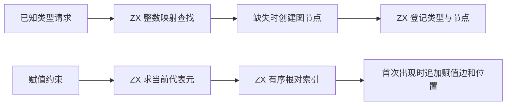
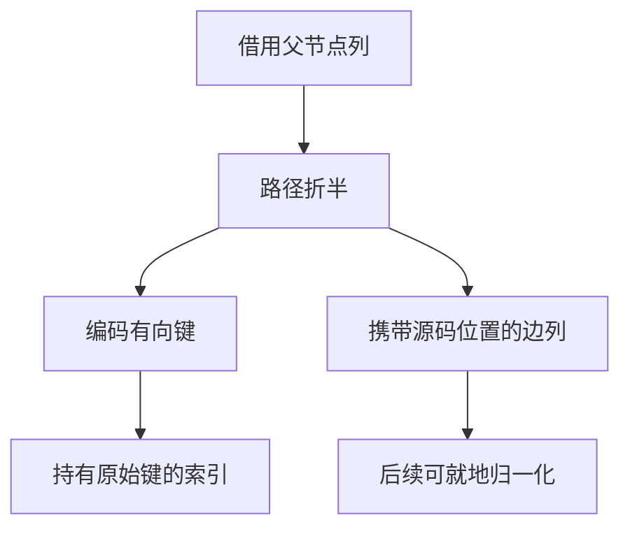

# RX 约束登记与索引自举

## Intent

将 RX 推导中已知类型节点的索引和赋值约束的登记迁入 RX/ZX，维持有序约束、诊断位置和节点身份。

## Data

已知类型索引以 TypeId 查找第一次创建的图节点。后续图合并可以改变该节点的代表元，索引中的初始节点身份保持稳定。赋值边以写入时的有向根对去重，深度求解会归一化边列，但不会改写用于判重的原始根对。

## Edges

正式路径复用现有 ZX 整数集合的查找和扩容。赋值键以两个 32 位节点编号编码成 64 位，方向不变。相等根不产生边，重复键不增加修订次数。先为边列预留容量，再登记键，保证成功登记的键有对应边。已知类型映射失败时回退节点及父列长度，未完成的映射不会留下悬空编号。Native seed 保留兼容实现。

两个索引只用于约束收集和求解，签名解析读的是已经登记的图节点。索引使用同一份独立 arena，并在求解结束后释放。图节点、赋值边列和类型表保留各自原来的存储。宽整数索引复用首次探测得到的空槽，只有扩容重排后才重新定位。

## Answer

核对顺序、重复输入、传递合并、递归约束和分配失败。比较安装版诊断及生成 Zig，检查索引增长和临时区的开销，并验证三代 Source 自编译。

### 安装版专项

两版由 Native seed 引导，执行 Source 分析和生成，关闭应用缓存。58 份生成 Zig 和 34 份拒绝诊断逐字节一致。八组专项交替七轮，舍弃首轮。

| 场景                 |     墙钟 / ms |      CPU / ms | 单进程峰值 RSS / MB |
| -------------------- | ------------: | ------------: | ------------------: |
| 宽对象合并与覆盖     |   8.20 → 8.30 |   7.94 → 7.99 |       10.46 → 10.47 |
| 宽对象构造           |   8.31 → 8.20 |   7.99 → 7.95 |       10.45 → 10.45 |
| 重复开放对象字段     |   4.43 → 4.45 |   4.14 → 4.14 |         8.77 → 8.77 |
| 由投影约束的平面列表 |   4.57 → 4.51 |   4.08 → 4.03 |         8.20 → 8.22 |
| 深层默认索引         |   7.77 → 7.58 |   7.47 → 7.33 |       10.28 → 10.36 |
| 带可选约束的索引     |   5.03 → 5.17 |   4.74 → 4.67 |         8.96 → 8.98 |
| 重复索引             | 18.67 → 18.42 | 18.00 → 17.90 |       14.91 → 14.42 |
| 宽对象内嵌列表默认   | 22.78 → 22.78 | 22.09 → 21.99 |       12.13 → 12.35 |

补充从冷构建安装版复核已有字段与长度夹具，合计 68 份生成 Zig 和 39 份拒绝诊断一致。同一轮增加两个专项。

| 场景       |     墙钟 / ms |      CPU / ms | 单进程峰值 RSS / MB |
| ---------- | ------------: | ------------: | ------------------: |
| 宽赋值图   | 17.41 → 17.42 | 16.78 → 16.87 |       11.58 → 11.66 |
| 宽约束根图 | 54.96 → 54.64 | 54.32 → 54.13 |       24.74 → 24.39 |

### 完整冷构建

同一隔离目录，Zig 0.17.0、ReleaseSmall、12 核、四分区和种子 `0x3b41c83f`。每次使用空本地与全局缓存，关闭常驻生成。Native seed 引导工具本体，安装版运行 Source。三次构建各通过 70 步，四个分区对象逐字节一致。

| 指标                             | 固定历史记录，两分区 | 上一阶段 |    首轮 |    复测 |
| -------------------------------- | -------------------: | -------: | ------: | ------: |
| 墙钟 / s（`time -l`）            |                    — |   115.72 |  120.16 |  115.94 |
| 进程树采样墙钟 / s               |              129.740 |  115.846 | 120.372 | 116.100 |
| CPU / s                          |               216.03 |   208.29 |  212.08 |  209.03 |
| 进程树峰值 RSS / MB              |              2,247.3 |  2,360.8 | 2,305.9 | 2,310.9 |
| 单进程峰值 RSS / MB（`time -l`） |              2,075.0 |  2,137.9 | 2,146.9 | 2,156.2 |
| 四个 LLVM 分区合计峰值 RSS / MB  |                    — |  2,203.3 | 2,276.3 | 2,281.2 |

首轮相邻墙钟增加 4.44 秒，其中 4.26 秒出现在首次采到子编译进程之前。三轮在该进程出现前分别经过 28.11、32.37 和 28.34 秒。首轮、复测的四分区末次采样 CPU 合计为 79.62 和 79.19 秒，上一阶段为 79.27 秒。复测相邻墙钟增加 0.22 秒，CPU 增加 0.74 秒。固定历史基线的采样墙钟减少 13.64 秒，CPU 减少 7.00 秒。相对同隔离目录早期的 207.44 CPU 秒，复测累计增加 1.59 秒；相对原工作区低点 203.17 秒，差额为 5.86 秒，跨目录差额仍需核对。

复测树峰比上一阶段少 49.9 MB，单进程峰值多 18.3 MB。LLVM 分区合计峰值多 77.9 MB。上一阶段的树峰发生在四分区与 Zig 检查并行时，本阶段两轮都发生在三个分区同时运行时。两轮树峰分别比两分区历史记录高 58.6 和 63.6 MB。

### 正确性与阶段自编译

安装版的 312 项既有回归通过，包含推导、任务、并行、分配失败、工件与可选列表运行。源码闭包、原生模块和 Store 的 47 份库发布文件逐字节一致。

以上一阶段 Source stage 3 引导，依次生成三代。本次使用 Zig 0.17.0、ReleaseSmall、12 核和 16 分区，各代通过 22 步。排除工具身份文件，两组相邻阶段各有 10,829 份生成文件逐字节一致。最终生成的赋值准备与已知类型查找入口未出现分配调用。宽索引的写入保留通用列表容量和所有权检查，已有状态通过拥有型 ABI 交接。

两版 Source 性能工具均由各自的 Source stage 2 生成，运行 Source 分析和生成。固定 552 入口，使用新输出目录与空函数缓存交替六轮，舍弃首轮。墙钟中位数为 2.41 → 2.42 秒，CPU 为 10.94 → 10.95 秒，单进程峰值 RSS 为 872.8 → 864.2 MB。首尾对照的 10,193 份主组文件逐字节一致。

图节点、边列写入和整轮不动点求解仍在 Zig。迁移阶段仅释放两个已确认不再被签名解析读取的索引。整仓累计 CPU 与 LLVM 峰值仍需跟踪。

记录目录为 `.zig-cache/cold-build-analysis/ownership-research/rx-constraint-registration/`。冷构建首次与复测的完整采样位于同根下 `rx-call-inputs/paired-source/.zig-cache/cold-build-analysis/ownership-research/partition-reference/` 中的 `cold-rx-constraint-registration` 与 `cold-rx-constraint-registration-repeat`。
