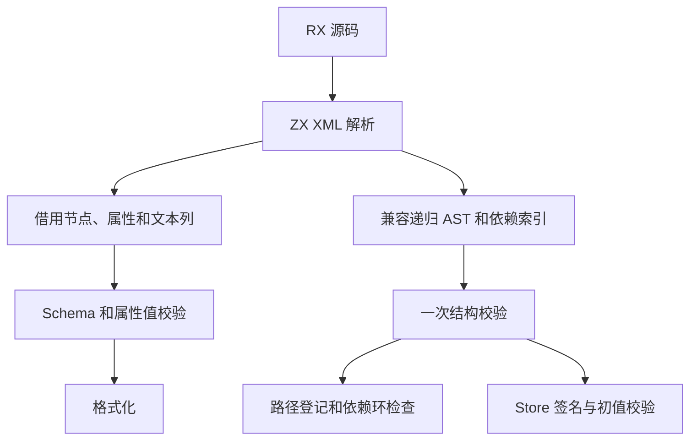
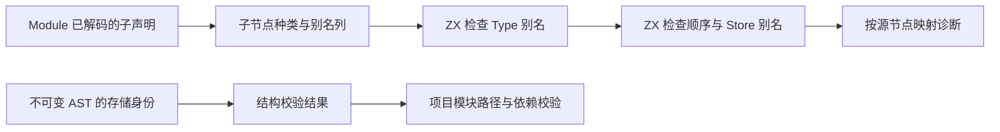

# RX 结构校验与结果复用

## Intent

让普通 RX lint 从 ZX 解析器的语法列完成 Schema、属性表达式和格式化检查。模块装载与自编译用同一份已验证的 AST 时复用结构校验，并将 Module 的 Type、Args 和 Store 声明顺序与别名规则迁入 RX/ZX。独立 Store 入口通过与项目装载相同的类型来源和初值校验。

## Data

普通 lint 原先把 XML 解析列物化为递归 AST，随后读取相同的源码跨度并格式化。借用节点能访问原属性、子节点和文本位置。实体解码一次写入共享缓冲，普通属性值直接借用源码。文件集合按不变的 AST 存储身份复用结构校验，模块路径和包配置仍按每次请求解析。Module 的重复 Type 别名检查优先于顺序错误；Store 别名冲突按遇到的先后报告。

## Edges

- 复用仅适用于成功验证且根节点与底层存储身份一致的普通 Module。手写 AST 仍按原规则校验。路径、包配置及依赖诊断保持当前请求语义。
- 公开 XML AST 和返回类型化 Schema 数据的入口仍可使用。普通 lint 的语法列随解析结果释放，诊断在释放前消费。
- Store 和 Gateway 的完整项目语义仍通过已有编译路径。专用入口检查不创建应用状态。
- Native seed 仍保留初始引导所需的 Module 规则。正式路径保留 Zig Schema 声明与 AST 消费接口。

## Answer

使用原有 RX 结构、依赖、格式化、Store 和安装版集成回归，逐字节对照仓库 RX 的格式化与诊断，集中验收模块装载、别名索引、生成器与冷构建成本。固定源码、工具链、并发与缓存边界进行阶段自编译对照。

### 行为验收

- 最终安装版通过 11,177 项 Zig 检查、76 项项目与库 CLI 场景、52 项格式化 CLI 检查及一项格式化前后的应用运行对照。18 项 RX 语义 lint 全部通过，包含直接 `.store.rx` 入口对错误初值类型的拒绝。
- 对仓库的 1,276 个 RX 文件分别运行 `fmt` 和普通 `lint`。两版的退出码、标准输出和诊断逐字节一致。格式化产生 1,274 个成功和 2 个诊断，普通 lint 产生 614 个成功和 662 个诊断。
- 使用上一阶段 Source stage 3、Zig 0.17.0、ReleaseSmall、12 核和 16 分区生成三代工具。每代通过 22 步。排除工具身份文件后，三代各 10,699 个生成文件逐字节一致。

### 结构校验成本

Type 和 Store 别名以源码顺序登记到已有的 ZX 字节索引。RX 先检查 Type 重复，再运行声明顺序和 Store 别名检查。顺序扫描在首个错误处停止。诊断使用原节点的属性位置。无待检声明的模块无需装配列。宿主在成功时只保存已验证根节点的身份，类型化结构与别名索引的临时分配按校验释放。

借用视图和公开 AST 共用同一套 Schema 声明。属性首先按源顺序确定字段槽，保留未知字段和重复字段的错误顺序。转换继续按 Schema 字段顺序完成。属性角色与空值检查共用一次扫描，遇到后续属性种类错误时仍优先报告种类错误。

前后安装版工具本体均由 Native seed 引导，运行均使用 Source。对同一输入按版本交替测量，格式化和别名专项各九轮，取后八轮中位数。峰值为单进程 RSS。

| 场景                           |           墙钟 / ms |            CPU / ms | 峰值 RSS / MB |
| ------------------------------ | ------------------: | ------------------: | ------------: |
| 4,096 个 Type 别名的普通 lint  |    1,431.30 → 53.12 |    1,429.50 → 51.82 | 15.50 → 14.42 |
| 4,096 个 Store 别名的普通 lint |      363.42 → 54.43 |      361.95 → 53.09 | 15.52 → 14.42 |
| 1,024 条引用的普通 lint        |       11.72 → 11.63 |       10.72 → 10.53 |   6.13 → 5.87 |
| 4,096 个标签的格式化           |       27.78 → 27.85 |       26.61 → 26.74 | 10.21 → 10.29 |
| 1,024 个 ZX 目录入口的混合检查 | 1,295.49 → 1,305.03 | 1,382.05 → 1,391.66 | 97.75 → 97.82 |

两个 Source 对照工具本体均由各自的 Source stage 2 生成，运行均使用 Source 分析和生成。同一份 541 入口清单以新输出目录及空函数缓存交替六轮，舍弃首轮。墙钟中位数 2.52 → 2.54 秒，CPU 11.01 → 11.02 秒，单进程峰值 RSS 866.8 → 870.1 MB。首尾两轮对照的 10,065 份主组产物逐字节一致。

### 完整冷构建

固定 Zig 0.17.0、ReleaseSmall、12 核、四分区和种子 `0x3b41c83f`，关闭常驻生成。本地和全局缓存从空开始。Native seed 引导工具本体，安装版运行 Source 分析与生成。

首轮墙钟为 117.79 秒，较上一阶段的 116.24 秒多 1.55 秒，CPU 为 205.39 秒，较上一阶段多 1.17 秒。采样显示一部分增量在 seed 开始前，另有宿主库编译 CPU 增加。随后在同一次属性扫描中完成字段索引和重复判断，合并属性角色检查与内容扫描，让两种节点视图共用 Module 规则的输入装配，并让 Native seed 复用已解析模块的结构校验。原工作区复测为 117.54 秒、204.82 秒 CPU。

为核对启动波动，在同一份隔离源码目录依次重建前后版本。首次候选测量因磁盘空间不足在宿主库编译中止。清理可再生缓存后重跑候选，成功样本如下，两版各通过 70 步。

| 指标                             | 固定历史基线 | 同目录上一阶段 | 同目录本阶段 |
| -------------------------------- | -----------: | -------------: | -----------: |
| 墙钟 / s（`time -l`）            |            — |         118.74 |       117.54 |
| 进程树采样墙钟 / s               |      129.740 |        118.759 |      117.754 |
| CPU / s                          |       216.03 |         206.24 |       206.01 |
| 进程树峰值 RSS / MB              |      2,247.3 |        2,388.3 |      2,304.3 |
| 单进程峰值 RSS / MB（`time -l`） |      2,075.0 |        2,129.0 |      2,145.1 |

同目录对照墙钟少 1.20 秒，CPU 少 0.23 秒，进程树峰值少 84.0 MB，单进程峰值多 16.0 MB。历史记录使用两分区，作为累计参考。相对它，采样墙钟少 11.99 秒，CPU 少 10.02 秒，树峰仍高 57.0 MB，单进程峰值仍高 70.1 MB。原工作区和同目录对照的候选墙钟均为 117.54 秒。各轮树峰受 LLVM 分区与 Zig 测试的重叠影响，需继续追踪。

自我复核保留两项边界。普通 lint 已直接消费解析列，项目分析仍保留递归 AST，复用的是它已完成的结构校验。DSL 的通用解码与正式入口的传递依赖审计仍有手写 Zig 职责，三代产物一致只覆盖阶段收敛。

回归、性能和阶段日志位于 `.zig-cache/cold-build-analysis/ownership-research/rx-schema-rows/`。冷构建采样位于相邻的 `partition-reference/cold-rx-schema-rows-optimized/`、`partition-reference/cold-rx-schema-paired-baseline/` 和 `partition-reference/cold-rx-schema-paired-candidate-repeat/`。
