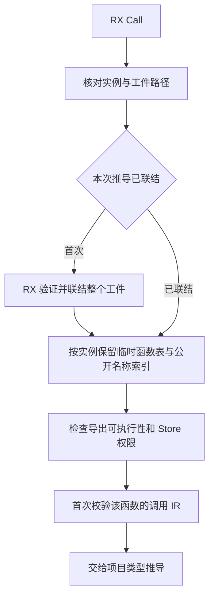
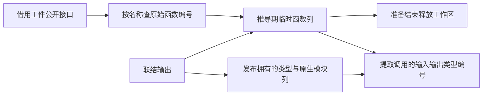

# RX 编译库调用联结复用

## Intent

RX 项目推导对同一编译库实例只验证和联结一次。项目使用编译库的签名与共享上下文，完整应用链接继续按依赖顺序确定正式函数编号。

## Data

原推导逐个 Call 复制共享类型表、验证同一工件、重映射函数和原生模块，并生成仅用于校验的调用 IR。公开别名可能指向同一个函数，原实现仍为每个别名重复执行上述工作。

编译库装载 RX 继续先验证整个外部工件，再联结类型、原生模块和函数。推导请求只发布这些列，复用工件本身的公开名称与函数编号。项目推导在第一次实际调用时联结实例，并在调用处检查所选函数与 Store 权限。

## Edges

- 复用限定在同一次推导与同一已验证的库实例。每次 Call 仍核对包实例、目标工件路径及授权。解析、依赖边和错误顺序由原项目装载过程保持。
- 共享类型和原生模块表在联结中只追加。已有结构匹配优先读取基表，名义身份和原生接口由装载规则保证相容。后续追加保留已联结函数引用的行编号。
- 合成调用按函数编号复用成功校验。同一函数的公开别名只改变接口名称或诊断位置。新的函数仍校验该调用，已验证的函数表可作为既有验证前缀。
- 函数重映射在推导工作区中存活，单次装载和单次校验的临时区各自释放。阶段完成后只保留共享上下文和类型端口。最终链接保持原函数编号顺序。独立编译库调用继续返回完整 Program。

## Answer

核对编译库调用、实例隔离、Store 事务、原生模块、再次发布和增量生成。以同一库的少量和大量调用对照禁用缓存的产物、时间和内存，最后验收完整冷构建与三代 Source 自编译。

### 安装版专项

两版工具本体均由 Native seed 引导，运行使用 Source 分析和生成。以同一份含 256 个公开别名的编译库交替测量七轮，舍弃首轮，应用生成关闭缓存。

| Call 数 |        墙钟 / ms |         CPU / ms | 单进程峰值 RSS / MB |
| ------: | ---------------: | ---------------: | ------------------: |
|       1 |    36.99 → 37.11 |    43.07 → 43.36 |       22.34 → 23.11 |
|      32 |   333.98 → 44.09 |   339.82 → 49.91 |      126.03 → 24.32 |
|     128 | 1,273.70 → 89.09 | 1,278.93 → 95.08 |      455.63 → 29.79 |

每组生成 Zig 逐字节一致，类型接口不可执行和公开路径缺失的诊断也一致。128 次调用的 RSS 降低 425.84 MB，墙钟缩短 1.185 秒。单次调用仍需进行首次完整联结，且有一次推导工作区及公开名称索引的装配成本。

### 完整冷构建

固定 Zig 0.17.0、ReleaseSmall、12 核、四分区和种子 `0x3b41c83f`，关闭常驻生成，本地和全局缓存从空开始。工具本体由 Native seed 引导，安装版使用 Source 分析和生成。70 个构建步骤全部通过。

| 指标                             | 固定历史基线 | 上一阶段 |  本阶段 |
| -------------------------------- | -----------: | -------: | ------: |
| 墙钟 / s（`time -l`）            |            — |   118.16 |  117.18 |
| 进程树采样墙钟 / s               |      129.740 |  118.336 | 117.353 |
| CPU / s                          |       216.03 |   205.62 |  205.03 |
| 进程树峰值 RSS / MB              |      2,247.3 |  2,253.8 | 2,330.9 |
| 单进程峰值 RSS / MB（`time -l`） |      2,075.0 |  2,143.4 | 2,148.5 |

相邻阶段墙钟减少 0.98 秒，CPU 减少 0.59 秒。CPU 距同配置近期低点的差额由 2.45 秒收窄到 1.86 秒。相对固定历史记录，采样墙钟少 12.39 秒，CPU 少 11.00 秒，树峰和单进程峰值仍分别高 83.6 MB 和 73.5 MB。固定历史记录使用两分区。

四个 LLVM 分区对象逐字节一致。树峰增加 77.2 MB，上一阶段峰值出现在四个 LLVM 分区并发时，本阶段峰值是三个分区进程的叠加，其中一个接近退出时的最后采样为 861.2 MB。单轮样本不能把整仓峰值变化归因于编译库联结工作区。

### 正确性与阶段自编译

正式安装版通过 11,318 项 Zig 检查、76 项项目与库 CLI 场景、32 项 Task 输出和执行用例，以及原生库再次发布与 ABI 资源回归。项目与库场景覆盖同一函数的不同公开别名、交错调用不同库实例、Store 事务和初始化器、发布后的独立执行与增量恢复。禁用缓存的 Task 对照中，14 份生成 Zig 与 18 份错误诊断逐字节一致。库清单中存在工件未提供的接口时，两版均返回相同位置的 `MissingPublicModule`。

以上一阶段的 Source stage 3 为起点，用 Zig 0.17.0、ReleaseSmall、12 核及 16 分区生成三代工具。每代通过 22 步，排除工具身份文件后，三代各 10,731 个生成文件逐字节一致。

Source 性能对照的工具本体均由各自的 Source stage 2 生成，运行使用 Source 分析和生成。固定 544 个入口，交替六轮，每轮使用新输出目录和空函数缓存，舍弃首轮。墙钟中位数均为 2.45 秒，CPU 由 11.03 至 11.06 秒，峰值 RSS 由 874.0 至 857.3 MB。首尾两轮的 10,097 个主组产物逐字节一致。

自我复核保留三处边界。首次调用仍完整联结工件，单次调用样本的内存小幅增加。推导与最终链接分别持有各自编号空间，最终链接仍会联结一次库。推导工作区的生命周期、合成调用 IR 的装配和最终链接的记录发布仍由 Zig 宿主处理。三代一致性无法替代正式入口的传递依赖审计。

专项、回归与阶段结果位于 `.zig-cache/cold-build-analysis/ownership-research/rx-library-binding-reuse/`。整仓冷构建采样位于相邻的 `partition-reference/cold-rx-library-binding-reuse/`。
