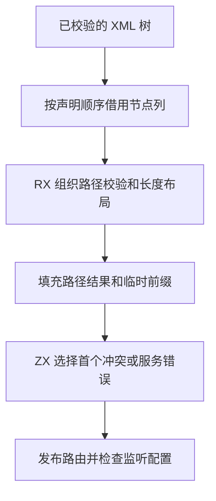

# RX 网关路由分析自举

## Intent

将 Gateway 的字面路径、Group 前缀布局、HTTP 方法冲突和监听端口规则迁入 RX/ZX。按原声明顺序发布路由和诊断。

## Data

原实现递归扩展路径，在同一次遍历中校验字面路径、方法冲突和服务引用。Group 路径会在每层复制父前缀，并一直保留在结果 arena。

## Edges

- 保留百分号转义、尾斜线、Group 前缀和 HTTP 方法通配规则。路径、方法冲突与服务错误按源位置选择，同一路由按原有校验顺序选择。
- 完整路由拥有路径和服务字符串，Group 临时前缀及索引在分析完成后释放。
- Zig 保留 XML 列投影、字节写入、通用模块路径适配和平台 IP 地址解析。初始 seed 保留等价规则。

## Answer

核对真实 Gateway 项目的生成结果、诊断顺序、运行边界及分配失败。对照冷构建和受影响的路由分析成本。

### 源码收集与依赖复用

首版在 8,192 条路由上，安装版 `check-rx --entry` 增加约 1.6 毫秒。调用链显示 Gateway 在收集依赖时重复解码 Schema 和解析服务路径，构建阶段还会重新执行路由分析。源码收集阶段现用已校验的属性生成路由表，以规范化的服务路径收集依赖，并将独立持有的路由分析结果交给构建阶段。分析失败仍在打开依赖文件前报告。其他协议仍沿用既有依赖检查和执行诊断顺序。

### 验收

- Native seed 和既有 Source stage 3 均成功生成路径布局、冲突与监听限制三个入口，各输出 26 个文件。
- 复用冷构建中的生成模块、导入配置和分区对象，直接运行既有 Gateway 分析测试。9 项路由、35 项校验和 4 项分配失败检查通过。最终安装版通过 86 项 Gateway HTTP 检查和 11 项 RX CLI 检查。
- 两个安装版对照 3 个现有 Gateway 项目，54 份生成 Zig 逐字节一致。使用既有校验用例对照 `check-rx --entry`，32 项返回码和输出一致，其中 27 项触发 Gateway 分析诊断。

### 专项与冷构建

同一项目路径、同一服务模块，按版本交替执行 `check-rx --entry` 九轮，取后八轮中位数。使用嵌套 Group 和不同 URL 扩大路由表，范围包含源码收集及依赖检查。

| 路由数 |       墙钟 / ms |        CPU / ms | 单进程峰值 RSS / MB |
| -----: | --------------: | --------------: | ------------------: |
|      1 |     4.39 → 4.45 |     3.19 → 3.11 |         5.95 → 6.11 |
|  1,024 |   17.84 → 17.28 |   16.71 → 16.22 |       12.03 → 12.17 |
|  8,192 | 122.10 → 118.45 | 120.91 → 117.23 |       53.56 → 53.40 |

Zig 0.17.0、ReleaseSmall、12 核、四分区，种子 `0x3b41c83f`。关闭常驻生成，从空的本地和全局缓存开始。Native seed 引导工具本体，安装版运行 Source 分析和生成。三次冷构建均通过 70 步。

| 版本             | 墙钟 / s | CPU / s | 进程树峰值 RSS / MB | 单进程峰值 RSS / MB |
| ---------------- | -------: | ------: | ------------------: | ------------------: |
| 上一阶段         |   117.50 |  205.02 |             2,325.9 |             2,137.2 |
| 路由分析迁移     |   116.07 |  203.57 |             2,315.8 |             2,126.2 |
| 复用源码收集结果 |   117.18 |  204.20 |             2,345.5 |             2,121.5 |

最终版较上一阶段少 0.32 秒墙钟、0.82 秒 CPU 和 15.7 MB 单进程峰值，进程树峰值多 19.6 MB。最终峰值时四个 LLVM 分区与约 475 MB 的 `zig test` 重叠。上一阶段峰值时有三个 LLVM 分区。相对固定历史基线，进程树采样墙钟少 12.52 秒，CPU 少 11.83 秒，进程树峰值多 98.2 MB。

生成、诊断、性能和回归日志位于 `.zig-cache/cold-build-analysis/ownership-research/rx-gateway-routing/`。冷构建日志、进程采样与分区哈希位于相邻的 `partition-reference/cold-rx-gateway-routing*`。
