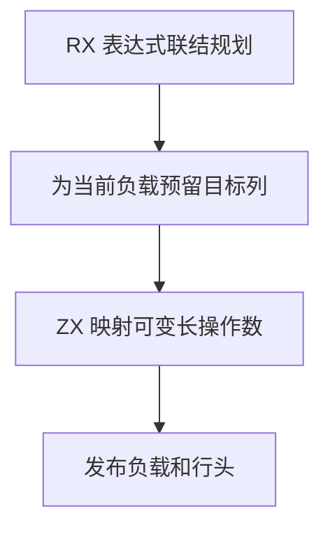

# RX 聚合表达式负载联结自举

## Intent

把 RX 联结中可变长表达式负载的引用重映射迁入 ZX，并直接写入最终 IR 列。覆盖列表、元组、模板、集合操作、转换参数、作用域绑定、Match 和对象。

## Data

源 IR 使用列式布局，旧联结先构造临时 ID 或记录数组，再由表达式存储逐项追加到最终列。上一阶段已提供连续的表达式编号、环境绑定映射和局部符号编号区间。

## Edges

- 引用必须指向当前行之前的保留表达式。缺失的环境符号仍拒绝联结，可空符号保持原值。
- 现有 `loop` 对无增长头的宿主切片执行续接复制。新增 `std:memory` 定长整数写入，借用调用方独占的可写切片，复用 Zig 原有元素布局。ZX 决定写入顺序和映射值，写入接口只检查目标下标。
- 预留容量与发布列长度仍由 Zig 存储层负责。发生错误时当前行和负载的可见长度均保持原值。
- 单值及固定宽度负载的装配在本阶段继续使用原路径。Native seed 保留同样的联结语义。

## Answer

Native 和 Source stage 3 分别生成映射规则。通过零容量分配器验证直接写入目标子区间，覆盖跳过行、无效表达式、目标越界、普通符号、连续局部编号及可空符号。左右边界的哨兵值保持原样。

集中回归通过 111 个构建步骤和 319 项 Zig 测试。32 项 Task CLI 用例及 Store、真实项目、混合库检查全部通过。对照两个安装版，45 个项目中的 23 份生成 Zig 和 22 份预期失败诊断逐字节一致。

安装版在无编译缓存下交替执行七轮，取后六轮的中位数。

| 项目                     |          墙钟 / s |           CPU / s |
| ------------------------ | ----------------: | ----------------: |
| 稀疏环境，两次生成       | 0.12732 → 0.12738 | 0.13342 → 0.13345 |
| 密集环境，两次生成       | 0.18790 → 0.18887 | 0.19441 → 0.19447 |
| 并行对象输出，十二次生成 | 0.06001 → 0.06032 | 0.06042 → 0.06055 |
| 384 个连续任务，两次生成 | 0.63336 → 0.63117 | 0.63026 → 0.62710 |

### 冷构建

沿用 Zig 0.17.0、ReleaseSmall、12 核、四分区及构建种子 `0x3b41c83f`，关闭常驻生成，本地及全局缓存为空。Native seed 引导工具本体，安装版执行 Source 分析与生成。

| 指标                             | 固定历史基线 | 上一阶段两次均值 |  本阶段 |
| -------------------------------- | -----------: | ---------------: | ------: |
| 墙钟 / s（`time -l`）            |            — |           116.82 |  116.40 |
| 进程树采样墙钟 / s               |      129.740 |          116.993 | 116.413 |
| CPU / s                          |       216.03 |           209.14 |  209.46 |
| 进程树峰值 RSS / MB              |      2,247.3 |          2,318.6 | 2,291.8 |
| 单进程峰值 RSS / MB（`time -l`） |      2,075.0 |          2,112.0 | 2,120.9 |

冷构建通过 70 步。相对上一阶段两次均值，墙钟少 0.42 秒，CPU 多 0.33 秒，树峰值少 26.8 MB。相对固定历史基线，采样墙钟少 13.33 秒，CPU 少 6.57 秒，树峰值多 44.5 MB。

CPU 相对近期 206.33 秒样本高 3.13 秒，超过累计观察线。相对该样本，采样 CPU 在分区 3 增加约 1.08 秒，在分区 0、1、2 合计增加约 0.94 秒。相对上一阶段的对象哈希，前三个分区逐字节一致，分区 3 增加 2,080 字节。下一阶段需要区分分区 3 的持续增长和其他进程的波动。

探针、回归及安装版对照日志保存在 `.zig-cache/cold-build-analysis/ownership-research/rx-link-operands/`。冷构建采样和对象哈希保存在相邻的 `partition-reference/cold-rx-link-operands/`。
