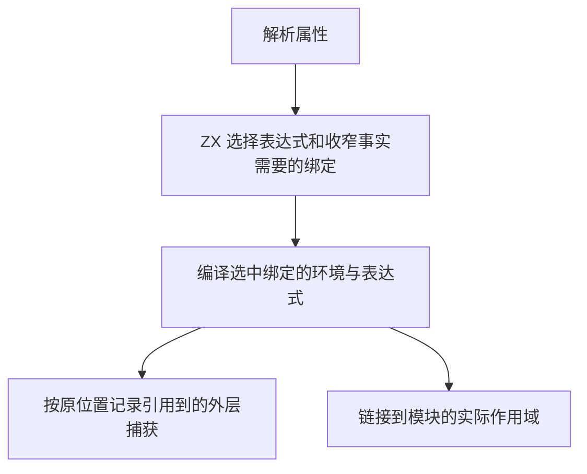
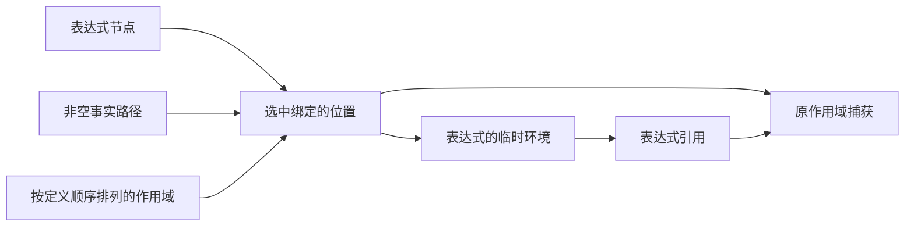

# RX 表达式环境自举

## Intent

表达式分析按需构造 RX 环境，在 ZX 中选择需要进入临时程序的绑定，并将临时符号映射回原作用域的捕获位置。控制表、求值顺序和公开接口保持一致。

## Data

每个 RX 表达式原先以完整可见作用域构造一个元组输入，再为所有绑定创建投影。随着顺序 Task 的结果增加，同一个模块保留不同长度的临时环境类型。表达式的暂存和发布结果也使用同一个父 arena，发布期间的分配会阻止暂存区及时回收。

## Edges

- 只缩减 RX 已验证作用域中的具体表达式环境。普通 ZX 表达式 API 保留其输入和诊断契约。
- 保留引用路径的任一完整绑定前缀，以及所有现有非空事实需要的绑定。选中位置按原定义顺序排列。
- 捕获由实际 IR 引用决定。临时符号编号先映射回原作用域位置，保留嵌套 Task 和本地符号边界。
- 临时分配沿用调用方的分配器，生命周期独立于表达式发布的结果。Native seed 保留等价语义以支持引导。
- 零个或一个可见绑定时直接借用现有作用域。Zig 宿主负责分配器、解析结果的所有权和绑定表投影。

## Answer

单独调整暂存分配器的探针中，256 个相互依赖的顺序 Task 从 1,030.9 MB 峰值 RSS 降至 88.5 MB。32、64、128、256 个 Task 的生成 Zig 分别与基线逐字节一致。环境缩减会改变内部类型和符号编号，因此需要通过链接、运行和诊断回归验证。

集中回归通过 118 个构建步骤和 427 项 Zig 测试，覆盖类型推导、Parallel 捕获、Task、属性、Store、项目 CLI 和混合库。独立表达式绑定 API 的 40 项测试也通过。Native seed 与 Source stage 3 生成的规则均通过直接探针，覆盖连续和非连续路径、完整路径段、仅被事实引用的绑定，以及捕获位置到本地符号的边界。捕获标记使用零容量分配器原地更新。

两个安装版对照 61 个项目。28 个错误诊断逐字节一致，33 个成功项目均能生成 Zig，其中 14 份逐字节一致，19 份改变了环境类型或符号编号。对长 Task 链、收窄捕获、靠前的 Default、对象字段事实和字符串标签五个项目构建并执行，两版结果相同。

### 运行成本

安装版关闭缓存，交替运行七轮，取后六轮中位数。墙钟和 CPU 按每次生成计算。单次峰值 RSS 以独立进程测量。

| 项目                      |    生成墙钟 / s |         CPU / s |    峰值 RSS / MB |
| ------------------------- | --------------: | --------------: | ---------------: |
| 256 个相互依赖的顺序 Task | 0.7981 → 0.4287 | 0.7980 → 0.4282 | 1,030.13 → 28.73 |
| 256 个独立的顺序 Task     | 0.1516 → 0.1497 | 0.1513 → 0.1494 |    34.08 → 23.07 |
| 384 个整数 Switch 分支    | 0.0744 → 0.0731 | 0.0741 → 0.0727 |    46.30 → 16.34 |
| 密集捕获环境              | 0.0926 → 0.0917 | 0.0960 → 0.0951 |    36.09 → 24.96 |

256 个相互依赖的 Task 的生成 Zig 从 436,579 降到 27,667 字节，生成的 `zx_type_*` 声明从 257 个降到 1 个。四种独立 Task 规模的生成文件大小与基线一致。

### 冷构建

固定 Zig 0.17.0、ReleaseSmall、12 核、四分区和构建种子 `0x3b41c83f`，关闭常驻生成，本地与全局缓存从空开始。Native seed 引导工具本体，安装版执行 Source 分析和生成。

| 指标                             | 固定历史基线 | 上一阶段 |  本阶段 |
| -------------------------------- | -----------: | -------: | ------: |
| 墙钟 / s（`time -l`）            |            — |   116.44 |  116.52 |
| 进程树采样墙钟 / s               |      129.740 |  116.575 | 116.617 |
| CPU / s                          |       216.03 |   208.21 |  209.16 |
| 进程树峰值 RSS / MB              |      2,247.3 |  2,317.0 | 2,226.9 |
| 单进程峰值 RSS / MB（`time -l`） |      2,075.0 |  2,114.4 | 2,118.3 |

冷构建通过 70 步。较上一阶段，墙钟多 0.08 秒，CPU 多 0.95 秒，进程树峰值少 90.1 MB，单进程峰值多 3.8 MB。CPU 较近期低点高 2.83 秒，接近累计观察阈值。第二、第三个分区对象逐字节一致，其余两个共增加 1,352 字节。引导生成的分析、生成和写入分别为 678、723、343 毫秒，上阶段为 700、728、485 毫秒。

探针、回归、安装版对照和运行日志位于 `.zig-cache/cold-build-analysis/ownership-research/rx-expression-scope/`，完整冷构建采样和分区哈希位于相邻的 `partition-reference/cold-rx-expression-scope/`。
