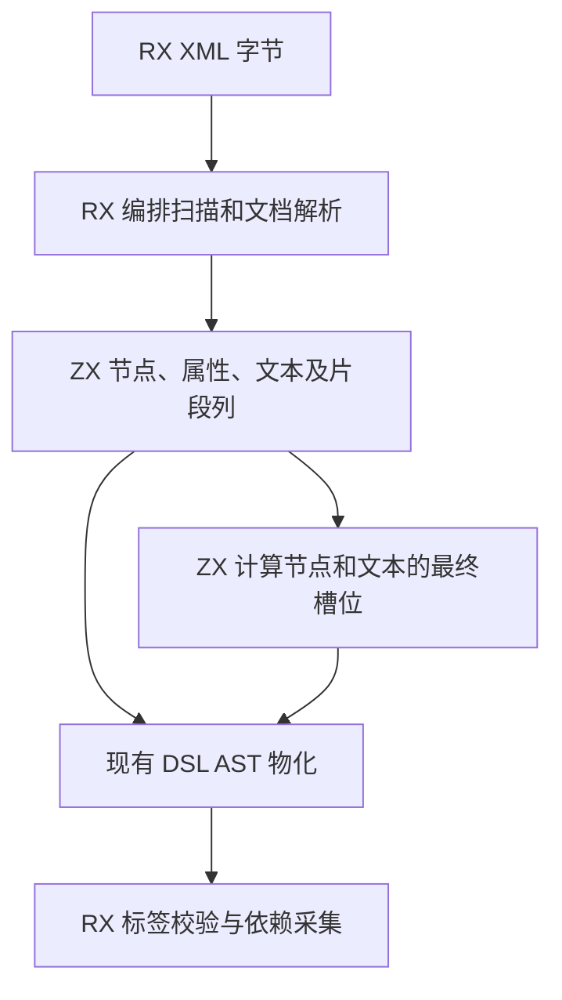
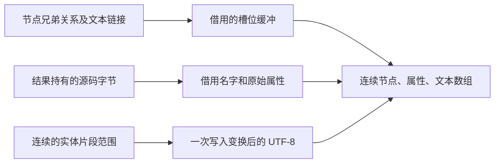

# RX 语法树布局自举

## Intent

由 ZX 决定 RX XML 节点、属性和文本的存储布局。保持公开 AST 的兄弟顺序、位置和字节生命周期，同时减少解析和输出阶段的中间记录。

## Data

原解析器为每条父子关系追加单独的记录。属性和实体片段在输入中连续，仍在每条记录中保存前驱。宿主逐节点追踪这些链接，在临时数组装配每个节点，再把整个节点描述符复制到父节点的子数组。

父节点已有最近完成的子节点编号。打开下一个子节点时，把这个编号存到新节点的兄弟字段即可。属性和实体片段用起点或尾端及计数表示连续范围。ZX 从根编号及节点列建立子节点和文本的最终槽位，直接写入调用方的定长索引列。宿主一次分配节点、属性和文本各自的最终数组，在最终位置初始化每个节点。

## Edges

- 保留源位置、混合文本顺序、嵌套深度限制和先前的 XML 诊断行为。公开 DSL AST 仍可独立于调用方传入的源码缓冲存活。
- 槽位计算使用标准库定长可写缓冲，借用已有的解析列和两个索引切片。索引与现有解析列同为 64 位。
- Zig 适配层仍负责公开递归 AST 类型的存储和 UTF-8 变换片段写入。ZX 当前禁止递归类型别名。初始 seed 继续使用原生 XML 解析器。

## Answer

核对生成的布局入口可在零容量分配器下写入槽位。集中运行已有 XML、RX 表达式位置、图、项目、Store 及 CLI 回归。对照安装版的 XML 路径成本、产物和完整冷构建，并验证 Source 自编译阶段。

### 安装版对照

对含 4,096 条 Import 的相同工程，分别使用普通属性与包含数字实体的属性。显式文件集与磁盘入口各交替运行十一轮，舍弃首轮。墙钟包含相同的进程启动与 `time -l` 包装成本。解析列布局通过零容量分配器执行，生成代码直接读取节点与文本列并写入索引。

| 属性与入口       | 墙钟中位数 / ms | 峰值 RSS / MB |   退役指令 / 百万 |
| ---------------- | --------------: | ------------: | ----------------: |
| 普通，显式文件集 |   28.99 → 26.19 | 15.20 → 13.80 |   692.18 → 625.35 |
| 普通，磁盘入口   |   59.70 → 54.10 | 37.09 → 34.87 | 1455.00 → 1321.71 |
| 实体，显式文件集 |   30.93 → 27.88 | 16.24 → 14.68 |   743.77 → 667.69 |
| 实体，磁盘入口   |   63.78 → 57.81 | 39.70 → 38.13 | 1560.01 → 1408.42 |

四组库发布的 53 份生成文件逐字节一致，墙钟中位数变化为 −0.40 至 +0.26 ms。闭包和原生项目恢复缓存与禁用缓存的产物一致。每轮 24 次热恢复的墙钟中位数为 0.1198 → 0.1200 秒，CPU 为 0.1195 → 0.1194 秒。

集中回归通过 10,851 项 Zig 检查和 37 项 CLI 场景。Zig 检查包含 10,446 项既有合成图，以及 XML 实体、CRLF、源码缓冲生命周期、256 层嵌套、1,024 个兄弟节点、RX 表达式位置和分配失败回归。12 份直接链接生成物逐字节一致。独立回归脚本首次遗漏 XML 表达式测试的 `rx_compiler` 导入别名，补上与正式测试构建相同的别名后，继续执行剩余测试并复用此前已通过的结果。

### 三阶段自编译

旧 Source 工具内置的标准库目录没有 `U64Buffer`。完整 Source 预检用临时原生接口映射验证借用 ABI。正式自编译使用本次冷构建的 Native seed，其标准库目录包含新接口。固定 Zig 0.17.0、ReleaseSmall、12 核和 16 分区，三个阶段各通过 22 步，排除工具身份文件后，stage 2 与 stage 3 的 10,658 份生成文件逐字节一致。stage 1 由 Native seed 生成，与 stage 2 有 1,328 份文件差异。

前后工具本体均由各自的 Source stage 2 生成，运行时均使用 Source 分析和生成。对旧工具也可执行的 534 个共同入口，使用新输出目录与空函数缓存交替六轮，舍弃首轮。生成墙钟中位数为 2.56 → 2.59 秒，CPU 为 10.94 → 10.93 秒，单进程峰值 RSS 为 868.4 → 864.9 MB。首尾轮次有 10,015 份文件逐字节一致。另两份文件的差异为 `types.zig` 中新增的定长缓冲接口，以及 `.zxc-files` 中对应的哈希。

### 完整冷构建

固定 Zig 0.17.0、ReleaseSmall、12 核、四分区与种子 `0x3b41c83f`，关闭常驻生成，本地和全局缓存从空开始。工具本体由 Native seed 引导，安装版运行 Source 分析和生成。70 步全部通过。

| 指标                             | 固定历史基线 | 上一阶段 |  本阶段 |
| -------------------------------- | -----------: | -------: | ------: |
| 墙钟 / s（`time -l`）            |            — |   118.24 |  117.93 |
| 进程树采样墙钟 / s               |      129.740 |  118.370 | 118.106 |
| CPU / s                          |       216.03 |   204.11 |  203.76 |
| 进程树峰值 RSS / MB              |      2,247.3 |  2,251.2 | 2,312.6 |
| 单进程峰值 RSS / MB（`time -l`） |      2,075.0 |  2,135.4 | 2,129.1 |

较上一阶段，墙钟减少 0.31 秒，CPU 减少 0.35 秒，进程树峰值增加 61.4 MB，单进程峰值减少 6.3 MB。较固定历史基线，采样墙钟减少 11.63 秒，CPU 减少 12.27 秒，树峰和单进程峰值分别高 65.3 MB 和 54.1 MB。

两轮树峰都出现在 LLVM 分区 0、1、2 的后段重叠。分区 0、1 的目标文件逐字节一致，分区 1 的同阶段 RSS 增加约 48.6 MB，占树峰差异的大部分。分区 2、3 目标文件分别减少 880 字节与增加 528 字节。改动对冷构建树峰的独立贡献仍未确定。

回归、专项与 Source 对照记录位于 `.zig-cache/cold-build-analysis/ownership-research/rx-xml-projection/`，冷构建和进程采样位于相邻的 `partition-reference/cold-rx-xml-projection/`。
