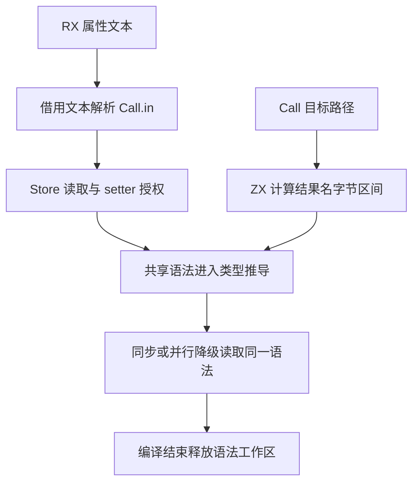
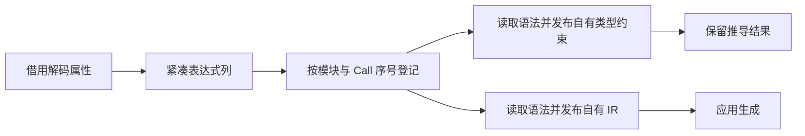

# RX 调用输入语法复用与结果名自举

## Intent

让 RX 的 Store 授权、类型推导和降级复用同一次 Call.in 解析，并将调用结果名的路径截取规则迁入 ZX。保留源码位置、授权顺序、类型诊断和生成结果。

## Data

原实现为每个显式 Call.in 分别解析并检查值语法三次。RX 已持有解码后的不可变属性和文件名，表达式解析器已经支持紧凑的语法快照。项目使用借用源码的解析入口，只在本次推导和降级期间保留快照。

结果名规则按最后一个正斜线或反斜线定位路径段，只去掉已知后缀。ZX 计算字节区间，宿主直接借用属性字节。现有标识符和可见作用域校验在原位置执行。

降级阶段已经拥有符号和表达式的源码位置列。直接在这些独占列上转换 XML 属性内偏移，移除原来重复分配的四列。未命中调用语法工作区的普通值使用独立临时分配器，发布的 IR 继续拥有其文本和表列。

## Edges

- Call.in 的语法诊断仍早于当前 Call 的 setter 和目标诊断。Store 授权与推导对同一属性读取同一解析结果。
- 工作区与本次编译绑定，历史记录保留推导结果。只复用历史 Frame 或由简写合成参数时，首次实际需要该语法的消费者继续调用原解析入口。
- 约束的字段名与降级的 IR 文本各自拥有。并行降级工作者只读发布的行，所有工作者结束后释放工作区。
- 结果名保留 `.zx`、`.rx`、`.zig` 后缀和两种目录分隔符的原规则。原生 seed 保留对应的兼容实现。

## Answer

在 Call 输入密集的宽分支和普通小模块中对照禁用缓存的生成结果、耗时与 RSS。复用现有 Store、Task、并行、增量和诊断位置回归，集中核对完整冷构建和三代 Source 自编译。

### 安装版专项

前后工具均由 Native seed 引导，运行使用 Source 分析和生成。每个 Call 输入包含对象、列表与算术表达式。初版配对在相同输入交替七轮，舍弃首轮，关闭应用生成缓存。

| 场景                        |             墙钟 / ms |              CPU / ms | 单进程峰值 RSS / MB |
| --------------------------- | --------------------: | --------------------: | ------------------: |
| 单次 Call                   |           6.95 → 6.93 |           6.48 → 6.30 |         9.27 → 9.22 |
| 256 分支，每分支一次 Call   |   1,288.47 → 1,217.87 |   1,286.20 → 1,216.43 |     122.76 → 113.98 |
| 1,024 分支，每分支一次 Call | 16,939.55 → 16,621.83 | 16,931.97 → 16,614.21 | 1,036.40 → 1,033.16 |

三组生成 Zig 逐字节一致。将普通函数调用置于 Call.in 时，两版的诊断内容与位置也逐字节一致。1,024 分支样本仍有约 16.6 秒墙钟，当前复用消除的解析开销仅占其中一部分。

优化版在单次 Call 和 256 分支输入上交替五轮，舍弃首轮。单次 Call 墙钟 6.29 → 6.00 毫秒，峰值 RSS 9.24 → 9.35 MB。256 分支墙钟 1,287.67 → 1,233.03 毫秒，CPU 1,286.22 → 1,231.79 毫秒，峰值 RSS 122.77 → 113.25 MB。1,024 分支只执行一组前后生成对照，生成 Zig 仍逐字节一致，峰值 RSS 为 1,036.4 → 1,033.2 MB。

### 完整冷构建

固定 Zig 0.17.0、ReleaseSmall、12 核、四分区和种子 `0x3b41c83f`，关闭常驻生成，从空本地和全局缓存开始。工具本体由 Native seed 引导，安装版执行 Source 分析和生成。

首轮候选通过 70 步，墙钟 117.79 秒、CPU 206.29 秒，较上一阶段分别多 1.63 秒和 1.34 秒。seed 编译启动时刻由 35.78 秒变为 37.31 秒，之后到结束的时长由 80.38 变为 80.48 秒。四个 LLVM 分区目标文件逐字节一致。首轮 CPU 距同配置近期低点 3.12 秒，触发累计观察线，需要隔离负载复测。

第二轮同源码通过 70 步，墙钟 120.27 秒、CPU 209.24 秒。四个 LLVM 分区对象与首轮逐字节一致，seed 编译启动时刻为 38.77 秒。同一源码两轮墙钟相差 2.48 秒，CPU 相差 2.95 秒。随后使用同一隔离源码目录，依次还原上阶段和本阶段输入，分别清空缓存构建。

同目录首次配对的基线为 117.82 秒墙钟及 207.44 秒 CPU，候选为 119.18 秒及 209.96 秒，仍超阈值。候选在 seed 启动前已有 0.96 秒墙钟差。保留迁移并优化位置列和临时解析分配，随后在同一目录验证。

| 指标                             | 固定历史基线 | 同目录上阶段 | 同目录初版 | 同目录优化版 |
| -------------------------------- | -----------: | -----------: | ---------: | -----------: |
| 墙钟 / s（`time -l`）            |            — |       117.82 |     119.18 |       117.71 |
| 进程树采样墙钟 / s               |      129.740 |      117.849 |    119.222 |      117.919 |
| CPU / s                          |       216.03 |       207.44 |     209.96 |       208.61 |
| 进程树峰值 RSS / MB              |      2,247.3 |      2,328.7 |    2,357.0 |      2,320.4 |
| 单进程峰值 RSS / MB（`time -l`） |      2,075.0 |      2,088.6 |    2,140.2 |      2,149.2 |

优化版较同目录上阶段墙钟少 0.11 秒，CPU 多 1.17 秒，树峰少 8.4 MB。按照墙钟稳定时可接受小幅 CPU 增加的规则收口。单进程峰值多 60.6 MB，出现在 Zig 编译宿主库的进程。前三个 LLVM 分区目标文件逐字节一致，第四个增加 792 字节。两版的树峰都包含四个 LLVM 分区与 Zig 检查重叠。

相对两分区的固定历史记录，优化版采样墙钟少 11.82 秒、CPU 少 7.42 秒、树峰多 73.1 MB。原工作区同配置的近期 CPU 低点为 203.17 秒，同目录基线本身已高 4.27 秒，优化版高 5.44 秒。后两项包含测量目录与当时负载差异，累计 CPU 和宿主进程内存仍需追踪。

### 正确性与阶段自编译

初版与优化版安装工具均通过 11,318 项 Zig 检查、76 项项目与库 CLI 场景和 32 项 Task 输出及执行用例。覆盖同步和并行推导、Store 读写授权、不同调用目标、作用域错误、XML 实体对应位置、增量与分配失败。32 项 Task 在关闭缓存的前后对照中，14 份生成 Zig 和 18 份错误诊断逐字节一致。

以上一阶段 Source stage 3 为起点，用 Zig 0.17.0、ReleaseSmall、12 核和 16 分区生成三代工具，每代通过 22 步。排除工具身份文件后，每代的 10,736 个生成文件逐字节一致。优化版 stage 1 的四组辅助产物命中同一生成缓存，按编译响应文件中的实际目录纳入比较。

Source 性能工具分别由各自的 Source stage 2 生成，运行使用 Source 分析和生成。固定 545 个入口，使用空函数缓存和新输出目录交替六轮，舍弃首轮。初版配对的墙钟中位数 2.45 → 2.44 秒，CPU 11.03 → 11.00 秒，峰值 RSS 864.4 → 862.8 MB。优化版配对的墙钟 2.54 → 2.55 秒，CPU 11.07 → 11.08 秒，峰值 RSS 867.6 → 850.2 MB。两组配对首尾轮次的 10,102 个主组产物逐字节一致。

自我复核的边界包括 Zig 持有的解析工作区和约束图、简写的按需解析，以及尚待完成的正式入口依赖闭包审计。宽分支的端到端成本仍需按编译阶段定位。

专项、回归与阶段对照位于 `.zig-cache/cold-build-analysis/ownership-research/rx-call-inputs/`。冷构建与采样位于相邻的 `partition-reference/`。
