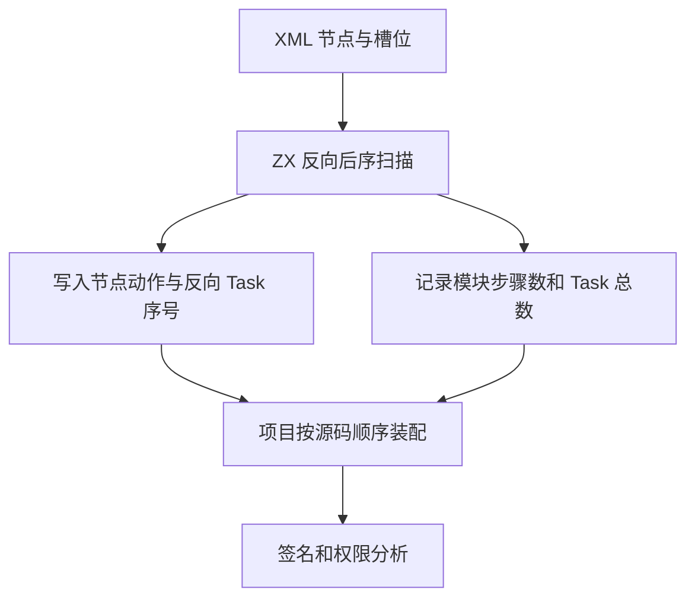
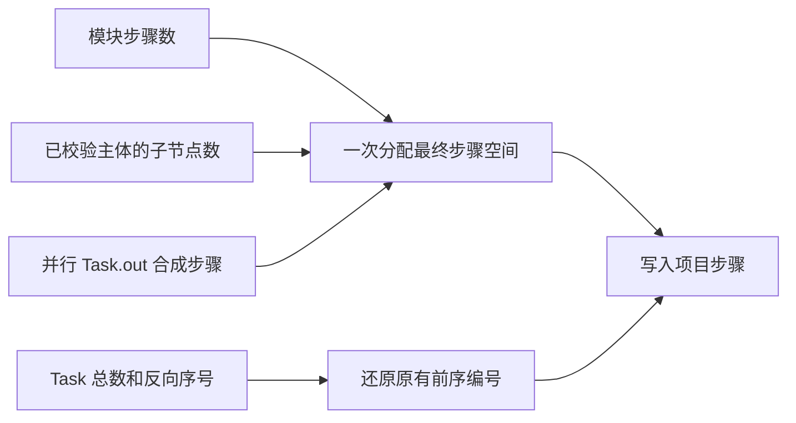

# RX 项目步骤定容与并行编号自举

## Intent

由 ZX 在已有 XML 后序扫描中确定项目执行动作、模块步骤数和并行 Task 编号。项目装载使用确切容量直接装配步骤，保留调用签名、权限和诊断在源码中的执行顺序。

## Data

旧装载逐步重新识别标签，并为每个主体动态扩容。并行 Task 按左到右的深度优先前序编号，先编号父 Task 再准备其嵌套主体。现有 XML 引用扫描先访问右侧兄弟并在子节点之后处理父节点，恰好提供反向前序。仅直接属于 Parallel 的 Task 参与编号。

## Edges

- 模块容量排除声明，嵌套主体容量来自 Schema 已验证的执行子节点数。并行 Task 的 `out` 存在时为合成 Return 预留一个位置。
- 动作和反向序号复用原有每节点 32 位事实字。序号列超出 24 位表示范围的输入仍可按兼容路径编号，手写 AST 和初始 seed 同样保留兼容路径。
- 候选的语法和诊断顺序不变。静态布局只提供索引、容量和动作。签名、权限及 Task 输出冲突仍在项目装载访问相应节点时检查。
- AST、源码和属性继续由原解析结果持有。步骤装配借用已有数据，Zig 宿主负责与签名、Store 权限及后续分析连接。

## Answer

对照既有 Task 运行、项目分析、输出字节和诊断，测量宽分支及磁盘装载成本，并用固定配置验证冷构建和连续三代 Source 产物。

### 安装版专项

前后安装版均由 Native seed 引导，运行使用 Source。前后版本交替运行，舍弃首轮。候选使用已有构建缓存安装，以下是工具执行成本。完整冷构建另以空缓存测量。

| 场景                           |       墙钟 / ms | 单进程峰值 RSS / MB |
| ------------------------------ | --------------: | ------------------: |
| 4,096 个 Case 的结构检查       |   21.43 → 21.14 |       15.97 → 15.97 |
| 256 个 Case 的无缓存项目生成   |   37.19 → 37.18 |       13.50 → 13.43 |
| 1,024 个 Case 的无缓存项目生成 | 138.64 → 138.71 |       29.67 → 29.39 |
| 4,096 条复杂导入的磁盘装载     |   55.09 → 54.89 |       18.17 → 18.19 |
| 4,096 个独立模块登记           |   61.68 → 61.84 |       49.66 → 49.66 |

256 和 1,024 分支的生成 Zig 在所有对照中逐字节一致。1,024 分支的 CPU 中位数为 137.981 → 137.967 毫秒。

### 完整冷构建

固定 Zig 0.17.0、ReleaseSmall、12 核、四分区和种子 `0x3b41c83f`，关闭常驻生成，从空本地及全局缓存开始。Native seed 引导工具本体，安装版运行 Source 分析和生成。候选通过全部 70 步。

| 指标                             | 固定历史基线 | 上一阶段 |  本阶段 |
| -------------------------------- | -----------: | -------: | ------: |
| 墙钟 / s（`time -l`）            |            — |   116.69 |  117.42 |
| 进程树采样墙钟 / s               |      129.740 |  116.775 | 117.472 |
| CPU / s                          |       216.03 |   204.14 |  204.97 |
| 进程树峰值 RSS / MB              |      2,247.3 |  2,332.0 | 2,340.2 |
| 单进程峰值 RSS / MB（`time -l`） |      2,075.0 |  2,157.9 | 2,160.6 |

相邻两阶段墙钟增加 0.73 秒，CPU 增加 0.83 秒，进程树峰值增加 8.2 MB，单进程峰值增加 2.7 MB。固定历史记录使用两分区，作为累计参考。相对它，采样墙钟少 12.27 秒，CPU 少 11.06 秒，进程树和单进程峰值仍高 92.9 MB 和 85.6 MB。相对同配置近期 CPU 低点 203.17 秒，本阶段差额为 1.80 秒。

分离 LLVM 分区统计时，分区进程 RSS 合计峰值为 2,303.8 → 2,236.3 MB。上一阶段树峰时有三个 LLVM 分区。本阶段树峰时有四个分区和约 474.6 MB 的 Zig 检查进程重叠，树峰差额不能直接归于步骤分配。

### 回归和阶段一致性

最终安装版通过 11,318 项 Zig 检查，含 105 项并行推导与 36 项 Task 输出检查。76 项项目与库 CLI 场景、32 项 Task 输出和运行用例、52 项格式化检查、一项应用运行对照及 18 项 RX 语义 lint 全部通过。

对 32 份现有 Task 夹具逐一禁用缓存生成，14 份生成 Zig 与 18 个错误诊断逐字节一致。仓库 1,278 个 RX 文件的格式化和普通 lint 退出码、输出和诊断逐字节一致。

使用上一阶段 Source stage 3、Zig 0.17.0、ReleaseSmall、12 核和 16 分区生成三代工具。每代通过 22 步。排除工具身份文件后，三代各 10,727 个生成文件逐字节一致。

两个 Source 对照工具本体均由各自的 Source stage 2 生成，运行均使用 Source。对同一 543 入口清单交替六轮，每轮使用空函数缓存与新输出目录，舍弃首轮。墙钟中位数 3.52 → 3.47 秒，CPU 11.29 → 11.33 秒，单进程峰值 RSS 869.4 → 862.7 MB。首尾两轮的 10,093 份主组产物逐字节一致。

自我复核保留两项边界。生成规则已决定索引项目的动作、步骤容量和并行编号，Zig 宿主仍分配和填写步骤记录，并处理签名、类型、权限及诊断。整仓树峰、单进程峰值与固定历史记录仍有差距，后续要继续按具体进程定位。

回归、性能和阶段对照记录位于 `.zig-cache/cold-build-analysis/ownership-research/rx-project-placement/`。完整冷构建采样位于相邻的 `partition-reference/cold-rx-project-placement/`。
