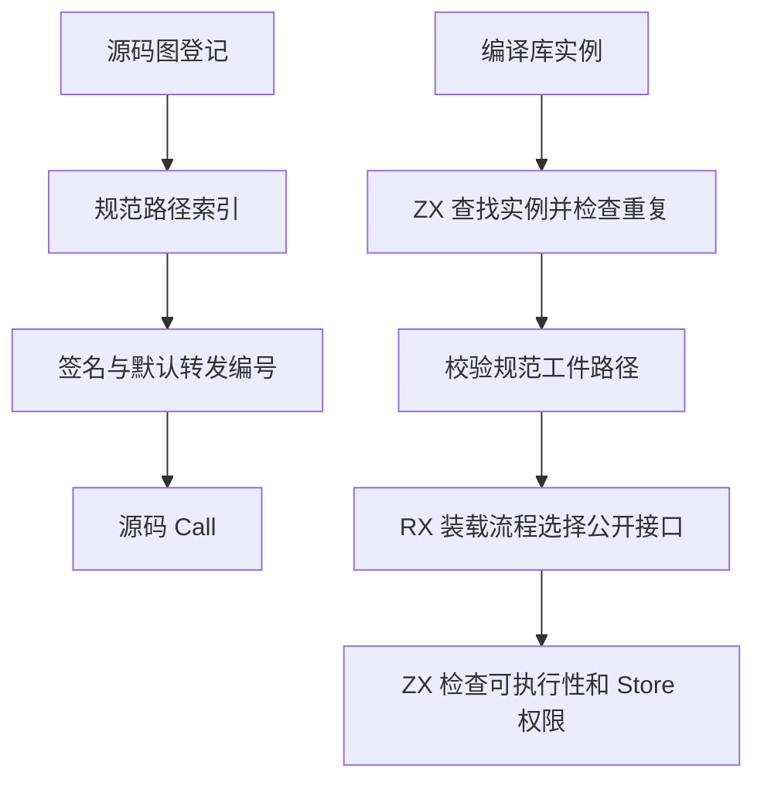
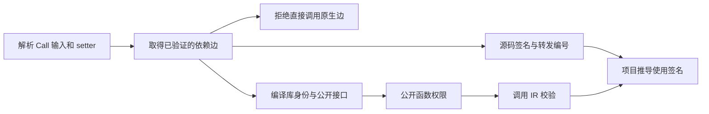

# RX 项目调用目标联结自举

## Intent

让 RX 项目推导与最终链接共用编译库实例选择和 Store 调用准入规则。源码默认转发复用依赖图的注册索引，编译库调用在既有 RX 装载流程内选出请求的公开接口。

## Data

项目图登记时已对规范路径建立索引。旧签名步骤另建哈希表，Call 遇到默认转发还会再扫描已登记的 RX 模块。现在签名绑定使用同一个规范路径索引，并缓存每个转发签名的模块编号。项目推导中的索引使用独立的临时分配器，签名联结结束即释放。没有默认转发的项目无需分配转发表。

ZX 导入、RX 推导和最终链接此前分别查找库实例并比较规范工件路径。三条路径现共用既有 ZX 名称选择算法。临时路径比较后即释放。RX 推导复用编译库加载 RX 中已有的公开接口选择，完整工件仍先验证，只发布选中的接口。Store 准入直接读取函数表的能力列。

## Edges

- 先解析 Call 输入并检查模块 Store 声明，再按原源码顺序解析目标。转发目标缺失在调用点诊断。
- 编译库完整图验证、类型及函数重映射、选定接口的调用 IR 校验仍执行。准入依次检查可执行函数、setter、事务权限。
- 平台路径、Zig IR 存储发布与诊断文本仍在宿主。最终链接复用准入规则，仍在自身的函数编号空间加载和定位公开导出。

## Answer

复用既有项目、库、Store 和 Task 场景，核对成功生成和拒绝诊断。对照受影响的源码转发与编译库调用，随后集中核对固定配置的完整冷构建和三代 Source 生成结果。

### 安装版专项

前后安装版均由 Native seed 引导，运行使用 Source。以相同输入交替七轮，取后六轮的中位数。生成入口关闭应用缓存。

| 场景                                |           墙钟 / ms |            CPU / ms |   峰值 RSS / MB |
| ----------------------------------- | ------------------: | ------------------: | --------------: |
| 编译库含 256 个公开别名，1 次调用   |       36.93 → 36.63 |       42.76 → 42.61 |   22.72 → 22.34 |
| 同一库，32 次调用                   |     335.82 → 332.72 |     341.63 → 338.82 | 137.72 → 126.08 |
| 同一库，128 次调用                  | 1,282.79 → 1,272.39 | 1,288.66 → 1,277.37 | 503.32 → 455.64 |
| 1 个经 barrel 转发到 RX 的源码 Call |         4.84 → 4.85 |         4.60 → 4.63 |     8.83 → 8.84 |
| 256 个经同一 barrel 转发的源码 Call |     173.51 → 172.83 |     184.68 → 183.65 |   26.74 → 26.74 |

五组生成 Zig 在所有轮次逐字节一致。类型接口用作 Call 与缺失公开接口的诊断逐字节一致。首次安装构建发现独立 Store 类型检查还使用旧签名索引接口，已将该入口也接到注册索引，修正后的安装通过 70 步。首次专项命令误走原生应用构建，测量脚本改用直接生成入口后才记录以上数据。

编译库清单声明一个工件内不存在的导出时，两个版本都报告 `MissingPublicModule`，错误位置和消息一致。

### 完整冷构建

Zig 0.17.0、ReleaseSmall、12 核、四分区、种子 `0x3b41c83f`，关闭常驻生成，从空的本地和全局缓存开始。工具本体由 Native seed 引导，安装版运行 Source 分析和生成。候选通过 70 步。

| 指标                             | 固定历史基线 | 上一阶段 |  本阶段 |
| -------------------------------- | -----------: | -------: | ------: |
| 墙钟 / s（`time -l`）            |            — |   117.42 |  118.16 |
| 进程树采样墙钟 / s               |      129.740 |  117.472 | 118.336 |
| CPU / s                          |       216.03 |   204.97 |  205.62 |
| 进程树峰值 RSS / MB              |      2,247.3 |  2,340.2 | 2,253.8 |
| 单进程峰值 RSS / MB（`time -l`） |      2,075.0 |  2,160.6 | 2,143.4 |

相邻阶段墙钟增加 0.74 秒，CPU 增加 0.65 秒。CPU 较同配置近期低点 203.17 秒高 2.45 秒，需继续监测累计变化。相对两分区固定历史记录，采样墙钟少 11.40 秒，CPU 少 10.41 秒，树峰高 6.5 MB，单进程峰值仍高 68.4 MB。四个 LLVM 分区对象均逐字节一致。前一阶段的树峰样本同时包含约 474.6 MB 的 Zig 检查进程，本阶段树峰样本没有这项重叠。树峰降幅包含进程重叠变化。

### 正确性与阶段自编译

最终安装版通过 11,318 项 Zig 检查和 76 项项目与库 CLI 场景，覆盖编译库别名、实例隔离、Store 初值与事务拒绝、再次发布、混合项目增量、分配失败和路径诊断。32 项 Task 输出和执行用例全部通过。禁用缓存的前后对照中，14 份生成 Zig 与 18 份诊断逐字节一致。首次回归脚本缺两份已有的本地探针源文件，补齐后复用已通过的结果并完成剩余检查。

以上一阶段的 Source stage 3 为起点，用 Zig 0.17.0、ReleaseSmall、12 核与 16 分区生成三代工具。每代通过 22 步。排除工具身份文件后，每代 10,731 个生成文件逐字节一致。

两个 Source 性能工具本体均由各自的 Source stage 2 生成，运行使用 Source 分析和生成。用同一份 544 入口清单交替六轮，每轮新建输出目录和空函数缓存，舍弃首轮。墙钟中位数 2.57 → 2.55 秒，CPU 11.11 → 11.05 秒，单进程峰值 RSS 881.2 → 860.8 MB。首尾两轮的 10,097 份主组产物逐字节一致。

自我复核仍有两处边界。编译库推导每次调用仍联结完整工件的类型和函数，随后校验调用 IR，专项 RSS 改善来自减少未请求导出的物化。全仓进程树峰值还受构建进程的重叠影响。三代产物一致覆盖了本阶段变更，完整自举仍需核对正式入口的传递依赖。

专项、回归与阶段证据位于 `.zig-cache/cold-build-analysis/ownership-research/rx-project-call-binding/`。冷构建和采样位于相邻的 `partition-reference/cold-rx-project-call-binding/`。
