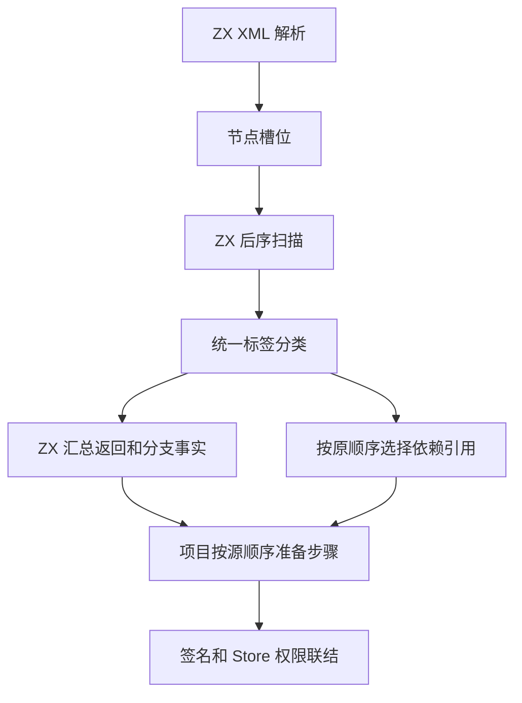
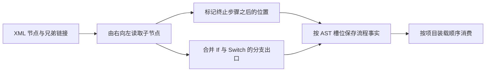

# RX 项目返回路径与分支布局自举

## Intent

将正式项目装载的语句可达性、If 和 Switch 返回路径合并、Task 输出冲突所需事实迁入 ZX。XML 解析完成后在同一次后序扫描中生成依赖引用和项目流程事实。项目分析在原有位置消费这些事实，保留签名与 Store 权限错误的顺序。

## Data

XML 节点在闭合时入表，引用扫描已经按反向兄弟顺序访问每个节点，且先处理所有子节点。节点槽位表把 XML 节点编号映射到兼容 AST 的连续存储。原项目装载遍历 AST 时累积 Return、终止和默认分支状态，提前停止不可达步骤。

## Edges

- 模块的声明不参与执行序列。If 的 Else 和 Switch 的 Default 各自提供分支覆盖，Parallel 内部的 Task 返回不结束外层序列。
- 事实绑定同一份不可变 AST。解析阶段只计算位置和状态，正式项目装载在处理到该步骤或 Task 时报告错误。手写 AST 和初始 seed 继续使用原始兼容路径。
- 宿主仍负责执行步骤对象的装配、签名和 Store 权限联结。已索引的项目保留一列定长标记，源码与属性字节继续由原 AST 持有。

## Answer

对照已有流程、Task、分支、依赖、增量与库回归。检查同一源码的诊断和生成结果，分别测量显式检查、磁盘装载和无缓存项目生成。固定工具链和并发核对冷构建及三代 Source 产物。

### 成本和诊断顺序

后序扫描在第一次读取节点名称时确定标签，同时用于引用和流程规则。每个普通模块按 AST 槽位保存一列 32 位标记。列内包含返回、终止、不可达、声明和备用分支五项事实。每个子节点只向其父序列提供一次出口，序列标记上一条终止语句之后的位置。模块中间的声明继续跳过。

项目分析仍从左到右处理步骤。它先处理当前可达步骤的签名和权限，随后在原来的位置检查下一步可达性。Task 先准备完整主体，再检查输出属性与主体 Return 的冲突。手写 AST 没有与其存储绑定的索引时，使用原序列归并。

### 安装版专项

对照的工具本体均由 Native seed 引导，运行均使用 Source。前后版本交替测量，使用新项目目录，舍弃首轮。结构检查与生成的输出均一致。

| 场景                         |     墙钟 / ms | 单进程峰值 RSS / MB |
| ---------------------------- | ------------: | ------------------: |
| 小型 If 结构检查             |   4.06 → 4.11 |         3.51 → 3.52 |
| 4,096 个 Case 的结构检查     | 21.10 → 21.37 |       15.91 → 15.97 |
| 256 个 Case 的无缓存项目生成 | 37.23 → 37.23 |       13.40 → 13.50 |
| 4,096 条复杂导入的磁盘入口   | 54.99 → 55.19 |       18.09 → 18.15 |
| 4,096 个独立 RX 模块登记     | 61.98 → 61.83 |       49.63 → 49.66 |

4,096 个 Case 的普通 lint 由 94.95 到 94.71 毫秒。256 分支项目的生成 Zig 逐字节一致，CPU 中位数为 36.57 → 36.59 毫秒。4,096 条复杂导入的退役指令增加约 0.11%，与新增线性事实列对应。

### 完整冷构建

固定 Zig 0.17.0、ReleaseSmall、12 核、四分区和种子 `0x3b41c83f`，关闭常驻生成。本地和全局缓存从空开始。Native seed 引导工具本体，安装版运行 Source 分析与生成。70 步全部通过。

| 指标                             | 固定历史基线 | 上一阶段中位数 |  本阶段 |
| -------------------------------- | -----------: | -------------: | ------: |
| 墙钟 / s（`time -l`）            |            — |         118.16 |  116.69 |
| 进程树采样墙钟 / s               |      129.740 |        118.217 | 116.775 |
| CPU / s                          |       216.03 |         206.24 |  204.14 |
| 进程树峰值 RSS / MB              |      2,247.3 |        2,344.1 | 2,332.0 |
| 单进程峰值 RSS / MB（`time -l`） |      2,075.0 |        2,152.7 | 2,157.9 |

相对上一阶段，墙钟少 1.47 秒，CPU 少 2.10 秒，树峰少 12.2 MB，单进程峰值多 5.3 MB。固定历史记录使用两分区，作为累计参考。相对该记录，采样墙钟少 12.96 秒、CPU 少 11.89 秒，树峰仍高 84.7 MB，单进程峰值仍高 82.9 MB。CPU 相对近期同配置低点 203.17 秒的差额由 3.07 秒收窄到 0.97 秒。

### 回归和阶段一致性

最终安装版通过 11,177 项 Zig 检查、76 项项目与库 CLI 场景、32 项 Task 输出和执行用例、52 项格式化 CLI 检查、一项格式化前后的应用运行对照及 18 项 RX 语义 lint。已有检查覆盖分支和 Task 返回路径、依赖顺序、路径诊断、增量缓存、分配失败和实际项目执行。仓库 1,278 个 RX 文件的格式化和普通 lint 退出码、输出和诊断逐字节一致。

使用上一阶段 Source stage 3、Zig 0.17.0、ReleaseSmall、12 核和 16 分区生成三代工具。每代通过 22 步。排除工具身份文件后，三代各 10,725 个生成文件逐字节一致。

两个 Source 对照工具本体均由各自的 Source stage 2 生成，运行均使用 Source 分析和生成。同一份 543 入口清单交替六轮，每轮使用空函数缓存及新输出目录，舍弃首轮。墙钟中位数 2.50 → 2.53 秒，CPU 11.06 → 11.08 秒，单进程峰值 RSS 852.7 → 853.5 MB。首尾两轮的 10,091 份主组产物逐字节一致。

自我复核保留两项边界。流程事实由 ZX 计算，Zig 宿主仍装配步骤、并行 Task 编号并执行逐步签名与权限联结，完整项目降级仍有后续工作。冷构建的单进程峰值继续出现在宿主库编译，固定历史记录的内存差额仍需独立定位。

回归、性能和阶段对照位于 `.zig-cache/cold-build-analysis/ownership-research/rx-project-flow/`。冷构建和进程采样位于相邻的 `partition-reference/cold-rx-project-flow/`。
