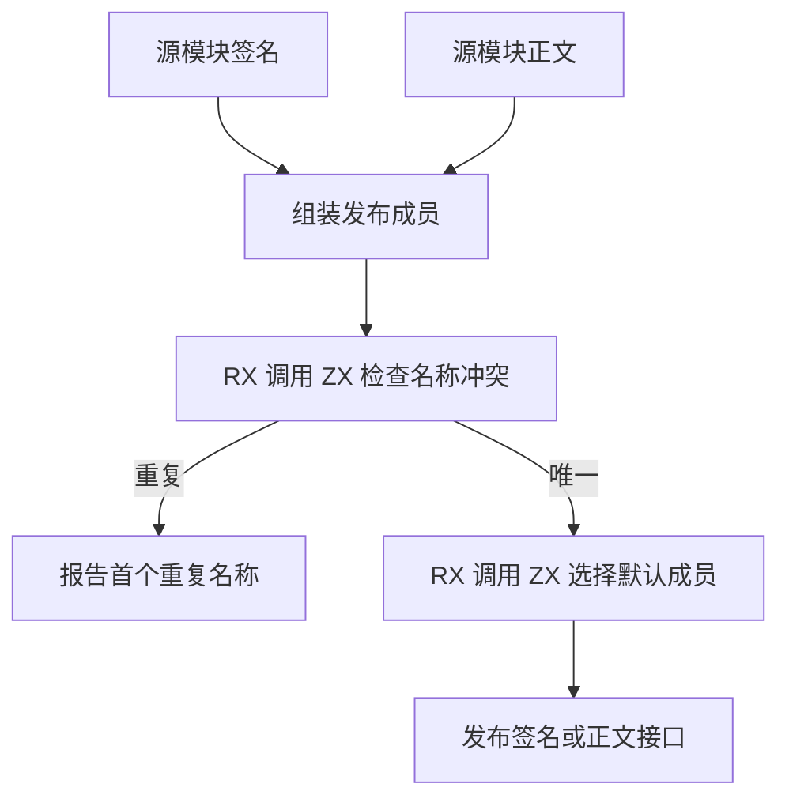

# ZX 项目公开接口发布自举

## Intent

将项目签名分析与正文链接中的公开名称冲突和默认成员选择迁入 RX/ZX。签名与正文共享规则，保持现有公开接口顺序和首条冲突诊断。

## Data

签名路径先转换原生函数签名，再与转发成员和本地默认函数分两次合并。正文和编译库路径也先分配单元素默认成员，再与转发成员合并。公开名称原先先排序检查，再对失败输入用原生索引重走一遍以定位诊断。

## Edges

- 成员按原有顺序发布。名称冲突按类型、常量、函数顺序检查，命中首个重复名称即停止。
- 类型和常量名称借用原存储，名称视图及索引只在发布过程中存在。签名直接填入最终成员缓冲。
- 没有转发声明时保留原快路径。签名端口、延迟解析目标和原生函数身份仍由现有 Zig 表承载。初始 seed 保留等价规则。

## Answer

对照签名与正文的普通、编译库和混合项目，验证默认转发、名称冲突、生成产物与源码诊断。对大规模公开名称执行配对测量，核对冷构建累计变化。

### 产物与专项成本

- Native seed 与既有 Source stage 3 都成功生成新入口，各生成 13 个文件。
- 编译器的实际 import parser barrel、闭包库、原生库和 Store 库共 62 个发布文件逐字节一致。直接编译 ZX 及经 RX 调用的十次对照，覆盖本地和转发默认函数、重复默认函数、重复常量和首个类型冲突。输出与诊断一致。
- 复用冷构建的生成模块及分区对象运行既有项目和路径测试，33 项通过。安装版导入路径 CLI 回归通过 14 项。
- 安装版的 5 项库入口用例和 17 项 RX 编译库用例通过。库入口首次运行因临时磁盘空间不足而无法解包 Zig。清理可重建的本阶段缓存后，用同版本外部 Zig 复验。
- 用现有工具生成普通与混合编译库测试工件。最终安装版通过 4 项运行和 9 项拒绝检查。

关闭应用编译缓存，交替执行九轮并取后八轮中位数。生成输入由本地常量、一个转发常量和默认函数组成。完整命令包含解析、分析、链接和生成。

| 场景                      |           墙钟 / ms |            CPU / ms | 单进程峰值 RSS / MB |
| ------------------------- | ------------------: | ------------------: | ------------------: |
| import parser barrel 发布 |     169.55 → 169.84 |     175.71 → 175.86 |       31.76 → 31.71 |
| 32 个本地常量             |         4.84 → 4.80 |         4.27 → 4.24 |         7.63 → 7.62 |
| 512 个本地常量            |       33.57 → 33.57 |       33.02 → 32.97 |       85.72 → 85.75 |
| 4,096 个本地常量          | 1,087.58 → 1,084.80 | 1,084.96 → 1,082.36 | 3,758.39 → 3,758.42 |

4,096 常量压力输入在两个版本都占约 3.76 GB。该输入显示大常量模块仍有独立内存热点，当前测量定位到编译进程整体，尚需分阶段归因。

### 冷构建

使用 Zig 0.17.0、ReleaseSmall、12 核、四分区和种子 `0x3b41c83f`，从空本地和全局缓存开始，关闭常驻生成。Native seed 引导工具本体，安装版运行 Source 分析与生成。各次构建通过 70 步。

| 版本       | 墙钟 / s | CPU / s | 进程树峰值 RSS / MB | 单进程峰值 RSS / MB |
| ---------- | -------: | ------: | ------------------: | ------------------: |
| 上一阶段   |   117.18 |  204.20 |             2,345.5 |             2,121.5 |
| 首次       |   120.74 |  215.24 |             2,328.8 |             2,118.5 |
| 同源码复测 |   117.44 |  204.50 |             2,303.4 |             2,130.9 |

首轮的额外 CPU 几乎均摊在四个 LLVM 分区，其中两个分区对象与上一阶段逐字节一致。首轮和复测的四个分区对象全部一致，执行指令数接近，非自愿上下文切换从 102.3 万次回到 45.6 万次，上一阶段为 46.2 万次。首轮的 CPU 增量未在同源码复测重现。

复测较上一阶段增加 0.26 秒墙钟和 0.30 秒 CPU，进程树峰值少 42.1 MB，单进程峰值多 9.4 MB。相对固定历史基线，进程树采样墙钟少 12.23 秒，CPU 少 11.53 秒，进程树峰值多 56.1 MB。

专项、发布和回归日志位于 `.zig-cache/cold-build-analysis/ownership-research/project-public-exports/`。冷构建日志、进程采样和分区哈希位于相邻的 `partition-reference/cold-project-public-exports*`。
