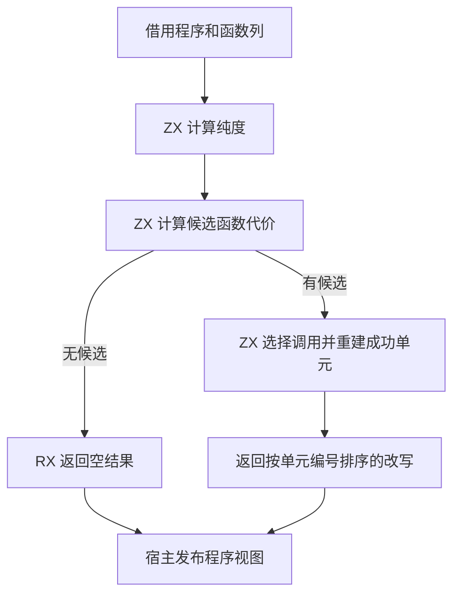
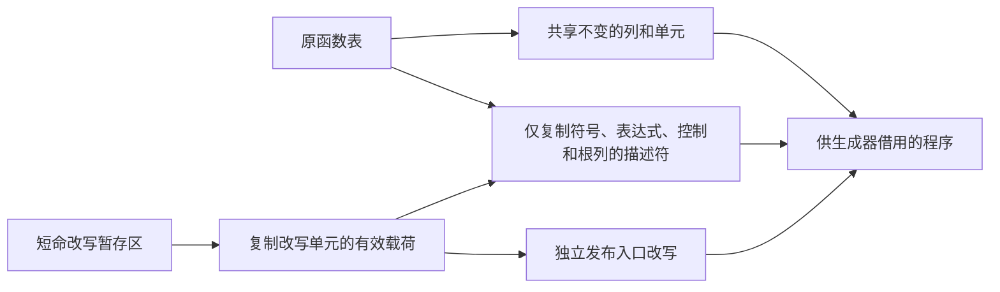

# 内联改写结果发布自举

## Intent

由 RX/ZX 决定是否需要改写并发布实际发生变更的编译单元。保留内联选择、预算、符号编号和生成结果，避免复制未改写程序的函数表。

## Data

原路径为每个函数和入口都生成一条结果，包括未改写的单元。宿主收到结果后重新装配全部 22 列函数表，并为未变的符号、表达式、Store 和契约分配新的描述符。即使没有候选调用也执行这些工作。

## Edges

- 内联代价的零值表示不可展开。没有非零代价时，原选择规则无法选中任何调用。没有普通调用的单元无需建立选择掩码。
- 改写列表保留单元顺序，入口编号等于函数数量。空改写保留整个程序，只有入口改写时保留整个函数表。改写函数时只更新四个相关列，其他列与未改写单元继续借用源程序。
- 改写输出暂存区随入口调用释放，进入生成器的改写负载由调用方 arena 持有。Zig 仍负责跨分配区的拥有式物化。初始 seed 继续使用旧发布路径。

## Answer

用 Native seed 和既有 Source stage 3 生成同一 RX 入口，以两个安装版核对生成文件，运行既有模块循环、缓存失效与分配失败检查。使用相同输入和工具链测量完整冷构建及内联相关的无缓存生成。

### 生成和对照

Native seed 和已有 Source stage 3 分别分析 165 个模块并完成 150 次生成写入。两种引导工具的生成细节有差异。正式安装版前后对照的 57 份文件逐字节一致，包含八个模块循环项目、闭包库、原生库、Store 库和两种宽函数图。嵌套循环夹具的导入别名只在 CLI 对照的临时副本中改成 camelCase，仓库夹具与既有 Zig 回归输入保持原样。

复用冷构建分区对象和生成模块，运行 150 项既有 Zig 检查。模块循环的九种模式均通过结构检查，源码与编译库路线共 120 项运行检查通过。其余 30 项覆盖内联缓存失效、原状态恢复、逐分配失败、迭代分析及 Store 初始化器链接、编码和导入。

安装版禁用应用编译缓存，轮换两版顺序并去掉首轮。真实循环链运行七轮，宽函数图运行九轮。峰值是单个进程的 RSS。

| 项目                 | 生成墙钟 / ms |      CPU / ms | 峰值 RSS / MB |
| -------------------- | ------------: | ------------: | ------------: |
| 104 个标量函数       | 48.55 → 48.19 | 51.42 → 50.97 | 17.61 → 17.38 |
| 104 个对象函数       | 62.20 → 61.73 | 65.18 → 64.87 | 21.44 → 21.16 |
| 模块循环内的链式调用 | 11.75 → 11.65 | 11.97 → 11.91 | 11.56 → 11.64 |

### 完整冷构建

Zig 0.17.0、ReleaseSmall、12 核、四分区、固定种子 `0x3b41c83f`，从空本地和全局缓存开始，关闭常驻生成。工具本体由 Native seed 引导，安装版使用 Source 分析与生成。首轮 Zig 编译发现局部变量重名，修正后 70 步全部通过。

| 指标                             | 固定历史基线 | 上一阶段 |  本阶段 |
| -------------------------------- | -----------: | -------: | ------: |
| 墙钟 / s（`time -l`）            |            — |   116.96 |  117.08 |
| 进程树采样墙钟 / s               |      129.740 |  116.990 | 117.087 |
| CPU / s                          |       216.03 |   204.50 |  203.76 |
| 进程树峰值 RSS / MB              |      2,247.3 |  2,384.6 | 2,308.7 |
| 单进程峰值 RSS / MB（`time -l`） |      2,075.0 |  2,135.4 | 2,120.3 |
| LLVM 分区 RSS 合计峰值 / MB      |            — |  2,238.5 | 2,235.9 |

较上一阶段，墙钟增加 0.12 秒，CPU 减少 0.74 秒，树峰减少 75.9 MB。两轮树峰均由四个 LLVM 分区和 RX 检查重叠产生。单独合计分区峰值少 2.6 MB。四个分区中三个对象逐字节相同，另一个增加 168 字节。历史基线的树峰差距仍有 61.4 MB。本阶段对照数据不足以把树峰降幅归因于内联改动。

专项、对照和回归日志位于 `.zig-cache/cold-build-analysis/ownership-research/inline-publication/`。完整冷构建及分区采样位于相邻的 `partition-reference/cold-inline-publication-checked/`。
