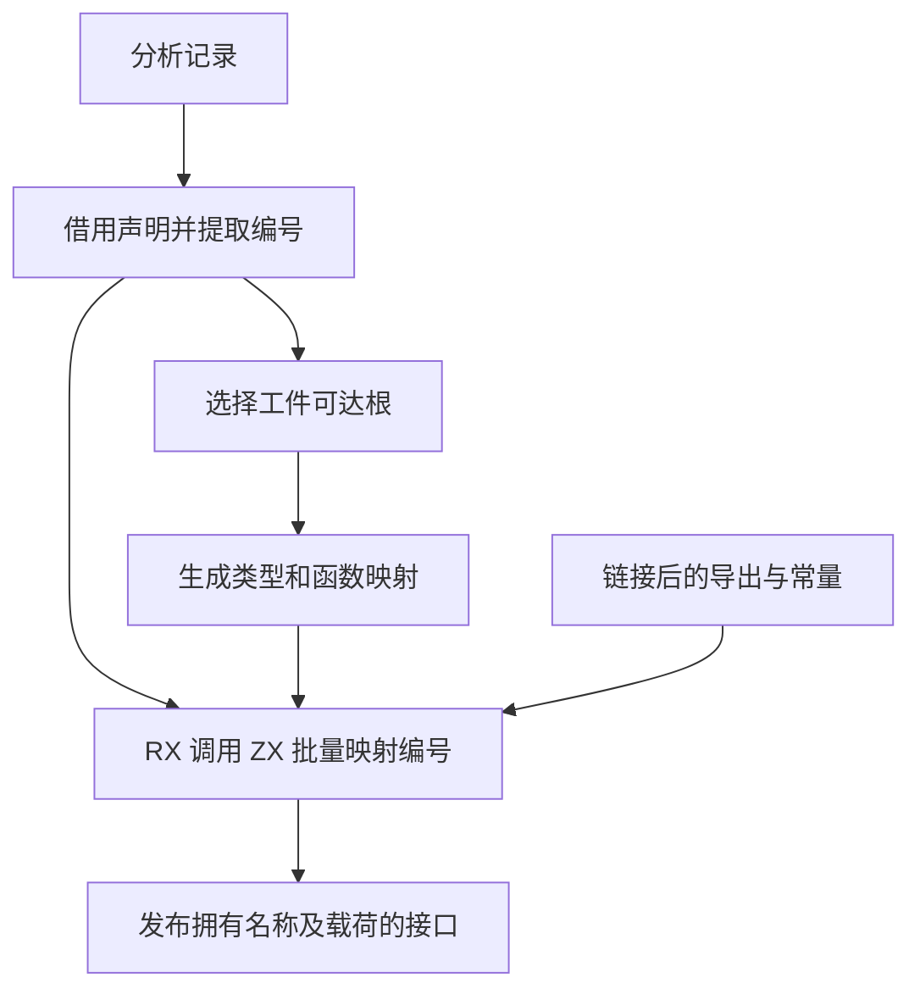
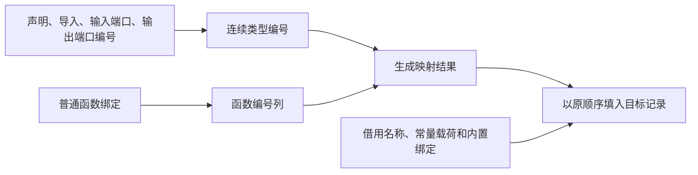

# 工件公开接口引用自举

## Intent

让工件提取和链接结果发布共用 RX/ZX 引用映射。保留类型导出、常量、函数导入和转发成员的次序，以及工件与输入程序独立的存储生命周期。

## Data

工件根分析已经提取声明编号、类型导入编号和函数端口。旧宿主发布接口时逐项使用 Zig 映射。首版将映射改为批量执行，但发布时再次提取了这些编号。最终把根分析所需的类型编号放在同一块连续缓冲中，给现有分析提供子切片，直接将整个缓冲交给现有 RX 列映射入口。链接最终结果只需要为类型导出和常量构造一份编号列。

## Edges

- 保留普通绑定和内置绑定的区别。普通绑定的函数及端口参与映射，内置绑定只复制原有元数据。
- 根分析与映射读取同一份编号，映射结果随短期分配区释放。最终记录拥有名称及字符串常量。Zig 仍负责从现有行式结构投影并发布目标记录。
- 缺失、越界编号和无效绑定仍报告无效工件。初始 seed 保留原映射，语义缓存格式保持一致。

## Answer

检查真实工件提取、联结、库发布和语义缓存路径。对照旧版和安装版的生成 Zig、库发布文件及语义工件，复用已有资源和执行回归。性能测量按固定冷构建口径，并覆盖创建语义工件和命中语义缓存两种专项。

### 生成与回归

Native seed 和已有 Source stage 3 均生成结果头及共享列映射入口，各分析 16 个模块并完成 9 次生成写入。安装版的 157 项 Zig 检查通过，包括工件生命周期、坏输入、分配失败、模块链接、库和语义缓存。其中 36 项执行六种导入顺序下的源码及编译库产物，12 份对应 Zig 与上一阶段逐字节一致。另通过五项独立进程持久缓存检查。

闭包、原生、Store 和契约项目的 53 个发布文件逐字节一致。写入空语义缓存时，闭包和原生项目及 4,096 常量项目的四份生成 Zig 一致，14 份缓存正文与其 SHA-256 一致。外层编译器指纹随编译器源码改变。两版各自预热后，闭包复用八个模块，原生复用三个模块及两个原生接口。热恢复生成与禁用缓存生成一致。

### 专项性能

安装版交替九轮，取后八轮中位数。每轮从空语义缓存开始，计时包含生成 Zig 与写入语义工件。单进程峰值使用 `time -l`。

| 场景       |       墙钟 / ms |        CPU / ms | 峰值 RSS / MB |
| ---------- | --------------: | --------------: | ------------: |
| 闭包工件   |     8.35 → 8.42 |     8.06 → 8.24 |   9.21 → 9.40 |
| 原生工件   |     7.18 → 7.20 |     6.83 → 6.79 |   9.37 → 9.42 |
| 4,096 常量 | 354.97 → 356.28 | 353.81 → 355.34 | 40.24 → 40.34 |

每轮 24 次热恢复的后七轮墙钟中位数 0.1189 → 0.1190 秒，CPU 0.1195 → 0.1194 秒。无缓存库发布的四个样例墙钟差异为 −0.16 至 +0.34 毫秒。

### 冷构建

使用 Zig 0.17.0、ReleaseSmall、12 核、四分区和固定种子 `0x3b41c83f`。关闭常驻生成，本地和全局缓存从空开始。工具本体由 Native seed 引导，安装版执行 Source 分析和生成。

首版完成 70 步，墙钟 118.12 秒、CPU 206.64 秒，较上一阶段多 1.80 秒墙钟。随后共用根分析的编号缓冲。一次构建因磁盘空间不足中止，清理可重建缓存并合并校验一致的 Zig 归档后重跑。最终源码首次完成 70 步，墙钟 132.15 秒、CPU 223.66 秒。该次运行期间，系统 ANE 编译服务消耗 180.51 CPU 秒，未改动的 C 转译等阶段也变慢。与上一阶段相比，非自愿上下文切换由约 43 万增至 172 万次。该样本保留用于说明环境差异。

后台负载恢复后，最终源码与同目录恢复的上一提交各完成 70 步。两轮 ANE 采样 CPU 增量均为零。固定基线及上一阶段原始记录同时保留。

| 指标                             | 固定历史基线 | 上阶段原测 | 空闲配对基线 |  本阶段 |
| -------------------------------- | -----------: | ---------: | -----------: | ------: |
| 墙钟 / s（`time -l`）            |            — |     116.32 |       117.61 |  117.46 |
| 进程树采样墙钟 / s               |      129.740 |    116.488 |      117.636 | 117.518 |
| CPU / s                          |       216.03 |     204.07 |       205.04 |  204.97 |
| 进程树峰值 RSS / MB              |      2,247.3 |    2,356.8 |      2,318.8 | 2,288.3 |
| 单进程峰值 RSS / MB（`time -l`） |      2,075.0 |    2,134.4 |      2,132.2 | 2,118.4 |
| LLVM 分区 RSS 合计峰值 / MB      |            — |    2,302.9 |      2,198.8 | 2,258.7 |

空闲配对中，墙钟少 0.15 秒，CPU 少 0.07 秒，进程树峰值少 30.4 MB，单进程峰值少 13.8 MB。LLVM 分区合计峰值增加 59.9 MB，仍低于上一阶段原测。相对固定基线，进程树采样墙钟少 12.22 秒、CPU 少 11.06 秒、树峰多 41.0 MB。两版前三个分区目标文件逐字节一致，第四个减少 984 字节。最终源码的两次成功冷构建中，四个分区对象全部一致。

回归、缓存正文与发布文件对照位于 `.zig-cache/cold-build-analysis/ownership-research/artifact-surface/`。可比冷构建命令和采样位于相邻的 `partition-reference/cold-artifact-surface-idle/` 和 `partition-reference/cold-artifact-surface-base-idle/`。
