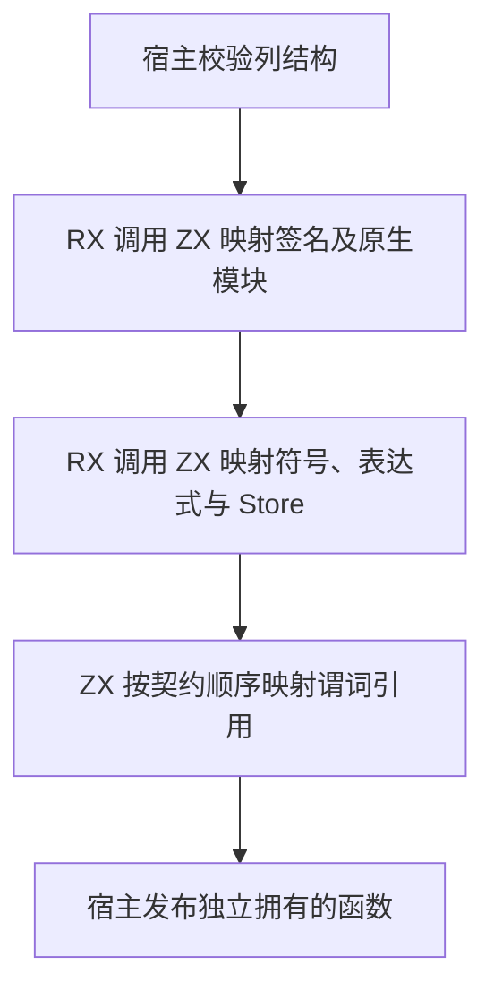
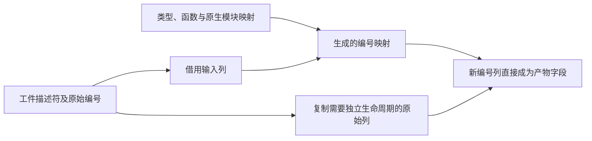

# 工件函数引用重映射自举

## Intent

让 RX/ZX 统一处理工件函数签名、函数体、Store 和契约中的引用重映射。工件提取、普通模块联结、库联结和语义缓存恢复共用同一条路径。

## Data

旧宿主先逐个映射签名端口，再分别调用生成入口处理符号、表达式、Store 和每条契约。单次函数处理使用相同的类型、函数和原生模块映射。生成入口可以直接借用现有列并在目标分配器写入新编号。

## Edges

- 映射保持输入、输出、外部模块和契约语义。无效编号映射到原有无效工件诊断，分配失败保留 OutOfMemory。
- 结果独立于源工件存活。编号列生成在目标分配器中，宿主接管这些列。结构校验及无变更的底层字段仍由 Zig 的通用 IR 存储层负责。
- 初始 seed 保留原实现。单独发布 Store 或外部签名的路径仍使用既有入口。

## Answer

验收涵盖工件提取、损坏工件、分配失败、原生联结、语义缓存及源码与编译库消费。安装版对照实际生成和发布的文件。完整冷构建使用已有固定工具链和并发口径。

### 产物与专项成本

Native seed 与已有 Source stage 3 都成功生成新入口，各分析 12 个模块、完成 10 次生成写入。两套生成结果使用各自的布局优化。正式路径使用 `executeValue` 直接借用契约列和映射，无需先复制表达式表及符号表。

两个安装版对照四种发布输入。闭包、原生、Store 和契约分别生成 13、20、14、6 份文件，全部逐字节一致。关闭应用编译缓存，交替九轮，取后八轮中位数。

| 场景     | 生成墙钟 / ms |      CPU / ms | 单进程峰值 RSS / MB |
| -------- | ------------: | ------------: | ------------------: |
| 闭包库   | 19.33 → 19.66 | 21.50 → 21.48 |       13.23 → 13.39 |
| 原生库   | 19.06 → 18.95 | 19.99 → 20.16 |       12.54 → 12.71 |
| Store 库 | 39.13 → 39.07 | 41.97 → 42.06 |       16.11 → 16.19 |
| 契约入口 | 13.51 → 13.66 | 11.78 → 11.86 |       25.02 → 25.02 |

持久语义缓存对照沿用闭包和原生项目。闭包项目复用八个模块，原生项目复用三个模块和两个原生接口。两个版本和禁用缓存路径的三份输出一致。每轮 24 次热恢复，后七轮墙钟中位数 0.1201 → 0.1186 秒，CPU 0.1196 → 0.1198 秒。安装版另通过五项持久缓存检查和三项编译库契约复验。

复用冷构建的生成模块和分区对象，共通过 198 项 Zig 检查。其中 162 项覆盖工件提取与生命周期、坏引用拒绝、原生模块和命名依赖、库和语义缓存。其余 36 项覆盖六种工件顺序下的源码及编译库执行。冷测后清理了仅 seed 可达的重复分支，正式引用映射复验通过。

### 冷构建

Zig 0.17.0、ReleaseSmall、12 核、四分区，固定种子 `0x3b41c83f`。关闭常驻生成，本地与全局缓存从空开始。Native seed 引导工具本体，安装版运行 Source 分析和生成。70 步全部通过。

| 指标                             | 固定历史基线 | 上一阶段 |  本阶段 |
| -------------------------------- | -----------: | -------: | ------: |
| 墙钟 / s（`time -l`）            |            — |   117.08 |  116.32 |
| 进程树采样墙钟 / s               |      129.740 |  117.087 | 116.488 |
| CPU / s                          |       216.03 |   203.76 |  204.07 |
| 进程树峰值 RSS / MB              |      2,247.3 |  2,308.7 | 2,356.8 |
| 单进程峰值 RSS / MB（`time -l`） |      2,075.0 |  2,120.3 | 2,134.4 |
| LLVM 分区 RSS 合计峰值 / MB      |            — |  2,235.9 | 2,302.9 |

实际墙钟减少 0.76 秒，CPU 增加 0.31 秒，树峰增加 48.1 MB。相对固定基线，采样墙钟少 13.25 秒、CPU 少 11.96 秒、树峰多 109.5 MB。两轮峰值都包含四个 LLVM 分区与 RX 检查同时运行。分区 2 对象增加 4,584 字节，其进程的采样峰值下降 63.4 MB，采样 CPU 为 21.43 → 21.42 秒。另三个对象逐字节一致，采样峰值分别变化 +25.0、+24.1 和 −36.7 MB。聚合峰值继续观察，单轮样本不足以把增长归因于改写的分区。

专项、回归和产物对照位于 `.zig-cache/cold-build-analysis/ownership-research/artifact-function-remap/`。完整冷构建、分区采样和对象哈希位于相邻的 `partition-reference/cold-artifact-function-remap/`。
