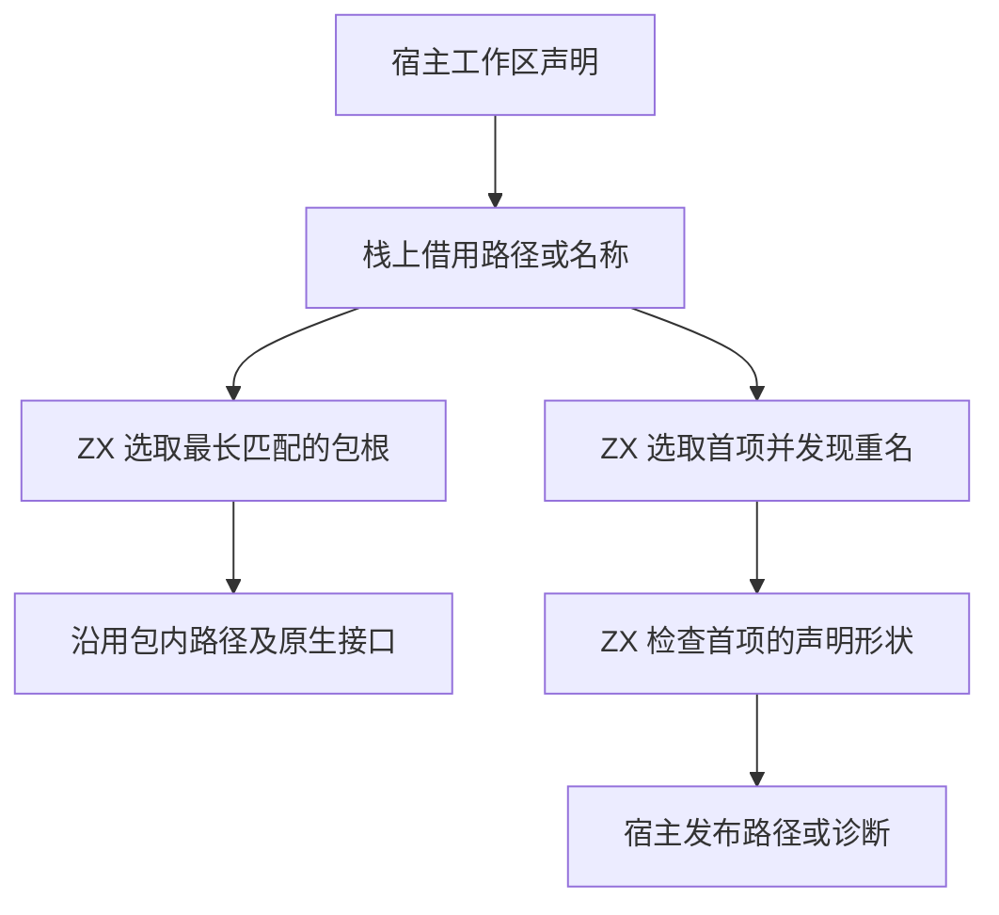

# 工作区包归属与依赖选择自举

## Intent

将工作区路径归属及包依赖名称选择的规则迁入 ZX。保持现有最长目录匹配、声明顺序、路径平台语义和诊断。

## Data

旧实现由 Zig 扫描包作用域和依赖声明。作用域选取覆盖路径的最长根，根长度相同时保留首个。依赖选择必须先校验首个匹配声明，再诊断后续重名。路径和包声明在宿主已拥有，ZX 只需要其中的根或名称。

## Edges

- 根路径必须在组件边界结束。Windows 比较保留 ASCII 忽略大小写和双分隔符规则，路径中已有分隔符的字节身份不变。
- Zig 每批传递至多 32 个借用描述符，两条正式路径都用零容量分配器执行选择。未复制路径字节，也未引入堆分配。已有更长匹配时跳过不可能获胜的根。
- 初始 seed 保留等价查找。平台路径规范化、从宿主记录构造目标、诊断消息和生成入口间的宿主接线仍由 Zig 执行。
- Windows 比较复用标准库的通用 ASCII 前缀比较。当前环境验证了 Windows 规则的生成代码，未在 Windows 上执行完整 CLI。

## Answer

用现有项目、原生包、RX 编译库和缓存回归核对正式路径。在零容量分配器下验证 POSIX 与 Windows 规则及跨批次的顺序。比较安装版产物，并记录完整冷构建与大小工作区的专项成本。

### 产物与回归

正式冷构建使用新标准库目录生成两个入口。已有 Native seed 和 Source stage 3 的目录尚未包含新接口，独立生成探针临时通过显式原生接口引用同一个标准库实现。两套生成结果在零容量分配器下通过最长前缀、路径边界、Windows 大小写、同长度首项和跨批次重复匹配对照。

安装版通过 37 项 Zig 检查和 35 项 CLI 检查，覆盖路径、坏包声明、原生包、语义缓存和编译库 RX。闭包、原生、Store 和契约项目的 53 份发布文件逐字节一致。2 个及 64 个依赖的工作区生成 Zig 一致，后者引用末尾声明，实际经过多个名称批次。

### 专项成本

禁用应用缓存，交替九轮，取后八轮中位数。工作区从实际磁盘文件装载，范围包含依赖发现、包归属和生成。

| 场景      |   墙钟 / ms |    CPU / ms | 峰值 RSS / MB |
| --------- | ----------: | ----------: | ------------: |
| 2 个依赖  | 4.42 → 4.28 | 4.10 → 4.02 |   8.15 → 8.10 |
| 64 个依赖 | 7.01 → 7.08 | 6.61 → 6.54 |   8.77 → 8.69 |

四个库发布样例的墙钟差异为 −0.29 至 +0.55 毫秒。

### 完整冷构建

使用 Zig 0.17.0、ReleaseSmall、12 核、四分区，固定种子 `0x3b41c83f`。关闭常驻生成，本地和全局缓存从空开始。Native seed 引导工具本体，安装版运行 Source 分析和生成。70 步全部通过。

| 指标                             | 固定历史基线 | 上一阶段 |  本阶段 |
| -------------------------------- | -----------: | -------: | ------: |
| 墙钟 / s（`time -l`）            |            — |   117.46 |  116.88 |
| 进程树采样墙钟 / s               |      129.740 |  117.518 | 116.932 |
| CPU / s                          |       216.03 |   204.97 |  203.88 |
| 进程树峰值 RSS / MB              |      2,247.3 |  2,288.3 | 2,246.6 |
| 单进程峰值 RSS / MB（`time -l`） |      2,075.0 |  2,118.4 | 2,133.0 |
| LLVM 分区 RSS 合计峰值 / MB      |            — |  2,258.7 | 2,217.1 |

墙钟减少 0.58 秒，CPU 减少 1.09 秒，树峰下降 41.7 MB，单进程峰值增加 14.5 MB。树峰略低于固定历史基线，单进程峰值仍高约 58.0 MB。两轮树峰由不同数量的 LLVM 分区进程重叠形成，单轮样本不足以量化本改动的整树 RSS 收益。前三个分区对象逐字节一致，第四个增加 1,816 字节。

专项、回归及独立探针位于 `.zig-cache/cold-build-analysis/ownership-research/package-selection/`。冷构建与进程采样位于相邻的 `partition-reference/cold-package-selection/`。
