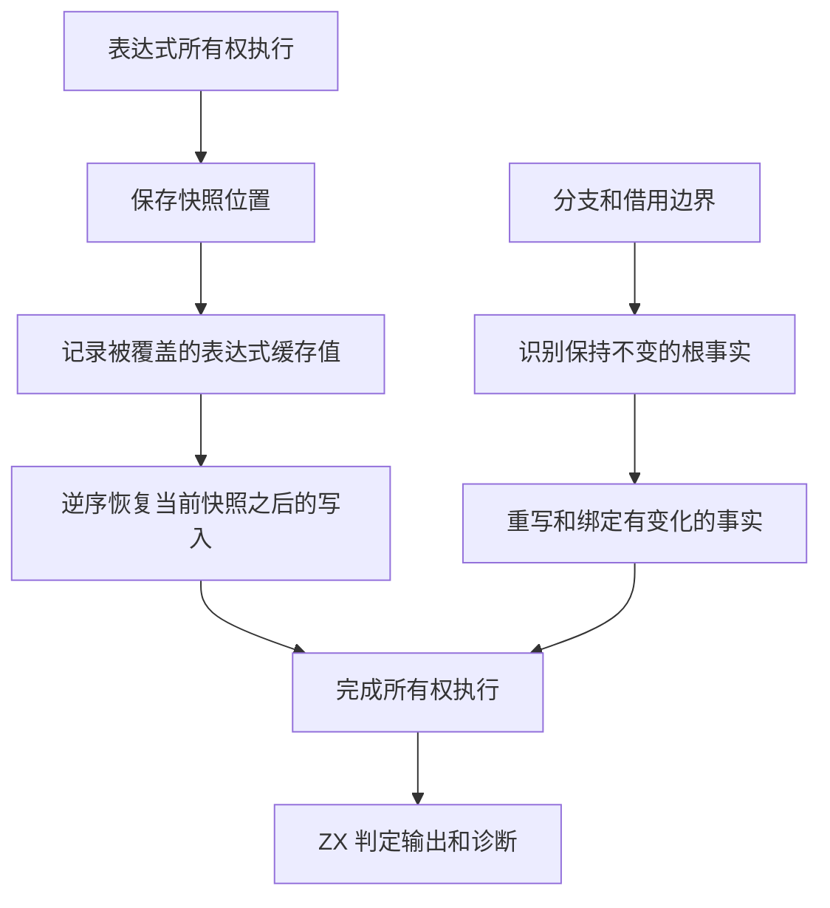

# 所有权表达式快照与分支恢复

## Intent

让所有权分析恢复对象表达式的临时缓存时只处理实际改动，减少宽分支反复恢复未变事实的成本。由 RX 统一编排所有权执行与 ZX 结果判定，供表达式、模块和工件校验使用。保持嵌套对象、循环收敛、分支汇合、诊断顺序和生成语义。

## Data

安装版以禁用应用缓存的方式生成 1,024 个分支、每分支包含一个对象参数调用的项目。历史配对候选约用 16.9 秒及 1.03 GB RSS。7 秒采样在快照应用、事实重写和事实绑定的生成函数中记录了大量 `memcpy`。以原构建的对象和链接参数生成符号映射，核对两份 Mach-O 的 `__text` 逐字节一致后还原采样地址。

对象缓存只在记录已求值子表达式的位置时写入。原先每个对象保存整个表达式缓存，在离开时逐项恢复。语句分支和借用释放还会多次处理相同的根事实。缓存和事实属于编译器分析器，不进入应用产物。

ZX 记录每次覆盖的表达式编号和旧值。快照保存日志长度，恢复按相反顺序回放并缩短日志。对象求值的写入路径和快照标记一一对应，内层对象恢复后保留外层写入。分支恢复复用相同的根事实，借用释放跳过已确认不会改变的事实。更新根和重写复合事实时，类型表、布局和引用表通过只读作用域访问。

## Edges

- 对象求值离开时恢复自身快照。循环求值每轮和退出时恢复入口快照，重复恢复同一位置合法。
- 分支状态仍依据原始根事实和汇合语义。只有能证明结果保持原值的情况跳过重写。
- Native seed 保留原有兼容分析。Source 的工作状态和结果判定由 ZX 持有，Zig 宿主借用输入表并转交诊断。
- 结果先判断完成状态，再判断失败位置和输出所有权。错误字符串由静态常量提供，Zig 宿主可在临时分析区释放后继续引用。收口时把结果字段展开为单层结构，避免为成功路径构建嵌套诊断对象。生成的结果判定函数没有分配或缓冲增长操作。

## Answer

### 安装版专项

前后工具均由 Native seed 引导，运行使用 Source 分析与生成。禁用应用缓存。单次 Call 和 256 分支各交替五轮，舍弃首轮。1,024 分支运行一组配对，生成 Zig 和非法 Call 属性的诊断逐字节一致。

| 输入         |          墙钟 / s |           CPU / s | 单进程峰值 RSS / MB |
| ------------ | ----------------: | ----------------: | ------------------: |
| 单次 Call    | 0.00826 → 0.00770 | 0.00762 → 0.00721 |         9.35 → 9.32 |
| 256 个分支   |     1.232 → 0.252 |     1.231 → 0.247 |        113.3 → 39.3 |
| 1,024 个分支 |    16.899 → 1.320 |    16.885 → 1.315 |     1,033.1 → 129.2 |

### 完整冷构建

使用相同隔离源码目录、Zig 0.17.0、ReleaseSmall、12 核、四分区、种子 `0x3b41c83f` 和空本地及全局缓存，关闭常驻生成。工具本体由 Native seed 引导，安装版运行 Source。候选初版和最终版均通过 70 步。

| 指标                  | 固定历史记录 | 同目录上一阶段 | 候选初版 |  最终版 |
| --------------------- | -----------: | -------------: | -------: | ------: |
| 墙钟 / s（`time -l`） |            — |         117.71 |   116.42 |  116.55 |
| 进程树采样墙钟 / s    |      129.740 |        117.919 |  116.498 | 116.658 |
| CPU / s               |       216.03 |         208.61 |   208.38 |  208.43 |
| 进程树峰值 RSS / MB   |      2,247.3 |        2,320.4 |  2,323.8 | 2,363.3 |
| 单进程峰值 RSS / MB   |      2,075.0 |        2,149.2 |  2,143.9 | 2,148.8 |

最终版较同目录上一阶段墙钟少 1.16 秒，CPU 少 0.18 秒，单进程峰值少 0.4 MB。两次树峰均处于四个 LLVM 分区与 Zig 检查重叠时。最终版峰值采样点的 Zig 检查 RSS 多 51.7 MB，四个分区 RSS 合计少 8.7 MB。三个分区目标文件逐字节一致，改动所在分区缩小 1,544 字节。

相较两分区的固定历史记录，采样墙钟少 13.08 秒、CPU 少 7.60 秒、树峰多 116.0 MB。相对原工作区近期同配置 CPU 参考值 203.17 秒，最终版仍高 5.26 秒，同目录上一阶段高 5.44 秒。累计 CPU 与宿主进程内存仍需追踪。

### 正确性与阶段自编译

使用最终安装版所链接的 Source 分区执行 8 组既有 Zig 回归，共 600 项通过。覆盖前端、函数返回、复合所有权、借用、循环收敛、缓存标记、Store 证明、RX 类型推导和 Task 输出。另以新旧安装版对照 69 个不同的既有应用，禁用缓存生成的 Zig 均逐字节一致。

以上一阶段的 Source stage 3 为起点，在 Zig 0.17.0、ReleaseSmall、12 核、16 分区下逐级生成三代工具。各代通过 22 步，排除工具身份文件后每代 10,738 个生成文件逐字节一致。

对照的两版 Source 工具均由各自的 Source stage 2 生成，运行使用 Source。固定 545 个入口，以新输出目录和空函数缓存交替六轮，舍弃首轮。墙钟中位数 2.45 → 2.41 秒，CPU 11.02 → 10.89 秒，单进程峰值 RSS 862.5 → 860.8 MB。首尾轮次的 10,104 个主组文件逐字节一致。

自我复核的边界包括一次对照的 1,024 分支输入、根事实仍按布局遍历，以及结果发布仍经过 Zig 输入借用和诊断适配。最终版短采样仍可见快照应用及所有权工作队列，无法从不同长度的采样窗口独立量化每个操作的收益。正式入口的传递依赖审计仍待完成。

采样、专项和回归原始记录位于本地 `.zig-cache/cold-build-analysis/ownership-research/rx-wide-selection/`。完整冷构建记录位于上一阶段的同一隔离源码目录下，分别为 `cold-rx-inputs-paired-optimized`、`cold-ownership-snapshot-replay` 和 `cold-ownership-snapshot-flat`。
