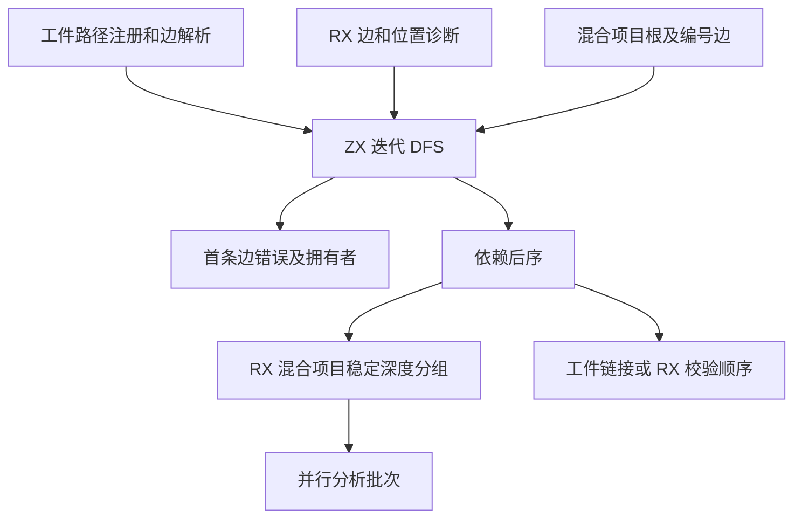
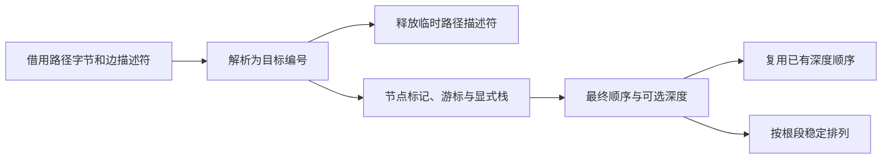

# 模块图遍历与排程统一

## Intent

统一混合项目排程、RX 依赖校验和工件链接的有序依赖遍历。保持入口可达性、首条错误、依赖后序和并行分析批次。

## Data

工件链接与 RX 校验共用迭代 DFS，混合项目有另一套 DFS，额外记录深度及第一个入口的结束位置。两套实现分别维护节点标记、游标和显式栈。混合项目的稳定分组每次都分配两个直方图和一份新顺序，工件链接临时路径描述符保留到整个链接结束。

三条路径借用同一个 ZX 遍历。混合项目传入显式根列表并启用深度传播，RX 校验依次遍历所有根，工件链接只遍历指定入口。RX 继续编排排程和诊断。稳定分组只为实际存在的后续根段分配直方图，已按深度排列的段保留原顺序。工件链接的目标路径描述符在数字边解析完成后释放。

## Edges

- 按原边序遍历。RX 的无效路径和缺失目标仍在遇到该边时报告，工件的不可达缺失或循环仍由入口可达性决定。
- 第一个根段和后续根段各自保持原有的稳定深度顺序。并行批次继续从最终顺序生成。
- Zig 过渡层仍负责从 AST、模块记录及路径解析取得输入，以及执行解析缓存和原生表操作。初始 seed 保留原有实现。

## Answer

集中运行 RX 图、混合项目依赖及缓存、工件链接边界和库消费检查。对照相同输入的安装版产物、Source 自编译与完整冷构建。

### 回归与安装版

10,719 项 Zig 检查全部通过，含 10,446 项现有合成图、138 项 RX 推导和 36 项源码及编译库运行检查。编译器的 RX 回归包含对全部 512 种三节点有向图的独立无环判定。安装版另通过 11 项 RX CLI 场景与 9 项真实磁盘项目场景，覆盖未使用 Import 的环、传递依赖缺失及恢复。

12 份直接链接输出和四组库发布的 53 份生成文件与上一阶段逐字节一致。安装版发布墙钟中位数变化为 −0.22 至 +0.01 ms。闭包与原生项目的热缓存恢复和禁用缓存输出一致，每轮 24 次热恢复的墙钟中位数为 0.1212 → 0.1206 秒，CPU 为 0.1205 → 0.1195 秒。

### 三阶段自编译

由上一阶段 Source stage 3 引导，固定 Zig 0.17.0、ReleaseSmall、12 核和 16 分区，三个阶段各通过 22 步。排除生成工具身份文件 `.zxc-inputs`，每阶段主组、增长组、宿主组、集合组和有序组共 10,649 份产物逐字节一致。

两个对照工具本体均由各自的 Source stage 2 生成，运行时均使用 Source 分析和生成。对同一份 534 入口主清单交替六轮，每轮使用空函数缓存和新输出目录，舍弃首轮。墙钟中位数为 2.43 → 2.44 秒，CPU 为 10.98 → 10.99 秒，单进程峰值 RSS 为 859.6 → 859.3 MB。首尾两轮的 10,015 份主组产物逐字节一致。

### 完整冷构建

固定 Zig 0.17.0、ReleaseSmall、12 核、四分区和构建种子 `0x3b41c83f`，关闭常驻生成，从空本地和全局缓存开始。工具本体由 Native seed 引导，安装版使用 Source 分析和生成。首轮构建发现 RX 宿主没有核心模块依赖，修正为直接使用生成入口的值参数或借用参数后，70 步通过。

| 指标                             | 固定历史基线 | 上一阶段 |  本阶段 |
| -------------------------------- | -----------: | -------: | ------: |
| 墙钟 / s（`time -l`）            |            — |   116.62 |  117.28 |
| 进程树采样墙钟 / s               |      129.740 |  116.746 | 117.516 |
| CPU / s                          |       216.03 |   203.13 |  203.36 |
| 进程树峰值 RSS / MB              |      2,247.3 |  2,299.6 | 2,316.8 |
| 单进程峰值 RSS / MB（`time -l`） |      2,075.0 |  2,146.5 | 2,144.9 |

较上一阶段，墙钟增加 0.66 秒，CPU 增加 0.23 秒，树峰增加 17.2 MB，单进程峰值减少 1.6 MB。较固定基线，采样墙钟减少 12.22 秒，CPU 减少 12.67 秒，树峰增加 69.5 MB。两轮树峰样本均包含四个 LLVM 分区与 RX 编译检查。在对应树峰样本中，RX 检查多 21.8 MB，四个 LLVM 进程的 RSS 合计少 4.6 MB。前三个分区对象逐字节一致，第四个增加 1,264 字节。

回归、产物及 Source 配对记录位于 `.zig-cache/cold-build-analysis/ownership-research/module-graph-walk/`。完整冷构建与采样位于相邻的 `partition-reference/cold-module-graph-walk-complete/`。
