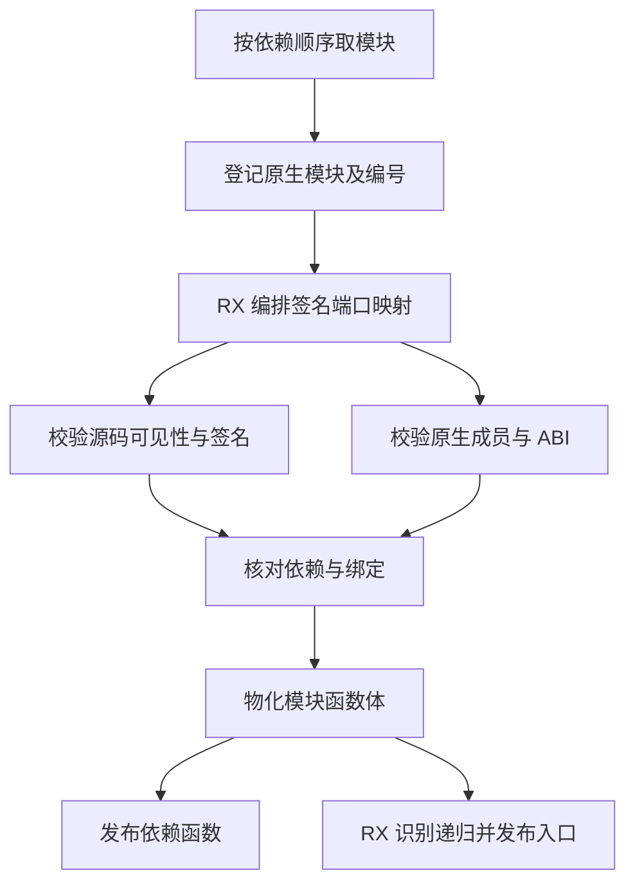

# 模块签名绑定与入口物化自举

## Intent

在同一阶段贯通模块签名绑定、依赖结果发布和入口物化。保持模块顺序、稳定的函数编号、原生 ABI 校验和入口递归行为。

## Data

原有源码签名通过 RX 解析。原生签名的类型端口映射、成员准入和模块编号映射由 Zig 先处理，再调用原生签名 RX。两条路径分别组装查询。完整工件链接还先计算入口递归，再通过独立生成入口发布结果头。

签名绑定 RX 先映射类型端口，再按签名来源执行源码可见性或原生 ABI 匹配。复用已有编号，只有新原生签名需要拥有式物化。入口发布 RX 通过已重映射的调用列识别递归，直接输出入口状态。每个模块的临时编号和依赖视图在本模块结束时失效，可复用的容量留给下一个模块。

## Edges

- 依赖函数先于消费者发布。同一模块按原声明顺序逐个绑定签名，使后续原生签名可检查本模块已登记的原生签名。
- 签名查找借用底层列。宿主在首个源码签名出现时准备依赖视图，在插入时拥有化原生元数据。宿主继续维护可增长的目标 IR 列与分配器生命周期。
- 完整链接把递归入口体追加到函数表并发布转发入口。语义缓存恢复沿用共享表前缀契约，由原有函数表完成步骤处理递归。
- 初始 seed 保留等价的宿主规则。完整图执行、表存储和模块结构桥仍属后续自举范围。

## Answer

集中核对现有工件提取、模块联结、原生接口、缓存恢复和源码及编译库运行。对比两版安装工具在相同输入下的发布产物、冷生成和热缓存恢复，再按固定口径核对冷构建。分开记录引导工具本体与运行时使用的分析和生成实现。

### 生成与回归

- Native seed 和此前的 Source stage 3 都生成了签名、依赖函数放置和入口发布三个入口，各分析 41 个模块并生成 24 个函数文件。生成的签名和入口执行路径通过 `executeValue` 取得结果，复用签名、类型及调用底层列。原生元数据只在新增目标行时复制。
- 复用冷构建生成模块及分区对象，集中执行 162 项现有 Zig 测试和 36 项已有源码及编译库运行检查。覆盖损坏工件、接口冲突、原生模块复用、释放原工件后的使用、分配失败清理及持久缓存。六种工件顺序下的 12 份生成 Zig 与此前工件函数映射阶段的相同输入逐字节一致。
- 直接链接使用同一仓库夹具，对照工件函数映射阶段保存的可执行文件。前后交替七轮，舍弃首轮。每轮执行六种顺序的源码及编译库生成共 12 次。墙钟中位数为 0.1345 → 0.1340 秒，CPU 为 0.1285 → 0.1280 秒。这项对照的基线早于上一阶段安装版。
- 和上一阶段安装版交替测量，四组闭包、原生、Store 与契约库的 53 份生成文件逐字节一致。墙钟中位数差异为 −0.60 至 +0.44 ms，CPU 差异为 −0.61 至 +0.14 ms。闭包和原生项目在冷生成及持久缓存恢复下输出一致。每轮 24 次热恢复，墙钟中位数从 0.1197 到 0.1200 秒，CPU 从 0.1197 到 0.1193 秒。

### 三阶段自编译

Native seed 构建 stage 1，stage 1 和 stage 2 依次构建后续工具。使用相同源码、Zig 0.17.0、ReleaseSmall、12 核、16 分区，三个阶段各通过 22 步。排除记录生成工具身份的 `.zxc-inputs`，stage 2 与 stage 3 的主组、增长组、宿主组、集合组和有序组共 10,668 个文件逐字节一致。Native seed 生成的 stage 1 产物与 stage 2 有 1,326 份差异。完整编译器的正式入口传递依赖审计仍待完成。

### 完整冷构建

同一 Zig 0.17.0、ReleaseSmall、12 核、四分区及构建种子 `0x3b41c83f`。关闭常驻生成，本地与全局缓存从空开始。工具本体由 Native seed 引导，安装版运行 Source 分析和生成。70 步全部通过。

| 指标                             | 固定历史基线 | 上一阶段 |  本阶段 |
| -------------------------------- | -----------: | -------: | ------: |
| 墙钟 / s（`time -l`）            |            — |   117.51 |  118.09 |
| 进程树采样墙钟 / s               |      129.740 |  117.738 | 118.287 |
| CPU / s                          |       216.03 |   204.38 |  203.85 |
| 进程树峰值 RSS / MB              |      2,247.3 |  2,357.9 | 2,299.4 |
| 单进程峰值 RSS / MB（`time -l`） |      2,075.0 |  2,126.5 | 2,136.2 |

较上一阶段，墙钟增加 0.58 秒，CPU 减少 0.53 秒，树峰减少 58.5 MB，单进程峰值增加 9.7 MB。较固定基线，采样墙钟减少 11.45 秒，CPU 减少 12.18 秒，树峰增加 52.1 MB。前三个分区对象逐字节一致，第四个减少 1,280 字节。本阶段树峰样本含三个 LLVM 分区，上一阶段含四个分区及 RX 检查。尚未单独量化逐模块分配区对进程峰值的贡献。

日志和局部生成结果位于 `.zig-cache/cold-build-analysis/ownership-research/artifact-module-binding/`。完整冷构建与采样位于相邻的 `partition-reference/cold-artifact-module-binding/`。
