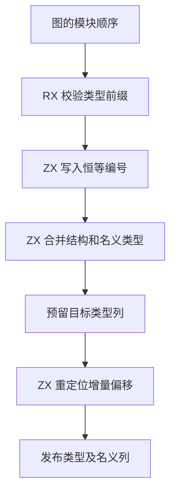

# 模块类型映射与增量发布自举

## Intent

让 RX/ZX 决定模块类型编号映射及类型表的增量偏移，缩短模块链接临时列的生命周期。保持类型 ID、结构与名义身份、错误顺序和表的可见长度契约。

## Data

原有合并入口从宿主取得映射切片。ZX 逐步更新并返回映射，宿主再将全部编号复制回原切片。上一版 Source stage 3 的初始化产物已直接更新该切片，宿主仍执行回拷。类型增量在候选比较时使用局部偏移，最终由 Zig 按类型种类逐行调整偏移。模块链接的类型映射保留在整个结果的分配区中，尽管只在链接期间使用。

合并 RX 继续编排前缀校验、恒等映射初始化和有序增量构造。ZX 通过现有定长内存接口写入调用方持有的映射。读取映射使用同一个独占借用。发布时 ZX 直接将已调整的偏移写入目标表预留列。宿主保存字符串所有权，预留所有列并在写入完成后发布长度。

编译库加载和缓存原生工件恢复使用同一个合并模块。宿主为两条路径各提供一份调用期间有效的编号列，RX 在合并成功后直接把该列用于函数、原生模块或公开接口重映射。

## Edges

- 名义身份、诊断次序和部分增量的提交语义保持原有行为。预留失败时，目标列的可见长度保持原值。
- 暂存区可以在每个模块类型完成后复用。跨模块仍需的编号映射保留到完整链接结束。独立的批量类型合并接口继续由其结果拥有映射。
- 生成入口借用独占的定长切片。Zig 过渡层仍维护可增长列及字符串所有权。通用类型表写入及初始 seed 继续使用等价 Zig 操作。

## Answer

集中核对结构与名义合并、类型表分配失败、前缀压缩、完整工件链接与缓存恢复。对照上一阶段安装版的产物与成本，并核对 Source 自编译产物。

### 正确性与安装版

集中通过 249 项现有检查，其中类型合并、表存储及压缩 123 项，源码及编译库运行 36 项。覆盖分配失败重试、名义身份冲突、跨模块映射、源工件释放后的使用及缓存复用。六种工件顺序下的 12 份生成 Zig 与上一阶段逐字节一致。

四组安装版库发布共 53 份文件逐字节一致。原生库从源码发布的 20 份文件和从编译库重发布的 21 份文件分别逐字节一致，两个独立原生模块的身份保持。交替九轮并舍弃首轮，编译库重发布墙钟中位数为 17.53 → 17.58 ms，CPU 为 19.12 → 18.68 ms，单进程峰值 RSS 为 12.87 → 12.80 MB。闭包及原生项目的缓存命中与无缓存产物一致，每轮 24 次热恢复的墙钟中位数为 0.1202 → 0.1193 秒，CPU 为 0.1199 → 0.1196 秒。

### 三阶段自编译

使用上一阶段 Source stage 3 引导本阶段 stage 1，随后由 stage 1 和 stage 2 构建后续工具。固定 Zig 0.17.0、ReleaseSmall、12 核和 16 分区。三个阶段各通过 22 步。排除生成工具身份文件 `.zxc-inputs` 后，每阶段的五组共 10,675 份产物按路径及 SHA-256 一致。

两个对照工具本体均由各自的 Source stage 2 生成，运行时均使用 Source 分析和生成。同一份 534 入口主清单，每轮使用新输出目录及空函数缓存，交替六轮并舍弃首轮。生成墙钟中位数为 2.46 → 2.47 秒，CPU 为 10.95 → 10.97 秒，单进程峰值 RSS 为 883.2 → 884.0 MB。首尾两轮各比较 10,041 份输出，全部逐字节一致。

### 完整冷构建

使用 Zig 0.17.0、ReleaseSmall、12 核、四分区和固定构建种子 `0x3b41c83f`。关闭常驻生成，本地和全局缓存从空开始。工具本体由 Native seed 引导，安装版运行 Source 分析和生成。前两次生成分别定位到编译库和原生工件恢复仍消费旧映射结果。两条路径接通后先核对完整主清单生成，再完成 70 步冷构建。

| 指标                             | 固定历史基线 | 上一阶段 |  本阶段 |
| -------------------------------- | -----------: | -------: | ------: |
| 墙钟 / s（`time -l`）            |            — |   118.09 |  116.62 |
| 进程树采样墙钟 / s               |      129.740 |  118.287 | 116.746 |
| CPU / s                          |       216.03 |   203.85 |  203.13 |
| 进程树峰值 RSS / MB              |      2,247.3 |  2,299.4 | 2,299.6 |
| 单进程峰值 RSS / MB（`time -l`） |      2,075.0 |  2,136.2 | 2,146.5 |

较上一阶段，墙钟减少 1.47 秒，CPU 减少 0.72 秒，树峰增加 0.2 MB，单进程峰值增加 10.4 MB。较固定历史基线，采样墙钟少 12.99 秒，CPU 少 12.90 秒，树峰高 52.3 MB。分区 1 和 2 的目标文件逐字节一致，分区 0 少 2,240 字节，分区 3 多 968 字节。前后树峰样本的并发组合不同，尚未独立量化链接临时列释放对整仓峰值的贡献。

生成、回归、专项测量及三阶段对照记录位于 `.zig-cache/cold-build-analysis/ownership-research/type-table-publication/`，完整冷构建与采样位于相邻的 `partition-reference/cold-type-table-publication-complete/`。
